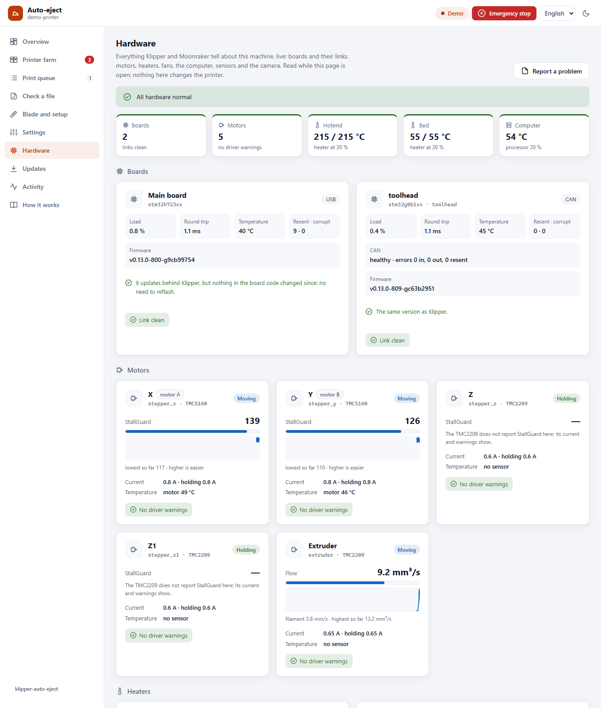

<h1 align="center">klipper-auto-eject</h1>

<p align="center">
  <b>Your 3D printer clears its own bed between prints.</b><br>
  A printed blade on the toolhead pushes the finished parts into a box, the probe checks the bed is empty,<br>
  and the next print starts by itself. For any printer running Klipper.
</p>

<p align="center">
  <a href="https://github.com/ahmedbebars/klipper-auto-eject/actions/workflows/ci.yml"></a>
  <a href="https://github.com/ahmedbebars/klipper-auto-eject/releases"></a>
  <a href="LICENSE"></a>
  <a href="https://www.klipper3d.org/"></a>
  <a href="https://moonraker.readthedocs.io/"></a>
  
  <a href="CONTRIBUTING.md"></a>
</p>

<p align="center">
  <a href="docs/getting-started.md"><b>Getting started</b></a> ·
  <a href="docs/faq.md">FAQ</a> ·
  <a href="docs/README.md">Documentation</a> ·
  <a href="docs/troubleshooting.md">Troubleshooting</a> ·
  <a href="https://github.com/ahmedbebars/klipper-auto-eject/discussions">Discussions</a> ·
  <a href="docs/ar/README.md"><b>العربية</b></a>
</p>

<p align="center">
  <a href="https://www.klipper3d.org/" title="Klipper"></a>&emsp;
  <a href="https://docs.mainsail.xyz/" title="Mainsail"></a>&emsp;
  <a href="https://docs.fluidd.xyz/" title="Fluidd"></a>&emsp;
  <a href="https://github.com/SoftFever/OrcaSlicer" title="OrcaSlicer"></a>&emsp;
  <a href="https://github.com/prusa3d/PrusaSlicer" title="PrusaSlicer"></a>
</p>
<p align="center"><sub>Works with Klipper and Moonraker, Mainsail or Fluidd, and OrcaSlicer, PrusaSlicer, SuperSlicer or Cura.
Phone access through Tailscale. (<a href="docs/images/logos/README.md">about these logos</a>)</sub></p>

---

> [!WARNING]
> **Beta software that moves your printer on its own.** Watch several test runs before you leave
> a printer alone, and read [docs/safety.md](docs/safety.md) first.

## How it works

When a print finishes, the printer:

1. **Cools the bed** with the fan circling over the parts, until they let go of the sheet.
2. **Pushes the parts off** the edge with a blade fixed to the toolhead: slowly, and with less
   motor force than usual, so a stuck part makes the motor skip instead of breaking something.
3. **Checks the bed** by touching the probe where each part was. A part still there is pushed
   again, lower and harder.
4. **Starts the next print** from Moonraker's queue, or **stops the queue** if a part is still on
   the bed, so nothing is ever printed on top of it.

<p align="center"></p>

The printer knows where every part is because the slicer writes the outlines into the G-code
(the *Label objects* option). Nothing has to be measured by hand.

## Is it for me?

| You need | Why | How to check |
|---|---|---|
| A printer running **Klipper**, with Mainsail or Fluidd | It is made of Klipper macros | You open the printer in a browser |
| A bed sheet that **lets go of parts when cool** | The blade pushes, it cannot pry | A cooled part slides off with a finger push |
| A slicer that can **label objects** | That is how the printer knows where the parts are | OrcaSlicer, PrusaSlicer, SuperSlicer, Cura with the Klipper plugin |
| Room to **print a blade** in PETG, ABS or ASA | It is mounted on the toolhead | Three small parts, about 3 hours |
| Recommended: a **probe** | To check the bed is empty before the next print | Voron Tap, BLTouch, Klicky, inductive… |

Not for delta printers, or for printers on Marlin, Bambu Lab or stock Prusa firmware.

## Getting started

<p align="center"></p>

**[The beginner's guide](docs/getting-started.md)** walks you through every step and says how
to check that it worked. In short:

1. **Check your bed:** a cooled part must slide off with a finger push.
2. **Print the blade** from [`hardware/stl/`](hardware/stl/): a blade, an arm and a mount.
3. **Mount it** on the toolhead and set its height with the printed gauge ([hardware.md](docs/hardware.md)).
4. **Install** over SSH, with one line:
   ```bash
   cd ~ && git clone https://github.com/ahmedbebars/klipper-auto-eject.git && ./klipper-auto-eject/install.sh
   ```
   It asks a few yes/no questions (the web page? your phone? notifications? more than one
   printer?), adds what `printer.cfg` needs, and restarts Klipper for you if it is not printing
   ([installation.md](docs/installation.md)). To take it back off later, it is one line too
   ([removing it](docs/uninstall.md)).
5. **Run the guided setup:** type `AUTO_EJECT_SETUP` in the console and press the buttons.
   With Voron Tap the printer measures the blade by itself ([with pictures](docs/setup-wizard.md)).
6. **Watch a test:** print two or three test cubes, leave them on the bed, and run `AUTO_EJECT`.
7. **Slicer:** turn on *Label objects* and add `AUTO_EJECT HEIGHT=[max_layer_z] HOME=1` to the
   end G-code, below your end macro ([slicer-setup.md](docs/slicer-setup.md)).
8. **Print in a row:** turn on Moonraker's job queue and queue as many prints as you like.

## The web page

<p align="center"></p>

An optional **Auto-eject** page in the Mainsail sidebar: a live map of the bed with the parts
and the push lanes, buttons to eject or test, the print queue, a check that tells you *before*
printing whether a file can be cleared automatically, the blade setup, every setting, and the
machine's hardware. In English or Arabic, light or dark, and on a phone.

```bash
~/klipper-auto-eject/install.sh --web
```

It needs your password once, for the web server. Details: [docs/web-page.md](docs/web-page.md).
You can also [try a demo](docs/web-page.md#trying-it-on-a-computer) without a printer.

### On your phone, as an app

<p align="center"></p>

**From anywhere:** `install.sh --remote` sets up Tailscale, a free private network between your
devices, so the printer opens from your phone wherever you are, without opening it to the
internet ([docs/remote-access.md](docs/remote-access.md)). Over HTTPS the page installs as an app
with its own icon, and `install.sh --push` sends a notification to it when the printer needs you,
even while it is closed ([docs/notifications.md](docs/notifications.md)).

### A printer farm

<p align="center"></p>

`install.sh --farm` on one printer puts every Klipper printer of your network on one page, the
ones that need you first. **Search the network** finds them and adds them; the other printers
need nothing installed ([docs/farm.md](docs/farm.md)).

### The machine's hardware

<p align="center"></p>

A **Hardware** tab shows everything Klipper and Moonraker tell about the machine, live: each board
and how clean its link is (USB or CAN), every motor and its driver's warnings, the heaters, the fans,
the computer, the sensors and the camera, with one line that says whether all is normal. With
`install.sh --push` the serious ones reach your phone with the page closed: a fan that stopped, a
hot motor, a cable starting to fail ([docs/web-page.md](docs/web-page.md#hardware)).

## The blade

<p align="center">
  
  
  
</p>
<p align="center"><sub>Fitted to a Voron Trident 450 with a Stealthburner toolhead, 100 mm blade.</sub></p>

Three printed parts held with M3 screws. Every joint has slots, so it fits most toolheads: the
mount takes toolhead screws 28–50 mm apart (or a strap), and height and reach adjust in the
slots. Blades come 60, 80 and 100 mm wide, and the OpenSCAD source makes any other size.
See [docs/hardware.md](docs/hardware.md).

**It measures itself.** With Voron Tap or any probe that touches with the nozzle, you print a
small block and leave it on the bed. The printer touches it with the nozzle, then with the blade,
and works out how high the blade sits and how far ahead of the nozzle, in 2–3 minutes.

<p align="center"></p>

## Features

**Safe**
- Lower motor current while pushing, set automatically for TMC drivers, so a stuck part makes the
  motor skip instead of breaking the blade, the part or a belt.
- The probe checks the bed after every eject. A part still there is pushed again, lower and
  harder; if it still won't move, the queue stops.
- Flat prints such as stencils, which the blade cannot catch, are left on the bed and the queue
  waits for you ([thin parts](docs/configuration.md#thin-parts)).
- Survives restarts and power cuts: the printer remembers where the parts are, homes without
  touching them, and never starts a print on top of them ([recovery](docs/recovery.md)).
- Cooling never waits forever: in a warm room the parts are pushed after a time limit, with a warning.

**Easy**
- Guided setup in five dialogs in Mainsail or Fluidd. No config editing, no ruler.
- The blade measures itself with Voron Tap and other nozzle probes.
- The web page, in English and Arabic.
- One-line install that asks what you want in plain words and adds what `printer.cfg` needs;
  updates from the Mainsail/Fluidd update panel, and your settings in their own file that updates
  never touch.

**Flexible**
- Any drop edge: front, back, left or right.
- Three ways to plan the pushes: side-by-side lanes for any layout, one part at a time, or the
  whole bed ([strategies](docs/strategies.md)).
- Contact, offset and eddy-current probes ([probes](docs/probes.md)), and printers without a probe.
- Works with stock macros, DEMON, Klippain and others ([integration](docs/integration.md)).
- `EJECT_PURGE`: a purge blob the blade can push off, instead of a purge line that builds up.

The macros are tested automatically on every change, against the Jinja2 versions Klipper uses.

## Compatibility

| Printer type | Status | Notes |
|---|:---:|---|
| CoreXY (Voron, RatRig, VzBot, Sovol SV08…) | ✅ | Ideal: the bed stays still |
| Cartesian, fixed bed | ✅ | |
| Bed slinger (Ender 3, Prusa MK3-style) on Klipper | ✅ | Push left or right, so the moving bed doesn't shake the parts |
| Vendor Klipper (Creality K1, Qidi, Sovol) | ⚠️ | Works if you can edit the config and the firmware is close to mainline |
| Delta | ❌ | The planning assumes a rectangular bed |
| Marlin, Bambu Lab, stock Prusa firmware | ❌ | Klipper only |

> **Field testing:** the first real-hardware runs are on a Voron Trident 450 with Voron Tap.
> Reports from other machines are very welcome:
> [share yours here](https://github.com/ahmedbebars/klipper-auto-eject/discussions).

## Everyday commands

| Command | What it does |
|---|---|
| `AUTO_EJECT` | Cool, push the parts off, check the bed |
| `AUTO_EJECT DRY=1` | Trace the path above the bed without pushing |
| `AUTO_EJECT HOME=1` | After a restart: home safely around the parts, then eject |
| `AUTO_EJECT_CLEAR` | You took the parts off by hand: forget them |
| `AUTO_EJECT_SETUP` | The guided setup |
| `AUTO_EJECT_SET KEY=cool_temp VALUE=35` | Change one setting and keep it |

All commands and options: [docs/commands.md](docs/commands.md).

## Documentation

| Start here | Set it up | Every day | Fine-tune and help |
|---|---|---|---|
| [Getting started](docs/getting-started.md) | [Hardware](docs/hardware.md) | [Commands](docs/commands.md) | [Configuration](docs/configuration.md) |
| [FAQ](docs/faq.md) | [Installation](docs/installation.md) | [Integration](docs/integration.md) | [Strategies](docs/strategies.md) |
| [Glossary](docs/glossary.md) | [Guided setup](docs/setup-wizard.md) | [Recovery](docs/recovery.md) | [Probes](docs/probes.md) |
| [Safety](docs/safety.md) | [Slicer setup](docs/slicer-setup.md) | [Web page](docs/web-page.md) | [Troubleshooting](docs/troubleshooting.md) |
| [العربية](docs/ar/README.md) | [Removing it](docs/uninstall.md) | | |
| | | [Remote access](docs/remote-access.md) | |
| | | [Notifications](docs/notifications.md) | |
| | | [Printer farm](docs/farm.md) | |

## Contributing

Bug reports, notes about your printer and pull requests are welcome; see
[CONTRIBUTING.md](CONTRIBUTING.md). If you run it on your machine, please share your blade and
settings in the [discussions](https://github.com/ahmedbebars/klipper-auto-eject/discussions) so
others can start from them. Translations of the web page are welcome too
([how](docs/web-page.md#translating)).

## License

[GNU GPLv3](LICENSE), the same license as Klipper. © 2026 Ahmed Bebars.
