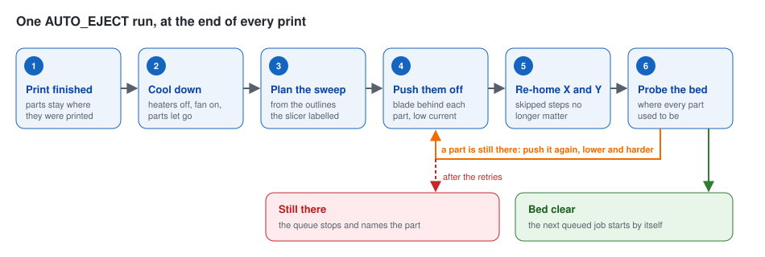
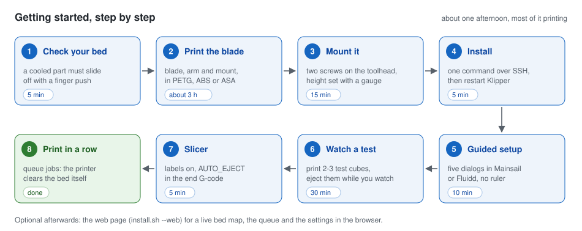
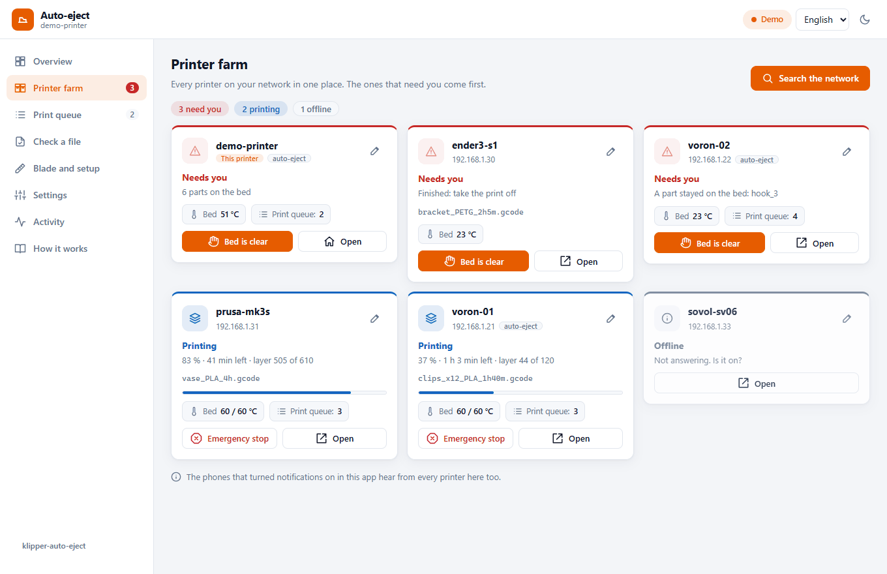
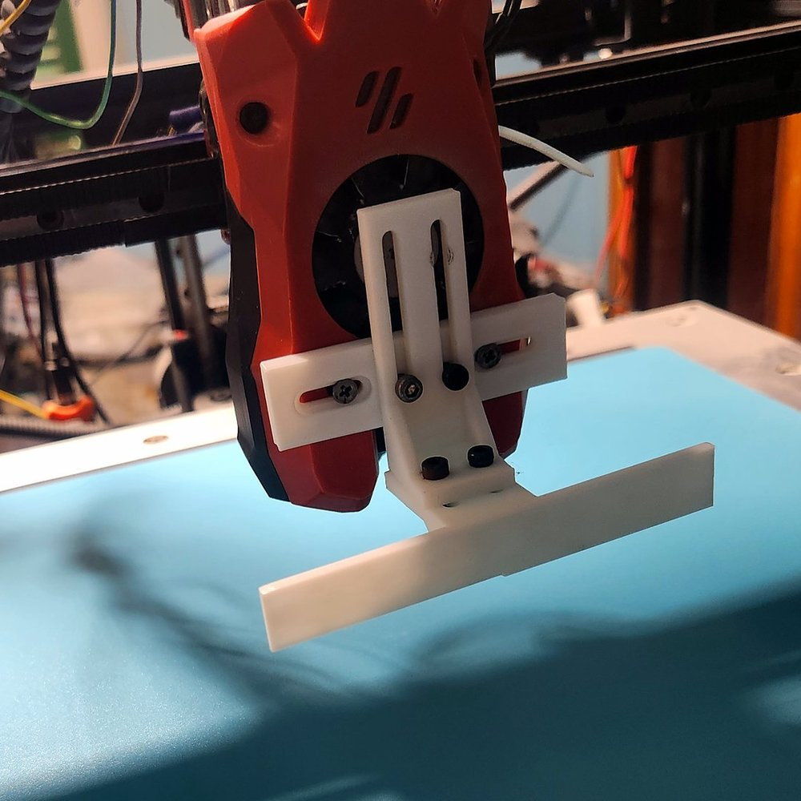
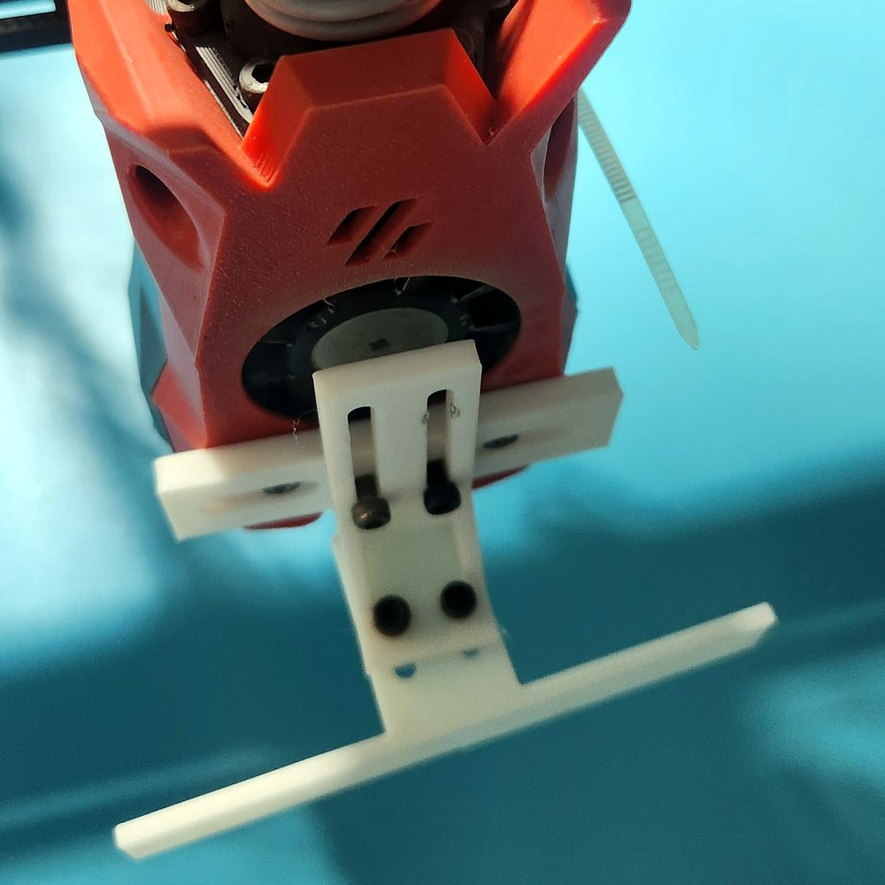
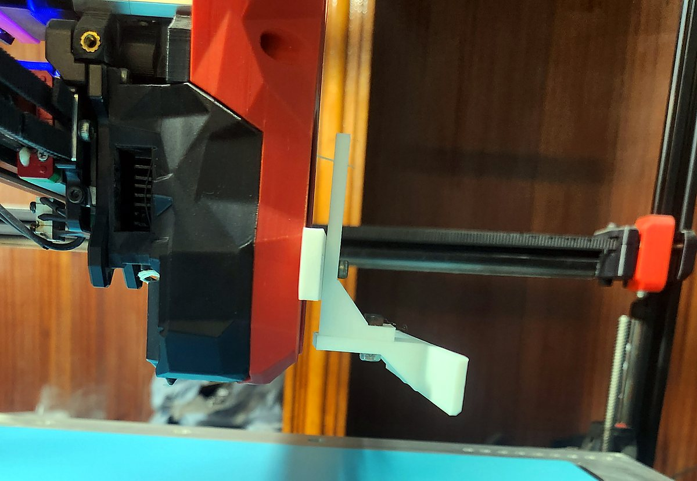
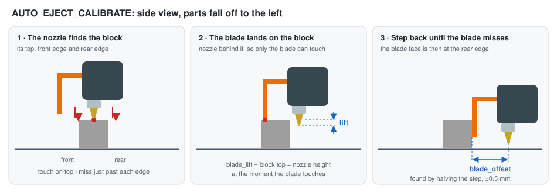

[klipper-auto-eject](../../README.md) › العربية

<h1 align="center">klipper-auto-eject</h1>

<p align="center">
  <b>طابعتك ثلاثية الأبعاد تفرّغ سريرها بنفسها بين الطبعات.</b><br>
  شفرة مطبوعة على رأس الطباعة تدفع القطع المنتهية إلى صندوق، ثم يتأكد المجس أن السرير فارغ،<br>
  وتبدأ الطباعة التالية وحدها. لأي طابعة تعمل بـ Klipper.
</p>

<p align="center">
  <a href="https://github.com/ahmedbebars/klipper-auto-eject/actions/workflows/ci.yml"></a>
  <a href="https://github.com/ahmedbebars/klipper-auto-eject/releases"></a>
  <a href="../../LICENSE"></a>
  <a href="https://www.klipper3d.org/"></a>
  <a href="https://moonraker.readthedocs.io/"></a>
  
  <a href="../../CONTRIBUTING.md"></a>
</p>

<p align="center">
  <a href="getting-started.md"><b>البداية خطوة بخطوة</b></a> ·
  <a href="faq.md">الأسئلة الشائعة</a> ·
  <a href="../README.md">التوثيق (بالإنجليزية)</a> ·
  <a href="../troubleshooting.md">حل المشكلات (بالإنجليزية)</a> ·
  <a href="https://github.com/ahmedbebars/klipper-auto-eject/discussions">النقاشات</a> ·
  <a href="uninstall.md">إزالة المشروع</a> ·
  <a href="../../README.md"><b>English</b></a>
</p>

<p align="center">
  <a href="https://www.klipper3d.org/" title="Klipper"></a>&emsp;
  <a href="https://docs.mainsail.xyz/" title="Mainsail"></a>&emsp;
  <a href="https://docs.fluidd.xyz/" title="Fluidd"></a>&emsp;
  <a href="https://github.com/SoftFever/OrcaSlicer" title="OrcaSlicer"></a>&emsp;
  <a href="https://github.com/prusa3d/PrusaSlicer" title="PrusaSlicer"></a>&emsp;
  <a href="https://github.com/Donkie/Spoolman" title="Spoolman"></a>
</p>
<p align="center"><sub>تعمل مع Klipper وMoonraker، ومع Mainsail أو Fluidd، ومع OrcaSlicer أو PrusaSlicer أو SuperSlicer أو Cura.
والوصول من الهاتف عبر Tailscale، وفحص البكرة مع Spoolman. (<a href="../images/logos/README.md">عن هذه الشعارات</a>)</sub></p>

---

> [!WARNING]
> **برنامج تجريبي (beta) يحرّك طابعتك وحده.** شاهد عدة تجارب قبل أن تترك الطابعة وحدها،
> واقرأ صفحة [السلامة](safety.md) أولًا.

## طريقة العمل

عندما تنتهي الطباعة، تقوم الطابعة بما يلي:

1. **تبرّد السرير** ورأس الطباعة يدور بمروحته فوق القطع، حتى تنفصل القطع عن السطح.
2. **تدفع القطع** من فوق الحافة بشفرة مثبتة على رأس الطباعة: ببطء، وبقوة محركات أقل من المعتاد،
   فإذا علقت قطعة يتخطى المحرك خطوات بدل أن يكسر شيئًا.
3. **تفحص السرير** بلمس المجس مكان كل قطعة. القطعة التي ما زالت موجودة تُدفع مرة أخرى، أخفض
   وبقوة أكبر.
4. **تبدأ الطباعة التالية** من قائمة Moonraker، أو **توقف القائمة** إذا بقيت قطعة على السرير،
   فلا يُطبع شيء فوقها أبدًا.

<p align="center"></p>

تعرف الطابعة مكان كل قطعة لأن برنامج التقطيع يكتب حدود القطع داخل ملف G-code
(خيار *Label objects*). لا شيء يحتاج إلى قياس باليد.

## هل يناسبني؟

| تحتاج إلى | لماذا | كيف تتأكد |
|---|---|---|
| طابعة تعمل بـ **Klipper**، مع Mainsail أو Fluidd | المشروع مبني من ماكروهات Klipper | تفتح الطابعة في المتصفح |
| سطح طباعة **يترك القطع عندما يبرد** | الشفرة تدفع، ولا تستطيع أن تقتلع القطع | القطعة بعد أن تبرد تنزلق بدفعة إصبع |
| برنامج تقطيع يستطيع **تعريف القطع** (Label objects) | بهذا تعرف الطابعة أين القطع | OrcaSlicer وPrusaSlicer وSuperSlicer، وCura مع إضافة Klipper |
| إمكانية **طباعة شفرة** من PETG أو ABS أو ASA | تُركّب على رأس الطباعة | ثلاث قطع صغيرة، حوالي 3 ساعات |
| يُنصح به: **مجس** | ليتأكد أن السرير فارغ قبل الطباعة التالية | Voron Tap، BLTouch، Klicky، مجس حثي… |

لا يناسب طابعات دلتا، ولا الطابعات التي تعمل بـ Marlin أو Bambu Lab أو البرنامج الثابت الأصلي من Prusa.

## كيف تبدأ

<p align="center"></p>

**[دليل المبتدئين](getting-started.md)** يمشي معك في كل خطوة، ويخبرك كيف تتأكد أنها نجحت.
باختصار:

1. **افحص السرير:** القطعة بعد أن تبرد يجب أن تنزلق بدفعة إصبع.
2. **اطبع الشفرة** من [`hardware/stl/`](../../hardware/stl/): شفرة وذراع وقاعدة تثبيت.
3. **ركّبها** على رأس الطباعة، واضبط ارتفاعها بالمقياس المطبوع ([hardware.md](../hardware.md)، بالإنجليزية).
4. **ثبّت الماكروهات** عبر SSH، بسطر واحد:
   ```bash
   cd ~ && git clone https://github.com/ahmedbebars/klipper-auto-eject.git && ./klipper-auto-eject/install.sh
   ```
   يسألك بعض الأسئلة بنعم أو لا (صفحة الويب؟ هاتفك؟ الإشعارات؟ أكثر من طابعة؟)، ويضيف ما يحتاجه
   `printer.cfg`، ثم يعيد تشغيل Klipper بنفسه إذا لم تكن الطابعة تطبع ([التثبيت](installation.md)). وإزالته لاحقًا سطر واحد أيضًا
   ([إزالة المشروع](uninstall.md)).
5. **شغّل الإعداد الموجّه:** اكتب `AUTO_EJECT_SETUP` في الطرفية (Console) واضغط الأزرار.
   مع Voron Tap تقيس الطابعة الشفرة بنفسها ([بالصور](../setup-wizard.md)، بالإنجليزية).
6. **شاهد تجربة:** اطبع مكعبين أو ثلاثة للاختبار، واتركها على السرير، وشغّل `AUTO_EJECT`.
7. **برنامج التقطيع:** فعّل *Label objects*، وأضف `AUTO_EJECT HEIGHT=[max_layer_z] HOME=1` إلى
   كود النهاية، تحت ماكرو النهاية ([slicer-setup.md](../slicer-setup.md)، بالإنجليزية).
8. **اطبع مهام متتالية:** فعّل قائمة المهام في Moonraker (job queue)، وأضف إليها ما تشاء من الطبعات.

### إزالة المشروع

سطر واحد يزيل كل شيء، فتعمل طابعتك كما كانت ([ما الذي يزيله وما الذي يبقى](uninstall.md)):

```bash
~/klipper-auto-eject/install.sh --uninstall
```

ثم أعد تشغيل Klipper بالأمر `FIRMWARE_RESTART`، وليس أثناء الطباعة أبدًا.

## صفحة الويب

<p align="center"></p>

صفحة اختيارية اسمها **الإزالة التلقائية**، ورابطها **Auto-eject** في القائمة الجانبية لـ Mainsail.
فيها خريطة حية للسرير تظهر عليها القطع ومسارات الدفع، وأزرار للإزالة أو للتجربة، وقائمة الطباعة،
وفحص يخبرك *قبل* الطباعة هل يمكن تفريغ السرير من ملف ما تلقائيًا، وإعداد الشفرة، وكل الإعدادات، وعتاد الطابعة.
بالإنجليزية أو العربية، بوضع فاتح أو داكن، وعلى الهاتف أيضًا.

```bash
~/klipper-auto-eject/install.sh --web
```

يطلب كلمة المرور مرة واحدة، من أجل خادم الويب. التفاصيل في [صفحة الويب](web-page.md).
ويمكنك أيضًا [تجربة نسخة العرض](web-page.md) دون طابعة.

### على هاتفك، كتطبيق

<p align="center"></p>

**من أي مكان:** الأمر `install.sh --remote` يجهّز Tailscale، وهي شبكة خاصة مجانية بين أجهزتك،
فتفتح الطابعة من هاتفك أينما كنت، دون فتحها على الإنترنت ([من الهاتف](remote-access.md)).
وعبر HTTPS تُثبَّت الصفحة كتطبيق له أيقونته الخاصة، والأمر `install.sh --push` يرسل إليه إشعارًا
عندما تحتاجك الطابعة، حتى وهو مغلق ([الإشعارات](notifications.md)).

### مزرعة الطابعات

<p align="center"></p>

الأمر `install.sh --farm` على طابعة واحدة يضع كل طابعات Klipper على شبكتك في صفحة واحدة،
والتي تحتاجك تظهر أولًا. زر **ابحث في الشبكة** يجدها ويضيفها، والطابعات الأخرى لا تحتاج أي
تثبيت ([مزرعة الطابعات](farm.md)).

### عتاد الطابعة

<p align="center"></p>

تبويب **العتاد** يعرض كل ما يقوله Klipper وMoonraker عن الطابعة، مباشرة: كل لوحة ومدى سلامة اتصالها
(USB أو CAN)، وكل محرك وتحذيرات مشغّله، والسخانات، والمراوح، والكمبيوتر، والحساسات، والكاميرا، مع سطر
واحد يقول هل كل شيء طبيعي. ومع `install.sh --push` تصل التحذيرات المهمة إلى هاتفك والصفحة مغلقة: مروحة
توقفت، أو محرك ساخن، أو كابل بدأ يتلف ([صفحة الويب](web-page.md#العتاد)).

## الشفرة

<p align="center">
  
  
  
</p>
<p align="center"><sub>مركّبة على Voron Trident 450 برأس طباعة Stealthburner، وشفرة بعرض 100 مم.</sub></p>

ثلاث قطع مطبوعة تُربط بمسامير M3. كل وصلة فيها فتحات طولية، لذلك تناسب معظم رؤوس الطباعة:
قاعدة التثبيت تقبل مسامير رأس طباعة المسافة بينها 28–50 مم (أو رباطًا)، ويُضبط الارتفاع والمسافة
إلى الأمام داخل الفتحات. الشفرات متاحة بعرض 60 و80 و100 مم، وملف OpenSCAD المصدري يصنع أي مقاس
آخر. انظر [hardware.md](../hardware.md).

**تقيس نفسها.** مع Voron Tap أو أي مجس يلمس بالفوهة، تطبع قطعة صغيرة وتتركها على السرير.
تلمسها الطابعة بالفوهة، ثم بالشفرة، وتحسب ارتفاع الشفرة وبعدها أمام الفوهة، في 2–3 دقائق.

<p align="center"></p>

## المزايا

**آمنة**
- تيار محركات أقل أثناء الدفع، يُضبط تلقائيًا لمشغلات TMC، فإذا علقت قطعة يتخطى المحرك خطوات بدل
  أن يكسر الشفرة أو القطعة أو أحد السيور.
- يفحص المجس السرير بعد كل إزالة. القطعة التي ما زالت موجودة تُدفع مرة أخرى، أخفض وبقوة أكبر؛
  وإذا لم تتحرك بعد ذلك تتوقف القائمة.
- الطبعات المسطحة مثل الاستنسل، التي لا تستطيع الشفرة الإمساك بها، تُترك على السرير وتنتظرك
  القائمة ([القطع الرفيعة](../configuration.md#thin-parts)، بالإنجليزية).
- تتحمل إعادة التشغيل وانقطاع الكهرباء: تتذكر الطابعة أماكن القطع، وتضبط المحاور دون أن تلمسها،
  ولا تبدأ طباعة فوقها أبدًا ([الاسترداد](../recovery.md)، بالإنجليزية).
- التبريد لا ينتظر إلى الأبد: في غرفة دافئة تُدفع القطع بعد مهلة محددة، مع تحذير.
- مع [Spoolman](spoolman.md)، تتوقف القائمة قبل مهمة لا تكفيها البكرة المركّبة، بدل أن تنفد البكرة في
  منتصفها.

**سهلة**
- إعداد موجّه في خمس نوافذ داخل Mainsail أو Fluidd. بلا تعديل ملفات إعداد، وبلا مسطرة.
- الشفرة تقيس نفسها مع Voron Tap ومع المجسات الأخرى التي تلمس بالفوهة.
- صفحة الويب، بالإنجليزية والعربية.
- تثبيت بسطر واحد يسألك عما تريد بكلمات بسيطة، ويضيف ما يحتاجه `printer.cfg`. والتحديثات تأتي من
  لوحة التحديث في Mainsail/Fluidd، وإعداداتك في ملف خاص بها لا تلمسه التحديثات أبدًا.

**مرنة**
- أي حافة سقوط: الأمام أو الخلف أو اليسار أو اليمين.
- ثلاث طرق لتخطيط الدفع: مسارات متجاورة تناسب أي ترتيب للقطع، أو قطعة واحدة في كل مرة، أو السرير
  كله ([طرق الدفع](../strategies.md)، بالإنجليزية).
- مجسات اللمس، والمجسات التي بجانب الفوهة، ومجسات التيار الدوامي ([المجسات](../probes.md)،
  بالإنجليزية)، والطابعات التي بلا مجس أيضًا.
- تعمل مع الماكروهات الأصلية ومع DEMON وKlippain وغيرها ([التكامل](../integration.md)، بالإنجليزية).
- الأمر `EJECT_PURGE`: حبة تنظيف تستطيع الشفرة دفعها، بدل خط تنظيف يتراكم على السرير.

الماكروهات تُختبر تلقائيًا مع كل تغيير، على إصدارات Jinja2 التي يستخدمها Klipper.

## التوافق

| نوع الطابعة | الحالة | ملاحظات |
|---|:---:|---|
| CoreXY (Voron وRatRig وVzBot وSovol SV08…) | ✅ | مثالية: السرير لا يتحرك |
| كارتيزية بسرير ثابت | ✅ | |
| طابعة بسرير متحرك (Ender 3، أو مثل Prusa MK3) تعمل بـ Klipper | ✅ | ادفع إلى اليسار أو اليمين، حتى لا يهز السرير المتحرك القطع |
| Klipper من الشركة المصنعة (Creality K1، Qidi، Sovol) | ⚠️ | تعمل إذا كنت تستطيع تعديل الإعدادات، وكان البرنامج الثابت قريبًا من النسخة الرسمية |
| دلتا | ❌ | التخطيط يفترض سريرًا مستطيلًا |
| Marlin وBambu Lab والبرنامج الثابت الأصلي من Prusa | ❌ | Klipper فقط |

> **الاختبار الميداني:** أول التجارب على عتاد حقيقي تجري على Voron Trident 450 مع Voron Tap.
> تقارير الطابعات الأخرى مرحب بها جدًا:
> [شارك تجربتك هنا](https://github.com/ahmedbebars/klipper-auto-eject/discussions).

## الأوامر اليومية

| الأمر | ماذا يفعل |
|---|---|
| `AUTO_EJECT` | يبرّد، ويدفع القطع خارج السرير، ثم يفحص السرير |
| `AUTO_EJECT DRY=1` | يمر بالمسار فوق السرير دون دفع |
| `AUTO_EJECT HOME=1` | بعد إعادة التشغيل: يضبط المحاور بأمان حول القطع، ثم يزيلها |
| `AUTO_EJECT_CLEAR` | أزلت القطع بيدك: ينساها |
| `AUTO_EJECT_SETUP` | الإعداد الموجّه |
| `AUTO_EJECT_SET KEY=cool_temp VALUE=35` | يغيّر إعدادًا واحدًا ويحفظه |

كل الأوامر والخيارات: [commands.md](../commands.md) (بالإنجليزية).

## التوثيق

| ابدأ من هنا | الإعداد | كل يوم | الضبط الدقيق والمساعدة |
|---|---|---|---|
| [البداية خطوة بخطوة](getting-started.md) | [الشفرة](../hardware.md) | [الأوامر](../commands.md) | [الإعدادات](../configuration.md) |
| [الأسئلة الشائعة](faq.md) | [التثبيت](installation.md) | [التكامل](../integration.md) | [طرق الدفع](../strategies.md) |
| [قاموس المصطلحات](../glossary.md) | [الإعداد الموجّه](../setup-wizard.md) | [الاسترداد](../recovery.md) | [المجسات](../probes.md) |
| [السلامة](safety.md) | [برنامج التقطيع](../slicer-setup.md) | [صفحة الويب](web-page.md) | [حل المشكلات](../troubleshooting.md) |
| [الشروحات بالعربية](#الشروحات-بالعربية) | [إزالة المشروع](uninstall.md) | | |
| | | [من الهاتف](remote-access.md) | |
| | | [الإشعارات](notifications.md) | |
| | | [مزرعة الطابعات](farm.md) | |

الصفحات المكتوبة بالعربية مذكورة في [الشروحات بالعربية](#الشروحات-بالعربية)، وروابط باقي الصفحات
تفتح النسخة الإنجليزية.

## المساهمة

بلاغات الأخطاء، وملاحظاتك عن طابعتك، وطلبات الدمج (pull requests) كلها مرحب بها؛ انظر
[CONTRIBUTING.md](../../CONTRIBUTING.md) (بالإنجليزية). إذا شغّلت المشروع على طابعتك، شارك من فضلك
شفرتك وإعداداتك في [النقاشات](https://github.com/ahmedbebars/klipper-auto-eject/discussions) ليبدأ
منها الآخرون. وترجمات صفحة الويب مرحب بها أيضًا ([الطريقة](web-page.md)).

## الرخصة

رخصة [GNU GPLv3](../../LICENSE)، وهي نفس رخصة Klipper. © 2026 Ahmed Bebars.

## الشروحات بالعربية

| الصفحة | محتواها |
|---|---|
| [البداية خطوة بخطوة](getting-started.md) | الطريق كله خطوة بخطوة للمبتدئين، من فحص السرير إلى طباعة مهام متتالية |
| [التثبيت](installation.md) | سكربت التثبيت، والتثبيت باليد، والتحديث، وإلغاء التثبيت |
| [إزالة المشروع](uninstall.md) | سطر واحد يزيله من الطابعة، وما الذي يبقى بعده |
| [صفحة الويب](web-page.md) | صفحة الإزالة التلقائية في Mainsail: تثبيتها وما تعرضه |
| [من الهاتف](remote-access.md) | مراقبة الطابعة والتحكم فيها من هاتفك من أي مكان، دون فتحها على الإنترنت |
| [الإشعارات](notifications.md) | رسالة على هاتفك عندما تحتاجك الطابعة، أو عندما تنتهي طباعة |
| [مزرعة الطابعات](farm.md) | كل طابعات شبكتك في صفحة واحدة، تجدها وحدها؛ والطابعات الأخرى لا تحتاج أي تثبيت |
| [البكرة وSpoolman](spoolman.md) | مع Spoolman، تتوقف القائمة قبل مهمة لا تكفيها البكرة المركّبة على الطابعة |
| [الأسئلة الشائعة](faq.md) | إجابات قصيرة: هل تخدش السرير، هل أحتاج مجسًا، كم تستغرق… |
| [السلامة](safety.md) | ما الذي قد يحدث خطأ، وما تراقبه قبل أن تترك الطابعة وحدها |

باقي الصفحات بالإنجليزية، وتجدها كلها في [فهرس التوثيق](../README.md).
