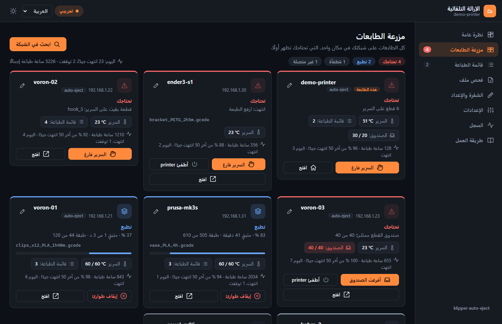
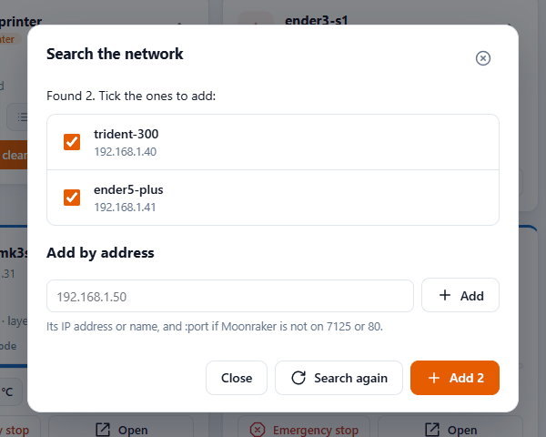
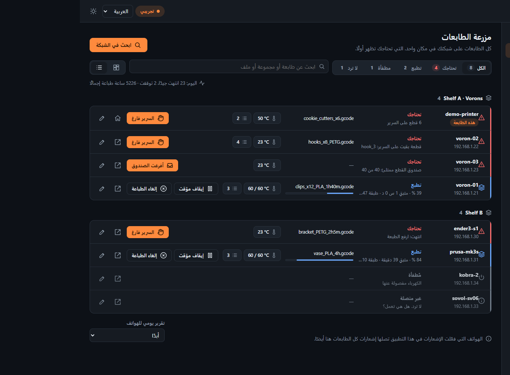
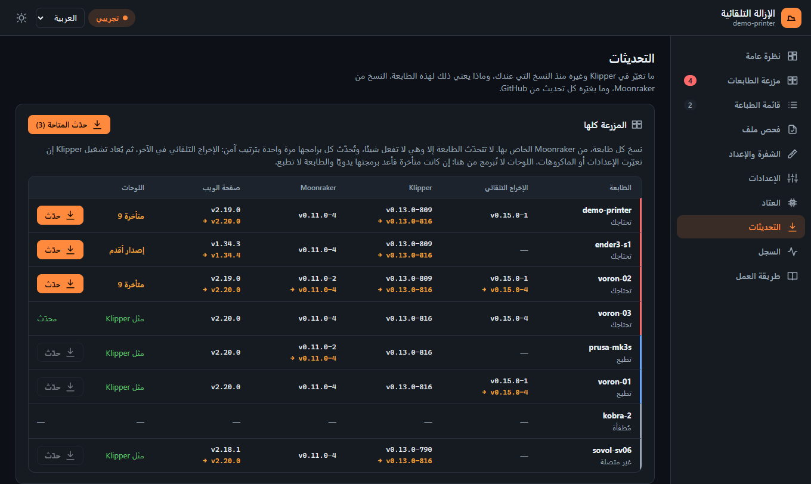
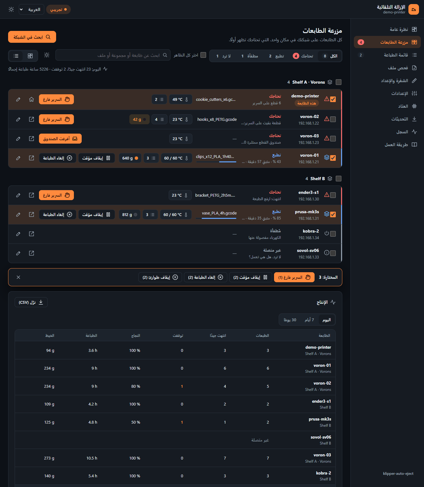

[klipper-auto-eject](../../README.md) › [العربية](README.md) › مزرعة الطابعات

# مزرعة الطابعات

كل طابعات Klipper على شبكتك في صفحة واحدة، والتي تحتاجك تظهر أولًا: طبعة يجب رفعها، أو قطعة بقيت
على السرير، أو خطأ، أو قائمة طباعة متوقفة. تثبّتها على **طابعة واحدة فقط**. هي تبحث في الشبكة،
وتجد الطابعات الأخرى وتضيفها. **الطابعات الأخرى لا تحتاج أي تثبيت**.

| تعرض البطاقة | |
|---|---|
| **تحتاجك** | طبعة انتهت ويجب رفعها، أو قطعة بقيت على السرير، أو قطع أرفع من أن تُدفع، أو خطأ، أو طباعة أُلغيت، أو قائمة طباعة تنتظرك. والبطاقة تقول أي سبب منها. |
| **تطبع** | الملف بصورته، ونسبة التقدم، والوقت المتبقي، والطبقة |
| **تفريغ السرير** | auto-eject يبرّد السرير ويدفع القطع خارجه |
| **متوقفة مؤقتًا**، **متوقفة** | طباعة متوقفة مؤقتًا؛ أو Klipper متوقف، مع رسالته |
| **متاحة** | جاهزة للطبعة التالية، وكم مهمة تنتظر في قائمتها |
| **غير متصلة** | لا ترد |

<p align="center"></p>

كل بطاقة تعرض أيضًا حرارة السرير، وصورة الكاميرا إن كانت للطابعة كاميرا في Moonraker. وفي الأعلى:
كم طابعة تحتاجك، وكم تطبع، وكم متاحة، وكم غير متصلة. وتبويب **مزرعة الطابعات** في القائمة يعرض
أيضًا عدد الطابعات التي تحتاجك.

ومن سجل الطباعة لكل طابعة في Moonraker، تعرض البطاقة أيضًا عدد ساعات الطباعة، وكم طبعة من آخر 50
انتهت جيدًا، وعدد طبعات اليوم. والسطر العلوي يجمع المزرعة كلها، مثل: *اليوم: 16 انتهت جيدًا، 2
توقفت · 4571 ساعة طباعة إجمالًا*. والطبعة المتوقفة هي التي انتهت بخطأ أو أُلغيت.

الطابعات التي فيها klipper-auto-eject تعرض قطعها، والإزالة ومشاكلها. وأي طابعة Klipper أخرى تعرض
طباعتها. والطبعة المنتهية على طابعة بدون auto-eject تُحسب **تحتاجك** حتى تضغط **السرير فارغ**.

## الإعداد (5 دقائق)

1. **اختر طابعة واحدة** للصفحة: أي طابعة Klipper فيها Moonraker وMainsail أو Fluidd، ويُفضَّل أن
   تكون طابعة تبقى تعمل دائمًا. لا تحتاج هذه الطابعة إلى شفرة.
2. **على تلك الطابعة**، عبر SSH:
   ```bash
   cd ~ && git clone https://github.com/ahmedbebars/klipper-auto-eject.git
   ~/klipper-auto-eject/install.sh --farm
   ```
   هذا يثبّت صفحة الويب وخدمة `klipper-auto-eject` التي تشغّل المزرعة. يطلب كلمة المرور مرة
   واحدة. إذا لم تكن على هذه الطابعة شفرة، أضف `--no-include`: المزرعة لا تحتاج ماكروهات
   auto-eject.
3. **افتح** `http://<that printer>/auto-eject/`، ثم تبويب **مزرعة الطابعات**، واضغط **ابحث في
   الشبكة**. بعد حوالي 10 ثوانٍ تعرض الطابعات التي وجدتها. أزل العلامة عن أي طابعة لا تريدها،
   ثم اضغط **أضف**.

<p align="center"></p>

تُحفظ القائمة على تلك الطابعة. اضغط **ابحث في الشبكة** مرة أخرى كلما أضفت طابعة جديدة. والطابعات
التي تركتها تُحفظ أيضًا: البحث التالي يعرضها في آخر القائمة، بلا علامة، مع عبارة «تركتها في المرة
السابقة»، فتستطيع إضافة أي منها لاحقًا.

### طابعة لا يجدها البحث

يسأل البحث كل عنوان في شبكة الطابعة نفسها (الـ 254 عنوانًا حول عنوانها، مثل `192.168.1.1` إلى
`192.168.1.254`)، وكل جهاز Linux على شبكة Tailscale الخاصة بك. وعلى كل عنوان يبحث عن Moonraker
على المنفذ 7125 والمنفذ 80. والطابعة التي يجدها بالطريقتين تظهر مرة واحدة، بعنوانها المحلي: فهو
يعرف أنها الجهاز نفسه من بطاقة الشبكة.

- **على شبكة أخرى أو VLAN أخرى:** اكتب عنوانها تحت **أضف بالعنوان**، مثل `10.0.5.20`.
- **عدة نسخ من Klipper على حاسوب واحد:** أضف كل نسخة بعنوانها مع منفذ Moonraker الخاص بها، مثل
  `192.168.1.50:7126`.
- **وُجدت لكنها غير متصلة:** Moonraker فيها لا يسمح لطابعة المزرعة بالدخول. أغلب طرق التثبيت
  (KIAUH وMainsailOS) تسمح لكل عناوين الشبكة المحلية. إن لم تكن طابعتك كذلك، أضف عنوان طابعة
  المزرعة إلى `trusted_clients` في ملف `moonraker.conf` على تلك الطابعة. أما Moonraker الذي يطلب
  تسجيل دخول أو مفتاح API فلا يمكن قراءته.

## الأزرار

| الزر | ماذا يفعل | هل يسأل أولًا |
|---|---|---|
| **السرير فارغ** | اضغطه بعد أن ترفع الطبعة بيدك. مع auto-eject: ينسى القطع المسجلة (`AUTO_EJECT_CLEAR`). وبدونه: ينسى المهمة المنتهية (`SDCARD_RESET_FILE`) لتظهر الطابعة متاحة. لا يتحرك أي شيء. | لا |
| **اطبع** | لطابعة متاحة: اختر أحد ملفات G-code فيها (كل ملف بصورته ومدة طباعته والخيط الذي يستهلكه)، أو أرسل لها ملفًا من هاتفك أو الكمبيوتر (**أرسله**، أو **أرسله واطبع**). يُرفض أثناء الطباعة أو إذا كانت auto-eject تعرف أن على سريرها قطعًا | نعم |
| **إيقاف مؤقت**، **استكمال**، **إلغاء الطباعة** | الطباعة الجارية على تلك الطابعة | الإلغاء يسأل |
| **شغّل القائمة** | يشغّل قائمة المهام (job queue) في Moonraker على تلك الطابعة: تُطبع المهمة التالية | نعم |
| **إيقاف طوارئ** | يوقف تلك الطابعة فورًا. بعدها تحتاج إلى إعادة تشغيل البرنامج الثابت | نعم |
| **افتح** | صفحة تلك الطابعة نفسها: صفحة auto-eject فيها إن وُجدت، وإلا Mainsail أو Fluidd. ومن خارج شبكتها يفتح عبر Tailscale إن كان Tailscale مثبتًا عليها؛ وإلا يظهر **افتح (على شبكتها)** ولا يفعل شيئًا | |
| **أفرغت الصندوق** | صندوق القطع في الطابعة ممتلئ: أفرغته، فيبدأ العدّ من الصفر (`AUTO_EJECT_BIN_EMPTY`) | لا |
| **شغّل** / **أطفئ** | للطابعات التي لها مفتاح كهرباء في Moonraker (`[power]` في `moonraker.conf`، أو فيشة ذكية، أو ريليه). الإطفاء لا يحدث أبدًا أثناء الطباعة أو والفوهة أسخن من 50 °م، لأن مروحة رأس الطباعة تتوقف معها | الإطفاء يسأل |
| ✎ | تغيير اسم الطابعة هنا، أو حذفها من المزرعة. لا يتغير شيء على الطابعة نفسها. ومع مفتاح كهرباء: **إطفاء تلقائي عندما لا يكون لديها عمل** | |

### إطفاء الطابعات تلقائيًا

للطابعة التي لها مفتاح كهرباء، يعرض ✎ اختيار **إطفاء تلقائي عندما لا يكون لديها عمل**: أبدًا، أو بعد
مدة من 15 دقيقة إلى 4 ساعات. لا عمل لديها يعني: لا تطبع، ولا شيء في قائمتها، والفوهة أبرد من 50 °م.
عندها تطفئها المزرعة وترسل إشعارًا. استخدمه فقط لمفتاح يغذي الطابعة، لا الكمبيوتر الذي يشغّل
Moonraker، وإلا فلن يستطيع شيء تشغيلها مرة أخرى. الطابعة المطفأة تظهر **مُطفأة**، مع زر **شغّل**.

والطابعة التي فيها auto-eject تعرض أيضًا صندوق القطع (**الصندوق: 32 / 40**) بعد ضبط
[`bin_capacity`](../configuration.md#the-parts-box) (بالإنجليزية)؛ والصندوق الممتلئ يجعلها **تحتاجك**.

### تذكير الصيانة والتقرير اليومي

- **تذكير الصيانة:** من ✎ في بطاقة الطابعة، اختر **كل 100 إلى 1000 ساعة طباعة**. تعرض البطاقة
  **الصيانة: 450 / 1000 ساعة** (بالأحمر عندما يحين وقتها)، ويصل للهواتف إشعار واحد عندما يحين. بعد
  الصيانة اضغط **تمت الصيانة** في ✎: يبدأ العدّ من الصفر. الساعات تأتي من سجل الطباعة لتلك الطابعة
  في Moonraker.
- **التقرير اليومي:** أسفل المزرعة، **تقرير يومي للهواتف**: كل يوم في الوقت الذي تختاره يصل إشعار
  يلخّص المزرعة: كم طبعة انتهت جيدًا وكم توقفت، وكم تطبع الآن وكم تحتاجك، وساعات الطباعة، والطابعات
  التي حان وقت صيانتها. الضغط عليه يفتح المزرعة. يصل للهواتف التي فعّلت الإشعارات في التطبيق
  ([الإشعارات](notifications.md)).

الاثنان متوقفان حتى تختارهما.

## مزرعة كبيرة

الصفحة نفسها تصلح لطابعة واحدة ولمئة طابعة.

- **التصفية** في الأعلى: **الكل**، و**تحتاجك**، و**تطبع**، و**متاحة**، و**مُطفأة**، و**لا ترد**، ومع كلٍّ
  عددها. والطبعة المتوقفة مؤقتًا تُحسب ضمن **تحتاجك**.
- **البحث**: باسم الطابعة، أو عنوانها، أو مجموعتها، أو الملف الذي تطبعه.
- **بطاقات أو قائمة**: إذا زادت الطابعات على 12 تعرض الصفحة سطرًا واحدًا لكل طابعة، فيه حالتها وملفها
  وتقدّمها والسرير وأزرارها. والزرّان بجوار البحث يبدّلان بين البطاقات والقائمة، ويتذكّر المتصفح اختيارك.
- **المجموعات**: من ✎ في الطابعة، أعطها مجموعة، مثل `الرف أ` أو `الغرفة 2`. تعرض الصفحة كل مجموعة تحت
  عنوانها، والمجموعات مرتبة بالاسم، والطابعات التي بلا مجموعة في الآخر. المجموعة تُحفظ على طابعة المزرعة
  فقط، ولا يتغيّر شيء على الطابعة نفسها.

<p align="center"></p>

### تحديث المزرعة كلها

يعرض تبويب **التحديثات** بطاقة **المزرعة كلها** إذا كان في المزرعة أكثر من طابعة: نسخة كل طابعة من
الإخراج التلقائي وKlipper وMoonraker وصفحة الويب (Mainsail أو Fluidd)، وأحدث نسخة من كلٍّ منها، وكم
تتأخر برامج لوحاتها عن Klipper الخاص بها. اضغط **حدّث** على طابعة واحدة، أو **حدّث المتاحة** لكل طابعة
لها نسخة جديدة ولا تفعل شيئًا.

<p align="center"></p>

- **لا تتحدّث الطابعة إلا وهي لا تفعل شيئًا.** الطابعة التي تطبع، أو متوقفة مؤقتًا، أو تخلي سريرها، أو
  متوقفة بخطأ، أو مُطفأة، أو لا ترد، لا تُحدَّث. وتسأل المزرعة من جديد قبل كل برنامج مباشرةً، فالتي تبدأ
  طباعة أثناء ذلك يتوقف تحديثها عند هذه النقطة. وMoonraker نفسه يرفض التحديث أثناء الطباعة.
- **كل شيء مرة واحدة، بترتيب آمن:** البرامج الأخرى أولًا (صفحة الويب، وcrowsnest، ومجموعة ماكروهات)، ثم
  Klipper، ثم Moonraker (وتنتظر المزرعة عودته)، والإخراج التلقائي في الآخر.
- **يُعاد تشغيل Klipper مرة واحدة في النهاية** إذا حُدِّث شيء فيه إعدادات أو ماكروهات (الإخراج التلقائي،
  أو مجموعة ماكروهات)، وبشرط أن تظل الطابعة لا تفعل شيئًا. أما Klipper وMoonraker فيُعاد تشغيلهما وحدهما
  عند تحديثهما.
- **طابعة المزرعة نفسها:** تحديث الإخراج التلقائي عليها يعيد تشغيل المزرعة أثناء التحديث. وعندما تعود، تعيد
  تشغيل Klipper على تلك الطابعة مرة واحدة وهي لا تفعل شيئًا، حتى تُحمَّل الماكروهات الجديدة.
- **اللوحات لا تُبرمج من هنا.** برمجتها تحتاج الخيارات الصحيحة لكل لوحة، وبعض اللوحات تحتاج ضغط زر. عمود
  **اللوحات** يبيّن كم تتأخر: افتح تبويب **التحديثات** في صفحة تلك الطابعة، فهو يبيّن هل تغيّر كود اللوحات
  منذ ذلك، أي هل تحتاج إعادة برمجة أصلًا.

تُقرأ النسخ من Moonraker في كل طابعة كل 5 دقائق، وبعد أي تحديث مباشرةً.

### أمر واحد لعدة طابعات

اختر الطابعات (مربع على كل بطاقة وسطر)، أو مجموعة كاملة (المربع بجوار عنوانها)، أو **اختر كل الظاهر** (ما
تعرضه التصفية والبحث الآن). يظهر حينها شريط بما يمكن فعله عليها: **السرير فارغ**، و**ابدأ القائمة**،
و**ادفع الآن**، و**إيقاف مؤقت**، و**استئناف**، و**أرسل ملفًا**، و**شغّل**، و**أطفئ**، و**ملصقات QR**، و**ألغِ الطباعة**،
و**إيقاف الطوارئ**، ومع كلٍّ عدد الطابعات التي يصلها. ولا يذهب الأمر إلا للطابعات المختارة التي يناسبها
الآن (الإيقاف المؤقت للتي تطبع، والإطفاء لا يصل أبدًا لطابعة تطبع)، ويذكر التأكيد التي استُبعدت.

**أرسل ملفًا** يرسل ملف G-code واحدًا من هاتفك أو كمبيوترك إلى كل طابعة متاحة مختارة، واحدة بعد الأخرى،
ويبدأ طباعته على كلٍّ منها إن طلبت. وتحتفظ كل طابعة بالملف.

### البكرة على كل طابعة

الطابعة التي يرتبط Moonraker فيها بـ [Spoolman](spoolman.md) تعرض بكرتها على بطاقتها: اللون والخيط والجرامات
الباقية، بالبرتقالي عندما توشك أن تنفد (أقل من 50 جم، أو أقل من عُشر البكرة الكاملة).

### الإنتاج

أسفل المزرعة يلخّص قسم **الإنتاج** ما صنعته كل طابعة **اليوم**، أو في آخر **7 أيام**، أو آخر **30 يومًا**:
الطبعات، وكم انتهت جيدًا وكم توقفت (بخطأ أو إلغاء)، ونسبة النجاح، وساعات الطباعة، والخيط المستهلك، ثم المزرعة
كلها. وزر **نزّل (CSV)** يحفظ الجدول لبرنامج جداول. البيانات من سجل الطباعة لكل طابعة في Moonraker، والخيط
بوزن كل ملف، أو كخيط PLA قطره 1.75 مم إذا لم يذكر الملف وزنه.

<p align="center"></p>

### ملصق QR على كل طابعة

اضغط ✎ على الطابعة ثم **ملصق QR**: اسمها ومجموعتها ورمز QR لصفحتها، لتطبعه وتلصقه عليها. وجّه كاميرا
الهاتف إليه فتُفتح صفحة الطابعة. اختر **في المنزل** (عنوانها على شبكتك: يجب أن يكون الهاتف على نفس الـ Wi-Fi)
أو **من أي مكان (Tailscale)** (الهاتف الذي يعمل عليه [Tailscale](remote-access.md) يفتحها في المنزل أو خارجه).
زر **اطبع** يطبع الملصق وحده، و**احفظه صورة** يحفظه بصيغة PNG لتطبعه من تطبيق طابعة الملصقات.

وللمزرعة كلها، اختر الطابعات ثم **ملصقات QR** من الشريط: ورقة واحدة، ثلاثة ملصقات في كل صف، وخط متقطع للقص.
والرموز تُصنع داخل الصفحة نفسها، دون إرسال أي شيء إلى أي مكان.

<p align="center"></p>

### طابعات كثيرة، بلا انتظار

كل 3 ثوانٍ تسأل المزرعة كل الطابعات في وقت واحد، حتى 32 طابعة معًا، فتستغرق 100 طابعة تقريبًا ما تستغرقه
طابعة واحدة. والطابعة التي لا ترد تُسأل من جديد بعد 10 ثوانٍ، ثم 20، حتى مرة كل دقيقة، وتظهر **لا ترد**
خلال ذلك: فعشر طابعات مفصولة عن الكهرباء لا تبطئ البقية. والطابعة التي توقف فيها Klipper تظل ترد عبر
Moonraker، وتظهر **متوقفة** مع رسالة Klipper.

## من هاتفك، من أي مكان

اضبط [التحكم عن بعد](remote-access.md) على طابعة المزرعة فقط:

```bash
~/klipper-auto-eject/install.sh --remote
```

طابعة المزرعة تقرأ الطابعات الأخرى نيابةً عنك. لذلك ترى من هاتفك كل طابعة، مع كاميرتها، عبر هذه
الطابعة الواحدة. وأزرار **اطبع** و**إيقاف مؤقت** و**إلغاء الطباعة** وغيرها تمر عبرها أيضًا، وكذلك
الملفات التي ترسلها، فتعمل من أي مكان. والطابعات الأخرى لا تحتاج Tailscale. زر **افتح** وحده يذهب مباشرة إلى الطابعة
الأخرى: على الشبكة نفسها يفتح عنوانها المحلي، ومن خارجها عبر Tailscale يفتح عنوانها في Tailscale إن
كان Tailscale مثبتًا عليها أيضًا (المزرعة تعرفها من كارت الشبكة).

## الإشعارات من كل الطابعات

الهاتف الذي فعّل الإشعارات في التطبيق ([notifications.md](notifications.md)) تصله أيضًا إشعارات كل
طابعات المزرعة:

| كل الطابعات | الطابعات التي فيها auto-eject، أيضًا |
|---|---|
| انتهت طباعة (إن كان هذا الهاتف يريد إشعارًا عن كل طباعة تنتهي) | قطعة ما زالت على السرير بعد الإزالة |
| توقفت طباعة بخطأ، أو أُلغيت | قطع أرفع من أن تُدفع تُركت على السرير |
| توقف Klipper | انتهت طباعة دون إزالة؛ أو لم يسمح الحارس ببدء طباعة |

يبدأ عنوان الإشعار باسم الطابعة، والضغط عليه يفتح المزرعة. والطابعة التي فعّلت الإشعارات في خدمة
klipper-auto-eject الخاصة بها ترسل إشعاراتها هي أيضًا. لذلك الهاتف الذي فعّلها في المكانين تصله
هذه الإشعارات مرتين.

## من يستطيع استخدامها

المزرعة ترد فقط على الأجهزة الموجودة على شبكة خاصة: شبكتك المحلية وTailscale، مثل Moonraker في
وضعه الافتراضي. وأي شخص يستطيع فتح الصفحة يستطيع الضغط على أزرارها، كما في Mainsail.

## طريقة العمل

المزرعة جزء من خدمة `klipper-auto-eject` (`push/farm.py`). كل 3 ثوانٍ تسأل Moonraker في كل طابعة عن
حالتها، بالطريقة نفسها التي يستخدمها Mainsail. هذه طلبات قليلة وصغيرة، ولا تشعر بها الطابعات. قائمة
الطابعات تُحفظ في قاعدة بيانات Moonraker على طابعة المزرعة (namespace `auto_eject_farm`). ترد الخدمة
على الصفحة على `127.0.0.1:7128`، وnginx ينشر ذلك على `/auto-eject/api/`:

| الطلب | الرد |
|---|---|
| `GET /auto-eject/api/farm` | بطاقة كل طابعة، وآخر بحث |
| `POST /auto-eject/api/farm/scan` | يبدأ بحثًا في الشبكة |
| `POST /auto-eject/api/farm/printers` | `{"add": [{"host": …, "port": …}]}`، `{"remove": id}`، `{"rename": id, "name": …}` |
| `POST /auto-eject/api/farm/<id>/clear`، `…/continue`، `…/estop` | الأزرار |
| `POST /auto-eject/api/farm/printers` | أيضًا `{"id": …, "group": …}`: مجموعة الطابعة |
| `GET /auto-eject/api/farm/report?period=today` | ما صنعته كل طابعة: `today` أو `7` أو `30` يومًا |
| `POST /auto-eject/api/farm/<id>/push` | **ادفع الآن**، والسرير يبرد والطابعة متاحة |
| `POST /auto-eject/api/farm/<id>/update` | `{"names": ["klipper", "moonraker", …]}`: يحدّثها في الخلفية، وفقط والطابعة لا تفعل شيئًا. وتعرض بطاقتها بعد ذلك `job`: `{"names", "done", "state", "error"}` |
| `GET /auto-eject/api/farm/<id>/snapshot` | صورة الكاميرا لتلك الطابعة |

سجلّها: `journalctl -u klipper-auto-eject`. جرّبها بدون طابعات في
[العرض التجريبي](web-page.md): `?demo#/farm`.

**غير مدعوم:** الطابعات التي ليس فيها Klipper وMoonraker (Bambu Lab وPrusa Connect وOctoPrint).

## إزالتها

الأمر `install.sh --uninstall` على طابعة المزرعة يزيل الخدمة والصفحة. أما الطابعات الأخرى فلم يتغير
فيها أي شيء أصلًا.
