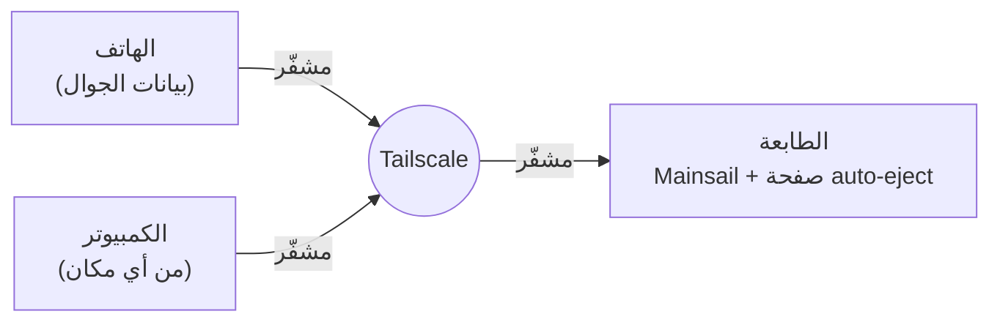

[klipper-auto-eject](../../README.md) › [العربية](README.md) › التحكم عن بعد

# التحكم عن بعد

راقب الطابعة وتحكّم فيها من هاتفك، من أي مكان: خريطة السرير، وقائمة الطباعة، والإزالة، والكاميرا.
وكل ذلك دون أن تفتح الطابعة على الإنترنت.

> [!WARNING]
> لا تفتح أبدًا منفذًا في الراوتر يوصل إلى الطابعة (80 أو 7125 أو أي منفذ آخر). Moonraker
> وMainsail يتحكمان في الآلة كلها: السخانات والمحركات والملفات. وأي شخص يعثر على هذا المنفذ
> يستطيع استخدامهما. الطريقة الموضحة بالأسفل تُبقي الطابعة خاصة بك.

## طريقة العمل

[Tailscale](https://tailscale.com) يصنع شبكة خاصة بين أجهزتك أنت: الطابعة وهاتفك وحاسوبك. كل جهاز
يأخذ عنوانًا مثل `100.87.12.34`. هذا العنوان يعمل في أي مكان يصل فيه الجهاز إلى الإنترنت: في البيت،
أو في العمل، أو على بيانات الهاتف. الاتصال مشفّر من طرف إلى طرف، ولا يستطيع أي شيء آخر الوصول إلى
الطابعة. وهو مجاني للاستخدام الشخصي.



## الإعداد (حوالي 10 دقائق)

1. **أنشئ حسابًا في Tailscale** من [tailscale.com](https://tailscale.com) (سجّل الدخول بحساب Google
   أو Apple أو Microsoft أو GitHub).
2. **على الطابعة**، عبر SSH:
   ```bash
   ~/klipper-auto-eject/install.sh --remote
   ```
   يسألك قبل كل خطوة، ويطلب كلمة المرور عندما يحتاجها:
   - يثبّت Tailscale إن لم يكن موجودًا،
   - يربط الطابعة بحسابك: يعرض رابط تسجيل دخول، افتحه على أي جهاز،
   - يسمح للأجهزة التي على شبكة Tailscale الخاصة بك باستخدام Mainsail وصفحة auto-eject (يضيف
     `100.64.0.0/10` إلى `trusted_clients` في Moonraker بعد أخذ نسخة احتياطية من `moonraker.conf`،
     ثم يعيد تشغيل Moonraker عندما لا تكون الطابعة مشغولة)،
   - يجعل الطابعة متاحة عبر HTTPS، انظر [بالأسفل](#https).

   في النهاية يعرض العنوان الذي تفتحه على هاتفك.
3. **على هاتفك**، ثبّت تطبيق Tailscale (من Google Play أو App Store)، وسجّل الدخول بالحساب نفسه،
   ثم شغّله.
4. **افتح العنوان** في متصفح الهاتف: Mainsail على `http://100.x.y.z/`، وصفحة auto-eject على
   `http://100.x.y.z/auto-eject/`.

**نجح الإعداد إذا** ظهرت الطابعة متصلة في Mainsail وشبكة Wi-Fi في الهاتف مطفأة.

في صفحة auto-eject، داخل تبويب **الشفرة والإعداد**، توجد بطاقة **الموبايل والتحكم عن بعد**. تعرض
البطاقة طريقة اتصالك، وما الذي ما زال ناقصًا.

## HTTPS

لا تسمح الهواتف بتثبيت صفحة ويب كتطبيق، ولا تسمح لها بإرسال إشعارات، إلا إذا وصلت الصفحة عبر
HTTPS. ويعطي Tailscale الطابعة عنوان HTTPS حقيقيًا مجانًا:

1. في [لوحة إدارة Tailscale](https://login.tailscale.com/admin/dns)، في صفحة **DNS**، فعّل
   **MagicDNS** و**HTTPS Certificates**.
2. على الطابعة (الأمر `install.sh --remote` يفعل هذا نيابةً عنك):
   ```bash
   sudo tailscale serve --bg 80
   ```
3. أصبحت الطابعة الآن على `https://<printer-name>.<your-tailnet>.ts.net/`، وصفحة auto-eject على
   `https://<printer-name>.<your-tailnet>.ts.net/auto-eject/`.

هذا العنوان يعمل فقط للأجهزة التي على شبكة Tailscale الخاصة بك. لإيقافه:
`sudo tailscale serve --https=443 off`.

## باليد، بدون المثبت

```bash
curl -fsSL https://tailscale.com/install.sh | sh
sudo tailscale up
```

بعد ذلك، في `moonraker.conf`، أضف نطاق Tailscale إلى `trusted_clients` ثم أعد تشغيل Moonraker:

```ini
[authorization]
trusted_clients:
    192.168.0.0/16
    100.64.0.0/10
```

## من يستطيع التحكم في الطابعة

كل جهاز على شبكة Tailscale الخاصة بك، ولا شيء غيرها. ومن يعرف العنوان لا يستطيع استخدامه: اسم
`https://….ts.net` ليس له عنوان على الإنترنت العام (يظهر في سجلات الشهادات العامة، مثل أي اسم
HTTPS، لكن هذا لا يفتح أي طريق للدخول)، وعنوان `100.…` لا يمكن الوصول إليه إلا من خلال شبكة
Tailscale الخاصة بك. يجب أن يعرض الأمر `tailscale serve status` عبارة **tailnet only**. لا تفعّل
أبدًا `tailscale funnel` للطابعة: Funnel ينشرها على الإنترنت كله.

إذا كنت تشارك شبكة Tailscale مع أشخاص آخرين، أو تشغّل عليها خوادم، فاسمح لأجهزتك أنت فقط بالوصول
إلى الطابعة باستخدام [ضوابط الوصول في Tailscale](https://tailscale.com/kb/1018/acls). أما كتابة
عناوين أجهزتك (`100.x.y.z`) في `trusted_clients` بدل `100.64.0.0/10` فتحمي عنوان `100.…` فقط:
فعبر عنوان HTTPS يرى Moonraker كل طلب وكأنه قادم من الطابعة نفسها.

## تطبيقات الهاتف والكاميرا

- **صفحة auto-eject** تعمل في أي متصفح على الهاتف. وعبر HTTPS يمكن تثبيتها كتطبيق له أيقونته
  الخاصة ([web-page.md](web-page.md)).
- **[Mobileraker](https://mobileraker.app)** (Android وiOS) تطبيق كامل لـ Klipper. أضف الطابعة
  بعنوانها في Tailscale. ولتصلك إشعاراته والتطبيق مغلق، ثبّت البرنامج المرافق له (companion) على
  الطابعة:
  ```bash
  cd ~ && git clone https://github.com/Clon1998/mobileraker_companion.git && ./mobileraker_companion/scripts/install.sh
  ```
- **الكاميرا**: أي كاميرا ويب USB تعمل مع crowsnest، الذي يثبّته MainsailOS وKIAUH
  ([crowsnest](https://github.com/mainsail-crew/crowsnest)). أضفها في إعدادات Mainsail تحت
  **Webcams**، وستعرضها صفحة auto-eject في تبويب **نظرة عامة**.

## طابعات كثيرة

اضبط التحكم عن بعد على طابعة واحدة فقط، وأضف الطابعات الأخرى إلى
[مزرعة الطابعات](farm.md) فيها: سترى كل الطابعات من هاتفك عبر هذه الطابعة الواحدة، دون تثبيت
Tailscale على الأخرى.

## الإشعارات

الأمر `install.sh --push` يرسل إشعارًا إلى تطبيق auto-eject على هاتفك عندما تحتاجك الطابعة، حتى
والتطبيق مغلق. والضغط على الإشعار يفتح الصفحة ([notifications.md](notifications.md)).

## بدون Tailscale

[Obico](https://www.obico.io) و[OctoEverywhere](https://octoeverywhere.com) يقدّمان التحكم عن بعد
عبر خوادمهما الخاصة، مع تطبيق وكاميرا واكتشاف لفشل الطباعة. البدء بهما أسهل، ولهما خطط مجانية،
لكن بيانات طابعتك تمر عبر السحابة الخاصة بهما.

## المشاكل وحلولها

| ما تراه | ما تفعله |
|---|---|
| يفتح Mainsail لكنه لا يتصل، أو تقول الصفحة إن الدخول غير مسموح | نطاق Tailscale غير موجود في `trusted_clients` بعد، أو لم يُعَد تشغيل Moonraker بعد إضافته |
| لا يفتح أي شيء على الهاتف | شغّل تطبيق Tailscale على الهاتف. وعلى الطابعة، يجب أن يعرض الأمر `tailscale status` الهاتف متصلًا |
| يعمل في البيت لكن لا يعمل خارجه | فتحت عنوان البيت (`192.168…`). استخدم عنوان `100.…` أو عنوان `https://….ts.net` |
| عنوان `https://` لا يفتح | فعّل MagicDNS وHTTPS Certificates في لوحة الإدارة، ثم شغّل `sudo tailscale serve --bg 80`. والأمر `tailscale serve status` يعرض ما هو متاح |
