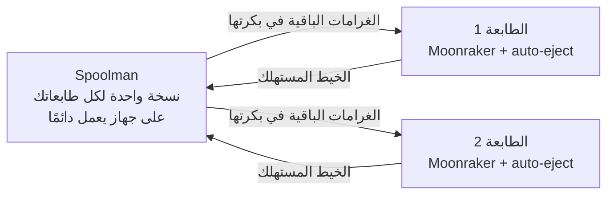

[klipper-auto-eject](../../README.md) › [العربية](README.md) › البكرة وSpoolman

# Spoolman: هل تكفي البكرة قائمة الطباعة؟

لا فائدة من قائمة طباعة تعمل طوال الليل إذا نفدت البكرة في منتصف مهمة.
[Spoolman](https://github.com/Donkie/Spoolman) يعرف كم بقي في كل بكرة من بكراتك. ومعه يقارن
auto-eject قائمة الطباعة بالبكرة المركّبة على الطابعة، ويوقف القائمة **قبل** المهمة التي لا تكفيها
البكرة.

لا شيء تحتاج إلى تشغيله في auto-eject: عندما يكون Moonraker مربوطًا بـ Spoolman، تجده الصفحة والخدمة
وحدهما. ومن دون Spoolman لا يتغير شيء.

| أين | ماذا تجد |
|---|---|
| **قائمة الطباعة** | بطاقة **البكرة**: البكرة المركّبة على الطابعة، وكم بقي فيها، وهل تكفي القائمة. كل مهمة تعرض الغرامات التي تحتاجها، والمهمة التي لا تكفيها البكرة عليها علامة **البكرة لا تكفي**. وزر **تغيير البكرة** يختار بكرة أخرى من بكراتك. |
| **نظرة عامة** | شارة **البكرة** بالغرامات الباقية، ورسالة إذا كانت الطباعة الجارية قد تنفد بكرتها، أو توقفت القائمة بسبب البكرة. |
| **تشغيل القائمة** | إذا كانت البكرة لا تكفي المهمة التالية، يسألك زر **شغّل القائمة** أولًا. |
| **الخدمة** | والصفحة مغلقة، توقف القائمة قبل المهمة التي لا تكفيها البكرة وترسل [إشعارًا](notifications.md). تحتاج خدمة `klipper-auto-eject` (`install.sh --push`). |

<p align="center"></p>

## كيف تتصل الأجزاء ببعضها

Spoolman برنامج صغير مستقل، له صفحة ويب، يحفظ قائمة بكراتك. وهو ليس جزءًا من Klipper ولا من
auto-eject. يخبره Moonraker في كل طابعة بكمية الخيط التي استهلكتها، فيعرف Spoolman دائمًا كم بقي في كل
بكرة. وقبل كل مهمة يسأله auto-eject، عبر Moonraker، كم بقي في البكرة المركّبة على تلك الطابعة.



## أين تثبّت Spoolman

**نسخة واحدة من Spoolman لكل طابعاتك**، على جهاز يعمل كلما طبعت أي طابعة.

| أين | |
|---|---|
| جهاز يعمل دائمًا: Home Assistant، أو NAS، أو Raspberry Pi، أو كمبيوتر صغير | الأفضل، خاصة مع عدة طابعات: إطفاء أي طابعة لا يغيّر شيئًا للباقي |
| إحدى الطابعات | مناسب ولا يحتاج جهازًا إضافيًا، فـ Spoolman صغير. اختر الطابعة التي لا تُطفأ أبدًا |
| نسخة على كل طابعة | لا: لكل طابعة قائمتها، والبكرة التي تنقلها إلى طابعة أخرى لا تُتابع |
| سيرفر على الإنترنت | لا: Spoolman بلا كلمة مرور، فكل من يصل إليه يستطيع تغيير بكراتك. وللوصول إليه من الخارج استخدم Tailscale ([من الهاتف](remote-access.md)) |

وما دام Spoolman مطفأ، تحتفظ الطابعة بما استهلكته وترسله عندما يعود (ويضيع إذا أُعيد تشغيل Moonraker في
هذه الأثناء)، ولا تُفحص القائمة: تقول بطاقة **البكرة** إن Moonraker لا يصل إلى Spoolman.

## الإعداد

1. **ثبّت Spoolman** مرة واحدة على الجهاز الذي اخترته: عبر Docker (وهو ما ينصح به Spoolman)، أو بسكربت
   التثبيت على أي جهاز Linux مثل Raspberry Pi، أو كإضافة في Home Assistant. انظر
   [دليل تثبيت Spoolman](https://github.com/Donkie/Spoolman/wiki/Installation) (بالإنجليزية). تفتح
   صفحته على `http://<ذلك الجهاز>:7912`.
2. **أضف بكراتك** في صفحة Spoolman. أعطِ كل خيط وزنه، وكل بكرة ما فيها: من دون وزن لا يعرف Spoolman كم
   بقي.
3. **اربط كل طابعة به**. سكربت التثبيت يفعل ذلك: على كل طابعة، عبر SSH،

   ```bash
   ~/klipper-auto-eject/install.sh --spoolman
   ```

   يسأل عن عنوان Spoolman (كما في المتصفح، مثلًا `192.168.1.50:7912`)، ويتأكد أن Spoolman يرد عليه،
   ثم يضيف القسم ويعيد تشغيل Moonraker إذا كانت الطابعة لا تطبع. ويدويًا، هو العنوان نفسه في
   `moonraker.conf` لكل طابعة:

   ```ini
   [spoolman]
   server: http://192.168.1.50:7912
   ```

   ثم أعد تشغيل Moonraker (من قائمة التشغيل في Mainsail أو Fluidd، وليس أثناء الطباعة).
4. **حدّد البكرة المركّبة على كل طابعة**: من بطاقة **البكرة** في قائمة الطباعة، أو من Mainsail أو Fluidd.
   وحدّدها من جديد كلما غيّرت البكرة.

لتتوقف القائمة وحدها والصفحة مغلقة، يجب أن تعمل خدمة `klipper-auto-eject` على الطابعة: ‏`install.sh --push`،
أو `--farm` ([الإشعارات](notifications.md)).

## كيف يحسب

- **ما تحتاجه المهمة:** وزن الخيط الذي يكتبه برنامج التقطيع في الملف (يكتبه OrcaSlicer وPrusaSlicer
  وSuperSlicer وCura). والملف الذي لا يذكر إلا الطول يُحسب وزنه بكثافة خيط البكرة وقطره كما في
  Spoolman.
- **ما بقي:** الوزن الباقي في البكرة كما يعرفه Spoolman، ناقصًا ما لم يبلغه به Moonraker بعد.
- **الطباعة الجارية:** الجزء الذي لم يُطبع منها فقط.
- **الاحتياطي:** أوزان برنامج التقطيع تقديرية، لذلك تُترك `spool_reserve` غرامات (10 افتراضيًا). المهمة
  التي تترك في البكرة أقل من ذلك تُعدّ مهمة لا تكفيها البكرة.
- **ما لا يُفحص:** ملف بلا وزن، وملف يطبع بأكثر من خيط (عدة خامات أو تغيير ألوان)، لأن بكرة واحدة لا
  تكفي للحكم عليه. والمهام التي بعده لا تُفحص أيضًا، والبطاقة تقول ذلك.

## الإعدادات

| الإعداد | الافتراضي | ماذا يفعل |
|---|---|---|
| `spool_low_action` | `"stop"` | قبل مهمة لا تكفيها البكرة: `"stop"` يوقف قائمة الطباعة قبلها ويرسل رسالة (يحتاج الخدمة)، و`"notify"` يرسل الرسالة فقط، و`"off"` لا يفحص |
| `spool_reserve` | `10.0` | كم غرامًا تُترك في البكرة، لأن أوزان برنامج التقطيع تقديرية |

غيّرها من تبويب **الإعدادات** (**البكرة (Spoolman)**)، أو في `auto_eject_settings.cfg`، أو بالأمر
`AUTO_EJECT_SET`.

## عندما تتوقف القائمة

يصلك إشعار باسم المهمة وما تحتاجه وما بقي. ركّب بكرة أخرى واخترها (بطاقة **البكرة**، أو Mainsail أو
Fluidd أو Spoolman)، ثم شغّل القائمة.

إذا شغّلت القائمة من جديد بالبكرة نفسها، فلن تتوقف مرة أخرى للمهمة نفسها: أنت قررت.

الطباعة التي بدأت لا تُوقف أبدًا. إذا كانت البكرة قد تنفد أثناءها، تصلك رسالة لتجهّز بكرة أخرى.
أما إيقاف الطباعة عندما ينتهي الخيط فهو عمل حساس نفاد الخيط.
