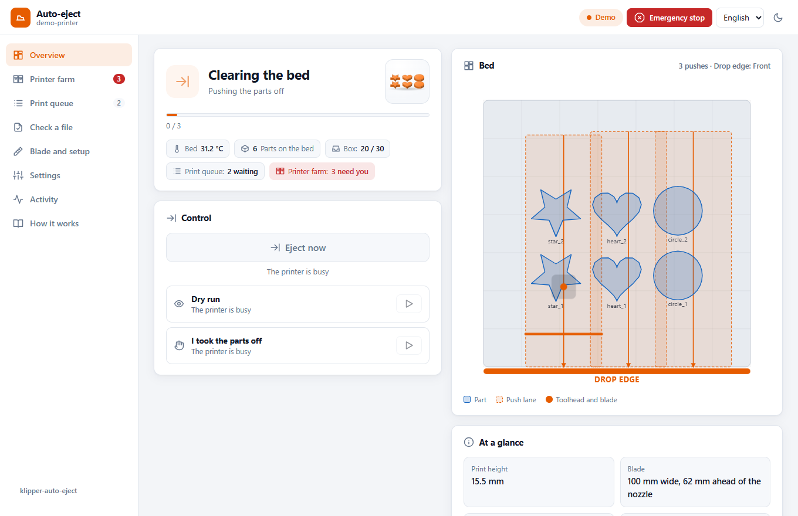
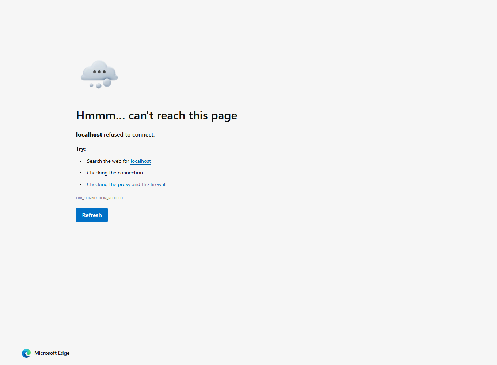
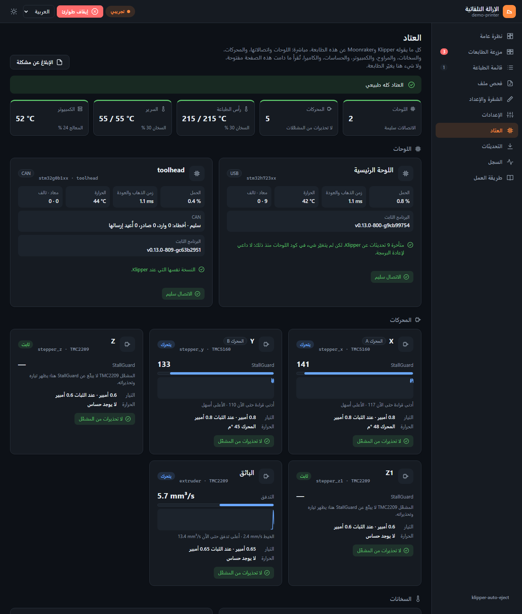
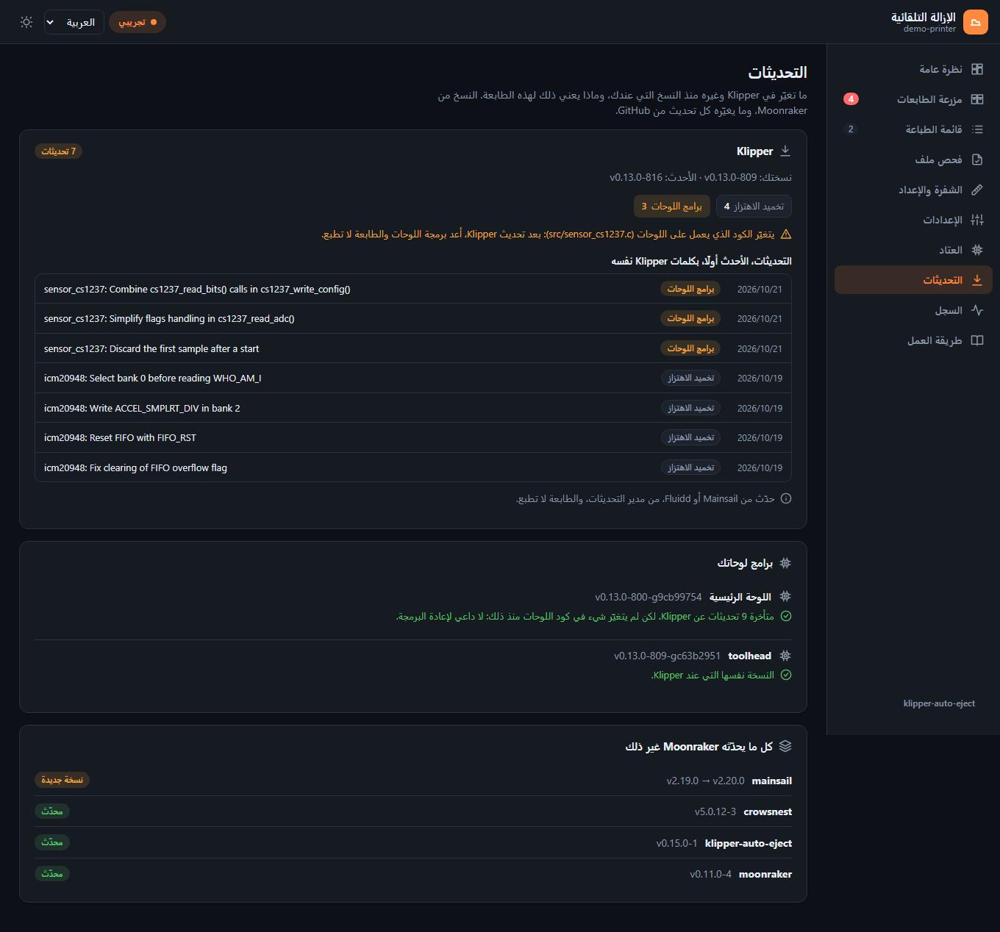
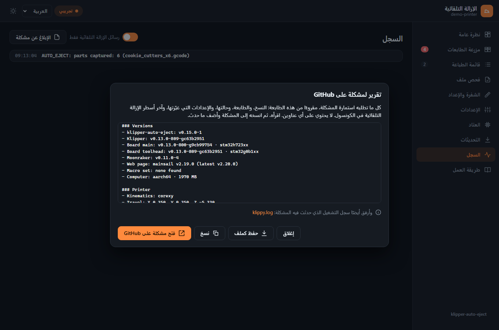
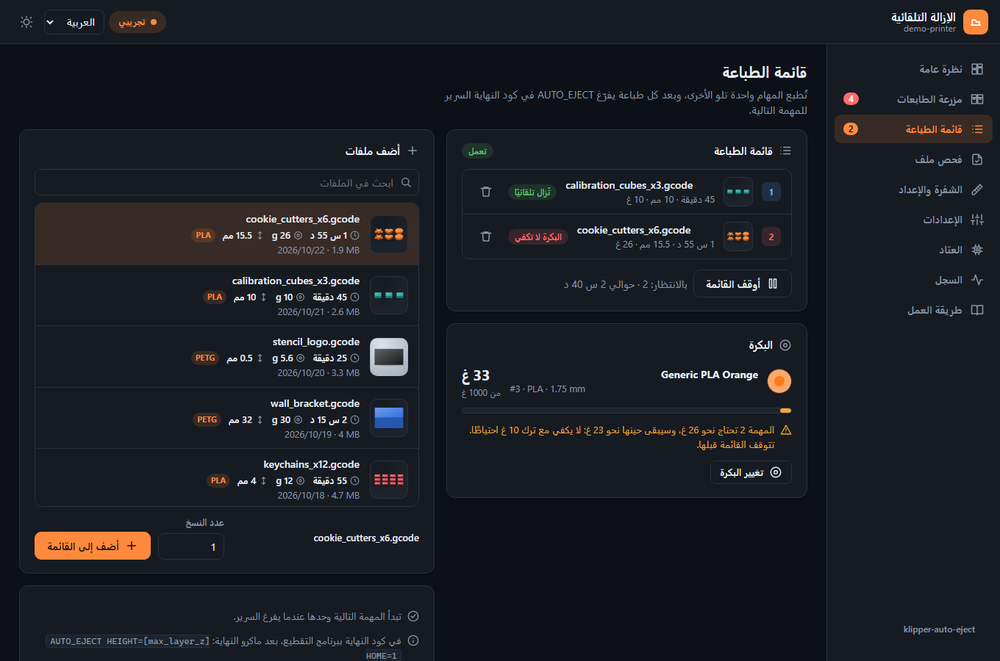
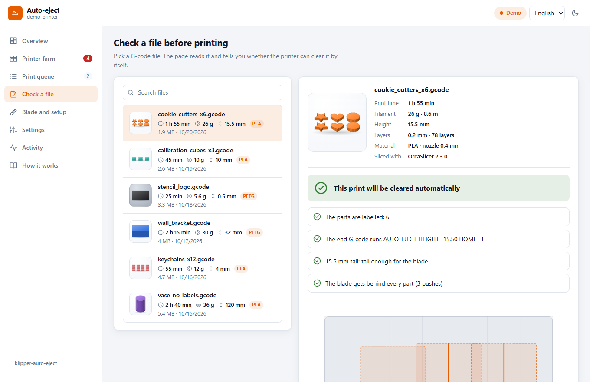

[klipper-auto-eject](../../README.md) › [العربية](README.md) › صفحة الويب

# صفحة الويب

صفحة **الإزالة التلقائية** (Auto-eject) تُضاف إلى واجهة الطابعة على الويب. تعرض ما تفعله الطابعة الآن،
وخريطة للسرير عليها مسارات الدفع، وقائمة الطباعة، وفحصًا لملفات G-code، وإعداد الشفرة، وكل الإعدادات.
في Mainsail يكون لها رابط خاص بها في القائمة الجانبية.

<p align="center"></p>

الصفحة اختيارية. كل ما تفعله يمكن فعله من الكونسول أيضًا، ولا تفعل أبدًا شيئًا لا يستطيعه الكونسول: كل
زر يشغّل أمرًا من [قائمة الأوامر](../commands.md) (بالإنجليزية) أو طلبًا إلى قائمة المهام في Moonraker
(job queue).

**جرّبها دون طابعة:** افتح `web/index.html?demo` من خادم ويب محلي (انظر
[تجربتها على الكمبيوتر](#تجربتها-على-الكمبيوتر)). الطابعة التجريبية تطبع، ثم تبرّد السرير وتفرّغه، ثم
تبدأ المهمة التالية وحدها.

## ما في الصفحة

| القسم | ماذا يفعل |
|---|---|
| **نظرة عامة** | الحالة (جاهزة، تطبع، تبريد السرير، تفريغ السرير، تحتاج تدخلك) مع نسبة التقدم، وأثناء تبريد السرير: الساعة التي يدفع فيها على الأكثر (`cool_timeout`). خريطة السرير تعرض القطع المسجلة، والمسارات التي ستدفع عليها الشفرة، وحافة السقوط، وحركة رأس الطباعة مباشرة. الأزرار: **أزل القطع الآن** (أو **ضبط آمن ثم إزالة** بعد إعادة التشغيل)، و**تجربة بدون دفع**، و**أزلت القطع بيدي**، وعندما تكون القائمة متوقفة: **السرير فارغ، أكمل القائمة**. كل زر يحرّك الطابعة يطلب تأكيدك أولًا. وتظهر الكاميرا إذا كانت معدّة في Moonraker. وشارة **الصندوق** تعدّ القطع في الصندوق تحت حافة السقوط؛ اضغطها بعد أن تفرغه. |
| **مزرعة الطابعات** | يظهر عندما تعمل خدمة `klipper-auto-eject` (`install.sh --farm`). يعرض كل طابعات Klipper على الشبكة، والتي تحتاجك تظهر أولًا، مع أزرار لتقول إن السرير فارغ، أو لتشغّل القائمة، أو لتوقف الطابعة. زر **ابحث في الشبكة** يجدها ويضيفها. انظر [farm.md](farm.md). |
| **قائمة الطباعة** | يظهر عندما يكون في Moonraker قسم `[job_queue]`. أضف ملفات بصورها (ابحث عنها بالاسم، واختر ملفًا، وحدد عدد النسخ)، أو احذفها، أو شغّل القائمة أو أوقفها. كل ملف يظهر بصورته، ويوضح هل ستدفعه الشفرة خارج السرير، أم أنه رفيع جدًا ويبقى عليه. ويوضح القسم هل تنتقل القائمة إلى المهمة التالية وحدها (`automatic_transition`). ومع [Spoolman](spoolman.md)، بطاقة **البكرة**: كم بقي في البكرة المركّبة، وهل تكفي القائمة، والمهمة التي لا تكفيها. |
| **فحص ملف** | كل ملف يظهر بصورته ومدة طباعته والخيط الذي يستهلكه وارتفاعه وخامته. اختر ملفًا وستقرؤه الصفحة: هل القطع معرّفة؟ هل يشغّل كود النهاية `AUTO_EJECT`؟ هل الطباعة عالية بما يكفي؟ هل تصل الشفرة خلف كل قطعة؟ ثم ترسم الخطة على خريطة السرير قبل أن تطبع. وإن كان برنامج التقطيع يحتاج تعديلًا، يفتح زر **اعرض ما ألصقه في السلايسر** الأسطر التي تلصقها. |
| **الشفرة والإعداد** | الشفرة كما قيست (ارتفاعها فوق طرف الفوهة، وبعدها أمام الفوهة، وعرضها) في رسم جانبي، ونوع المجس، وأزرار الإعداد الموجّه وقياس الشفرة والتجربة بدون دفع، وتنزيل قطع الاختبار (قطعة المعايرة، ومقياس ارتفاع الشفرة، ومكعب الاختبار). نوافذ الإعداد تفتح داخل الصفحة نفسها. وبطاقة **في برنامج التقطيع (السلايسر)**: مكان كل إعداد في OrcaSlicer أو PrusaSlicer/SuperSlicer أو Cura، والأسطر التي تلصقها مع زر **نسخ**. كود النهاية يذكر ماكرو النهاية الذي تستخدمه طابعتك فعلًا، من أحدث ملف لديها أو من إعداداتها (`PRINT_END` أو `END_PRINT` أو `DEMON_END`…). ومع DEMON Klipper Essentials تقول البطاقة أن تترك أسطر البداية الخاصة به كما هي وفوقها `AUTO_EJECT_GUARD`، وتنبّه إذا كانت قيمة `home_method` هي `"g28"`. |
| **الإعدادات** | كل إعداد من `auto_eject_settings.cfg`، مجمّعة كما في الملف، مع شرح كل إعداد، ومفتاح تشغيل أو قائمة اختيار أو خانة رقم، ومصدر القيمة (من ملفك، أو محفوظ هنا؛ والقيمة الافتراضية بلا علامة). وتظهر الأقسام على الجانب مع عدد ما ضبطته في كل منها، ويعرض **تغييراتي فقط** هذه الإعدادات وحدها. تُحفظ التغييرات بـ `AUTO_EJECT_SET` وتبقى بعد إعادة التشغيل. ولا يقبل Klipper أي أمر أثناء إخلاء السرير، فالتغيير الذي يحدث عندئذٍ ينتظر انتهاء الإخراج، وتوضح الصفحة ذلك. |
| **العتاد** | كل ما يقوله Klipper وMoonraker عن الطابعة، مباشرة: اللوحات واتصالاتها، والمحركات، والسخانات، والمراوح، والكمبيوتر، والحساسات، والكاميرا، مع سطر يقول هل كل شيء طبيعي، وبطاقة لكل جزء في الأعلى تنقلك إليه. وتحت كل لوحة: هل برنامجها متأخر عن Klipper ويحتاج إلى إعادة برمجة. انظر [العتاد](#العتاد). |
| **التحديثات** | ما تغيّر في Klipper وغيره منذ النسخ التي عندك، من مدير التحديثات في Moonraker: كل تحديث بكلمات Klipper مع ما يخصه (الحركة، السخانات، برامج اللوحات…)، وهل يغيّر الكود الذي يعمل على اللوحات (فتعيد برمجتها بعد التحديث)، وملاحظات Klipper على تغييرات الإعدادات. وبرنامج كل لوحة مقارنةً بـ Klipper، وهل يحتاج إلى إعادة برمجة. ما يغيّره كل تحديث يأتي من GitHub، ومن دون إنترنت تظهر القائمة رغم ذلك. |
| **السجل** | رسائل الإزالة التلقائية من الكونسول، الأحدث أولًا. وزر **الإبلاغ عن مشكلة** (هنا وفي **العتاد**) يجمع ما تطلبه استمارة المشكلة على GitHub: النسخ، والطابعة، وحالتها، والإعدادات التي غيّرتها، والكونسول، دون أي عناوين، لتنسخه إلى المشكلة. |
| **طريقة العمل** | الشرح المصوّر. |

الصفحة متاحة بالإنجليزية والعربية (من اليمين إلى اليسار)، بالوضع الفاتح والداكن، وتعمل على الهاتف. تختار
لغة المتصفح ووضعه تلقائيًا، ويمكنك تغيير الاثنين من أعلى الصفحة.

### الإعدادات

كل إعداد مع شرحه وخانته، مقسّمة بأقسام الملف. تظهر الأقسام على الجانب مع عدد ما ضبطته في كل منها، ويضيّق
البحث و**تغييراتي فقط** القائمة. ولا تُعلَّم إلا قيمك أنت: **من ملفك** لما في `auto_eject_settings.cfg`، و**محفوظ
هنا** لتغيير من الصفحة، ويعيده السهم الدائري.

<p align="center"></p>

### العتاد

يعرض تبويب **العتاد** ما يبلّغ عنه Klipper وMoonraker عن الطابعة، ويقرؤه ما دام التبويب مفتوحًا (Klipper مرة كل
ثانية) دون أن يغيّر شيئًا. يظهر كل جزء فقط إن كان موجودًا في الطابعة. والسطر العلوي يقول **العتاد كله طبيعي** أو ما
يحتاج نظرة.

<p align="center"></p>

| القسم | ماذا يعرض | متى يحذّر |
|---|---|---|
| **اللوحات** | كل لوحة تحكم (الرئيسية، ولوحة رأس الطباعة، وعملية المضيف): شريحتها، واتصالها USB أو CAN أو تسلسلي، وحملها، وزمن الذهاب والعودة، والبايتات المعاد إرسالها والتالفة، وبرنامجها الثابت، وحرارتها إن كان عليها حساس `temperature_mcu`. ولوحات CAN تضيف حالة الناقل وعدد الأخطاء. | بايتات يُعاد إرسالها أو تصل تالفة أثناء فتح الصفحة (كابل أو موصل أو تشويش)، وناقل CAN غير سليم |
| **المحركات** | أدناه | تحذيرات المشغّل، ومحرك ساخن |
| **السخانات** | الحرارة والمطلوب، وقدرة السخان، وآخر عشر دقائق | سخان وصل إلى حرارته ثم لا يستطيع الحفاظ عليها بأقصى قدرة، أو أسخن بكثير من المطلوب |
| **المراوح** | سرعة كل مروحة، ودوراتها في الدقيقة إن كان لها حساس سرعة، وحرارة مراوح الحرارة | مروحة يجب أن تدور ولا تدور (يحتاج حساس سرعة) |
| **الكمبيوتر** | استخدام المعالج وحرارته، والذاكرة، والتخزين، وحمل النظام، ومدة التشغيل، وكل واجهة شبكة بأخطائها ورسائلها الضائعة (وواجهة CAN بسرعتها) | معالج ساخن، أو ذاكرة أو تخزين على وشك النفاد، أو جهد منخفض في Raspberry Pi، أو أخطاء جديدة على واجهة CAN |
| **الحساسات** | كل حساس حرارة بأدنى وأعلى قراءة له، وحساسات الخيط | لا خيط أثناء الطباعة |
| **الكاميرا** | تعمل أم لا، ودقتها وإطاراتها في الثانية مع ustreamer | كاميرا توقفت عن الرد |
| **المشكلات** | كل تحذير أثناء فتح الصفحة، والطبعات التي توقفت بخطأ | |

**والصفحة مغلقة.** مع خدمة الإشعارات (`install.sh --push`) تراقب الطابعة التحذيرات المهمة طوال الوقت وترسلها إلى
الهواتف التي فعّلت الإشعارات في التطبيق: مروحة لها حساس سرعة توقفت، وتحذير من مشغّل، ومحرك فوق 70 °م (بحساس عليه)،
واتصال لوحة يعيد إرسال البيانات (200 بايت في عشر دقائق) أو يرسل بيانات تالفة، وناقل CAN غير سليم، وسخان لا يحافظ
على حرارته، والكمبيوتر ساخن أو جهده منخفض أو ذاكرته أو تخزينه على وشك النفاد. يجب أن يستمر التحذير بضع ثوانٍ، ويُرسل
مرة واحدة، ثم لا يُرسل ثانيةً إلا بعد أن يزول ويعود. ولا ترسل StallGuard ولا «الملف مفصول؟» أي إشعار. ويمكن لكل
هاتف إيقافها: **وتحذيرات العتاد أيضًا**.

#### المحركات

يعرض قسم المحركات كل محرك له مشغّل TMC (‏TMC2130 و2208 و2209 و2224 و2240 و2660 و5160): محوري X
وY، وكل محركات Z، وكل باثق. ويعرض لكل محرك:

- هل هو **يتحرك** أم **ثابت** أم **متوقف**، وتياره (أثناء الدوران وعند الثبات)؛
- للباثق **تدفقه** بدلًا منها: الخيط عبر رأس الطباعة بالمم³/ث، وآخر عشر دقائق، وأعلاه حتى الآن، لتقارنه بما
  يستطيع رأس الطباعة صهره (الباثق يدور ببطء لا يكفي لـ StallGuard)؛
- قراءة **StallGuard** مع خط لآخر عشر دقائق: مدى سهولة دوران المحرك، والأعلى أسهل. تنخفض حين يُجهَد المحرك،
  وتنخفض أيضًا عند السرعة البطيئة، فليست إنذارًا وحدها؛ وإن قاربت 0 والمحرك يدور بسرعة فهو قريب من فقدان
  الخطوات (انزياح الطبقات). لا يبلّغ عنها هنا إلا TMC2130 و2240 و2660 و5160؛ أما TMC2208 و2209 و2224 فلا؛
- تحذيرات مشغّله: السخونة الزائدة، والقِصر مع الأرضي أو التغذية، وانخفاض جهد التغذية، والملف المفصول (وهذا
  مجرد تلميح: تظهره المشغّلات عند الثبات أو السرعة العالية والملف موصول)؛
- حرارة المحرك نفسه إن كان عليه حساس (انظر أدناه).

في CoreXY وCoreXZ يُعلَّم محركا السير بـ **المحرك A** (‏stepper_x) و**المحرك B**.

**حرارة المحرك نفسه.** ألصق ثرمستور 100K على جسم المحرك، وصِله بمدخل ثرمستور فارغ، وأضفه باسم المحرك:

```ini
[temperature_sensor motor_a]
sensor_type: Generic 3950
sensor_pin: PF6        # مدخل ثرمستور فارغ في لوحتك
```

الأسماء التي يتعرف عليها: `motor_x` و`motor_y` و`motor_z` و`motor_e` (أو `stepper_x`…)، و`motor_a`
و`motor_b` لمحركي السير في CoreXY. ويعرضها التبويب على بطاقة ذلك المحرك، بالبرتقالي من 65 °م وبالأحمر من 80 °م.

### التحديثات

يعرض تبويب **التحديثات** ما تغيّر في Klipper منذ نسختك، كما يراه مدير التحديثات في Moonraker، وماذا يعني
ذلك لهذه الطابعة:

- كل تحديث بكلمات Klipper نفسه، مع ما يخصه: الحركة، أو السخانات، أو تخميد الاهتزاز، أو برامج اللوحات، أو
  التوثيق…؛
- هل تغيّر التحديثات الكود الذي يعمل على اللوحات: عندها أعد برمجتها بعد تحديث Klipper. وإن لم يغيّره أي
  تحديث، فلا تحتاج إلى إعادة برمجة؛
- ملاحظات Klipper على تغييرات الإعدادات (`docs/Config_Changes.md`)، عندما يضيف تحديث ملاحظة؛
- برنامج كل لوحة مقارنةً بـ Klipper: كم تحديثًا متأخرة، وهل تغيّر كود اللوحات منذ ذلك. والسطر نفسه تحت كل
  لوحة في **العتاد**؛
- كل ما يحدّثه Moonraker غير ذلك (Moonraker، وMainsail أو Fluidd، وcrowsnest، والإزالة التلقائية…)، وما له
  نسخة جديدة أولًا.

وعندما يكون Klipper محدّثًا، يعرض آخر التحديثات التي عندك. وما يغيّره كل تحديث يقرؤه متصفحك من GitHub ويحتفظ
به؛ ومن دون إنترنت تظهر القائمة رغم ذلك. أما التحديث نفسه فيبقى من Mainsail أو Fluidd.

<p align="center"></p>

### الإبلاغ عن مشكلة

زر **الإبلاغ عن مشكلة**، في **العتاد** و**السجل**، يجمع ما تطلبه استمارة المشكلة على GitHub: النسخ (الإزالة
التلقائية، وKlipper، وكل لوحة، وMoonraker، وصفحة الويب، ومجموعة الماكرو)، والطابعة، وحالتها، والإعدادات التي
غيّرتها عن الافتراضي، وآخر أسطر الإزالة التلقائية في الكونسول. وتُحذف منه عناوين IP وأسماء الأجهزة. انسخه أو
احفظه كملف، والصقه في مشكلة جديدة مع ما حدث، وأرفق `klippy.log` من الرابط تحته.

<p align="center"></p>

### صور المطبوعات

الملفات في **فحص ملف** وقائمة الطباعة ومزرعة الطابعات ونافذة **اطبع** فيها تظهر بالصورة التي يضعها
برنامج التقطيع في ملف G-code، ومعها ما يقوله الملف عن الطباعة: المدة، والخيط، والارتفاع، والخامة.
وتعرض **نظرة عامة** صورة الطبعة التي على السرير. والقطعة السوداء على الصفحة الداكنة، أو البيضاء على
الصفحة الفاتحة، تظهر على خلفية تبرزها.

<p align="center"></p>

يحفظ Moonraker الصور بجوار الملفات، ولا يلزم تثبيت أي شيء آخر. لكن برنامج التقطيع يجب أن يضعها في الملف:

| برنامج التقطيع | الإعداد |
|---|---|
| OrcaSlicer | Printer settings › Basic information › **G-code thumbnails**، مثلًا `300x300/PNG` |
| PrusaSlicer / SuperSlicer | Printer Settings › General › Firmware › **G-code thumbnails**، مثلًا `32x32/PNG, 300x300/PNG` |
| Cura | Extensions › Post Processing › Modify G-Code › Add a script › **Create Thumbnail** |

الملف الذي ليست فيه صورة يظهر بمربع بسيط. والملفات التي قُطّعت قبل تفعيل الإعداد تحتاج إلى تقطيعها من جديد.

<p align="center"></p>

## التثبيت

```bash
~/klipper-auto-eject/install.sh --web
```

يحتاج هذا إلى `sudo` مرة واحدة (يطلب كلمة المرور)، لأن nginx هو الذي يقدّم الصفحة، وهو خادم الويب نفسه
الذي يقدّم Mainsail أو Fluidd. السكربت:

1. يكتب `/etc/nginx/auto-eject.conf`، الذي يقدّم الصفحة من المستودع على
   `http://<printer>/auto-eject/`.
2. يضيف سطر `include` واحدًا له إلى موقع Mainsail أو Fluidd في `/etc/nginx/sites-enabled/`
   (وتُحفظ نسخة احتياطية في `/etc/nginx/`)، ثم يفحص النتيجة بـ `nginx -t` ويعيد تحميل nginx.
   إذا لم يقبلها nginx، يعيد الملف القديم كما كان.
3. يضيف رابط **Auto-eject** إلى القائمة الجانبية في Mainsail، في الملف `.theme/navi.json` داخل مجلد
   الإعدادات. أعد تحميل Mainsail لتراه.

الصفحة موجودة داخل المستودع، لذلك يحدّثها مدير التحديثات في Moonraker مع الماكروهات. إعادة تحميل nginx
لا تقطع الطباعة. والأمر `install.sh --uninstall` يزيل الثلاثة.

**Fluidd** لا يسمح بإضافة روابط خاصة إلى قائمته الجانبية: احفظ `http://<printer>/auto-eject/` في
المفضلة.

### التثبيت اليدوي

أضف هذا داخل كتلة `server { ... }` في موقع Mainsail أو Fluidd
(`/etc/nginx/sites-available/mainsail` في أغلب التثبيتات)، وضع المسار الخاص بك:

```nginx
location = /auto-eject/ { absolute_redirect off; return 302 /auto-eject/web/; }
location ~ ^/auto-eject/(.*/)?\. { deny all; }
location /auto-eject/ {
    alias /home/pi/klipper-auto-eject/;
    index index.html;
    add_header Cache-Control "no-cache";
}
```

بعدها نفّذ `sudo nginx -t && sudo systemctl reload nginx`. ولرابط القائمة الجانبية في Mainsail، أنشئ
`.theme/navi.json` في مجلد الإعدادات (أو أضف العنصر إلى الملف الموجود عندك):

```json
[
  {
    "title": "Auto-eject",
    "href": "/auto-eject/web/",
    "target": "_self",
    "position": 35,
    "icon": "M2 11h12V7l6 5-6 5v-4H2z M20 4h2v16h-2z"
  }
]
```

## المتطلبات

- klipper-auto-eject مثبّت ومضاف إلى `printer.cfg` بأسطر include (الصفحة تخبرك إذا لم تجد الماكروهات).
- Moonraker، ويمكن الوصول إليه عبر nginx نفسه (وهذا هو تثبيت Mainsail أو Fluidd المعتاد).
- يجب أن يسمح Moonraker للمتصفح بالدخول، كما يسمح لـ Mainsail: أي أن تكون شبكته في `trusted_clients`
  داخل `moonraker.conf`. الصفحة لا تسجّل الدخول.
- قسم `[save_variables]` في `printer.cfg`، حتى تبقى الإعدادات المعدّلة بعد إعادة التشغيل. بدونه تبقى
  حتى إعادة التشغيل التالية فقط، والصفحة تخبرك بذلك.
- اختياري: `[job_queue]` في `moonraker.conf` لقسم قائمة الطباعة، وكاميرا معدّة في Moonraker لصورة
  الكاميرا.

لا يُحمَّل أي شيء من الإنترنت: الصفحة مكتوبة بـ HTML وCSS وJavaScript فقط، وتعمل على طابعة بلا اتصال
بالإنترنت.

## على هاتفك كتطبيق

<p align="center"></p>

على الهاتف تنتقل الأقسام إلى شريط تبويبات في أسفل الشاشة. وتبتعد الصفحة عن النتوء في أعلى الشاشة
(notch) والزوايا المستديرة وشريط الشاشة الرئيسية في الأسفل، على أي هاتف، ومنها الهواتف القابلة للطي
والأجهزة اللوحية.

عبر HTTPS يمكن تثبيت الصفحة كتطبيق له أيقونته الخاصة، ويفتح دون أشرطة المتصفح. جهّز
[الوصول عن بعد](remote-access.md) مع HTTPS (`install.sh --remote`)، وافتح
`https://<printer>.<your-tailnet>.ts.net/auto-eject/` على الهاتف، ثم:

| الهاتف | الطريقة |
|---|---|
| Android (Chrome وEdge وSamsung Internet) | زر **ثبّت التطبيق** في تبويب **الشفرة والإعداد** بالصفحة، أو من قائمة المتصفح: **تثبيت التطبيق** |
| iPhone وiPad (Safari) | **مشاركة**، ثم **إضافة إلى الشاشة الرئيسية** |

بطاقة **الموبايل والتحكم عن بعد** في تبويب **الشفرة والإعداد** توضح الطريقة المناسبة للجهاز الذي في يدك.
يحتفظ التطبيق بنسخة من ملفاته، لذلك يفتح حتى عند انقطاع الاتصال ويخبرك أن الطابعة غير متاحة. أما كل ما
يخص الطابعة فيأتي دائمًا مباشرة من Moonraker. عبر HTTP العادي (عنوان شبكة المنزل) لا تثبّت المتصفحات
الصفحات كتطبيقات، لكن إضافة الصفحة إلى الشاشة الرئيسية تعمل كاختصار.

## تغيير إعداد من الكونسول

تحفظ الصفحة الإعدادات بماكرو يمكنك أن تستخدمه بنفسك أيضًا:

```
AUTO_EJECT_SET KEY=cool_temp VALUE=35
AUTO_EJECT_SET KEY=verify VALUE=off
AUTO_EJECT_SET KEY=cool_temp RESET=1
```

تُفحص القيمة حسب نوع الإعداد (رقم للأرقام، وon/off للمفاتيح)، ثم تُحفظ في `[save_variables]` مثل قيم
الإعداد الموجّه. وتحل محل القيمة في `auto_eject_settings.cfg` حتى تعيد ضبطها. القيم النصية لا يمكن أن
تحتوي على مسافات أو علامات تنصيص أو `#` أو `;`، ولمثل هذه القيم عدّل الملف نفسه.

ينفّذ Klipper أمرًا واحدًا في كل مرة، والإخراج كله أمر واحد طويل، بما فيه التبريد. فالإعداد الذي يتغير
أثناء إخلاء السرير لا يُنفَّذ إلا بعد انتهاء الإخراج: لتدفع الشفرة أسرع، غيّر `cool_temp` أو `cool_timeout`
قبل أن تنتهي الطباعة.

## تجربتها على الكمبيوتر

من نسخة من المستودع على جهازك:

```bash
python3 -m http.server 8000
```

ثم افتح `http://localhost:8000/web/?demo`. إضافات مفيدة إلى العنوان:

| | |
|---|---|
| `?demo=eject` | تبدأ الطابعة التجريبية تفريغ السرير وحدها |
| `?demo=print` | تبدأ الطابعة التجريبية الطباعة التالية وحدها |
| `&lang=ar`، `&lang=en` | اللغة |
| `&theme=dark`، `&theme=light` | الوضع الداكن أو الفاتح |
| `?printer=http://printer.local:7125` | التحكم في طابعة حقيقية من الكمبيوتر. يجب أن يكون عنوان الكمبيوتر في `cors_domains` داخل `moonraker.conf` على تلك الطابعة. |

## الترجمة

النصوص موجودة في `web/lang/`. انسخ `en.js` إلى ملف جديد باسم رمز اللغة، وترجم القيم (واترك
`{placeholders}` كما هي)، وغيّر السطر الأول إلى رمز لغتك واسمها واتجاهها (`"ltr"` أو `"rtl"`)، ثم أضف
سطر `<script>` لها في `web/index.html`. أي نص لا تترجمه يظهر بالإنجليزية. أسماء الإعدادات ورسائل
الكونسول تبقى بالإنجليزية.

## مكونات الصفحة

| الملف | |
|---|---|
| `web/index.html` | الصفحة |
| `web/app.js` | العروض والأزرار والاتصال بـ Moonraker |
| `web/model.js` | المنطق: خطة الدفع، وقراءة ملف الإعدادات، وفحص G-code، ونوافذ الإعداد. يفعل ما تفعله الماكروهات، والملف `tests/test_web.py` يقارن بين الاثنين |
| `web/moonraker.js` | عميل websocket صغير لـ Moonraker |
| `web/demo.js` | الطابعة التجريبية لـ `?demo` |
| `web/style.css` | التنسيقات: الوضع الفاتح والداكن، وتخطيط الهاتف |
| `web/manifest.json`، `web/sw.js`، `web/icons/` | ما يجعلها تطبيقًا: الاسم والأيقونات، وعامل الخدمة (service worker) الذي يحتفظ بنسخة من ملفات الصفحة |

يُبنى قسم الإعدادات من التعليقات في `config/auto_eject_settings.cfg`، لذلك يظهر أي إعداد جديد في الصفحة
مع شرحه دون تغيير الصفحة.
