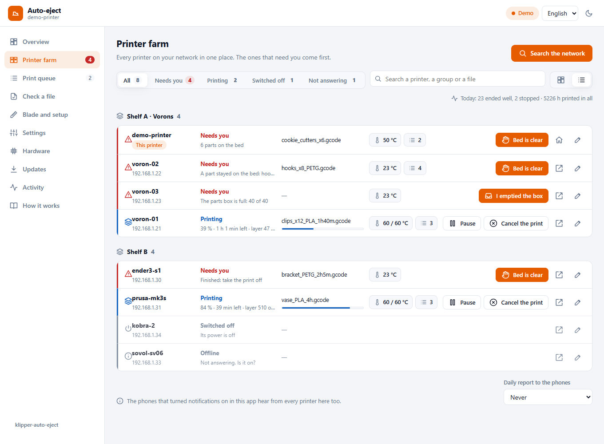
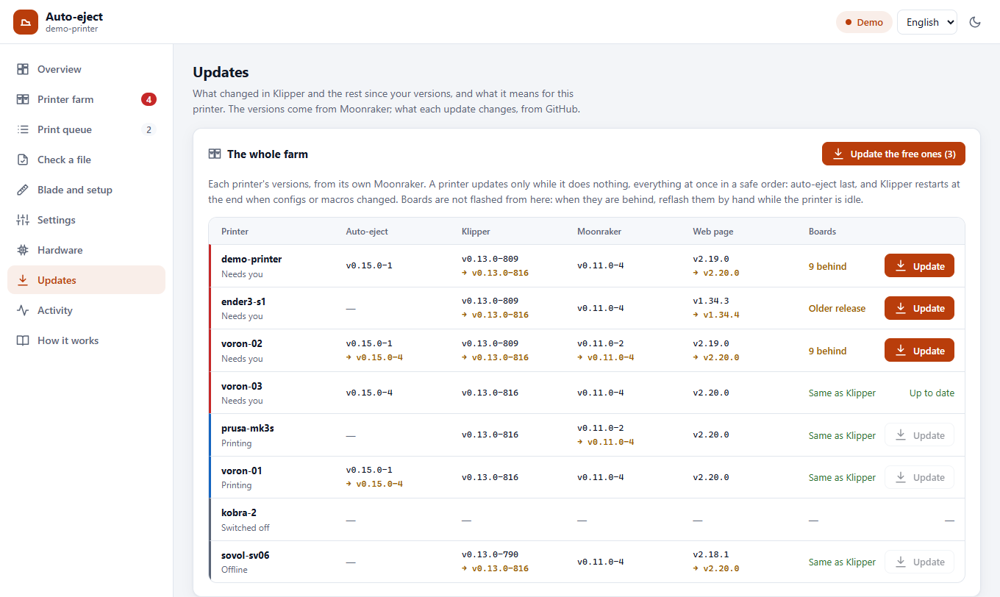
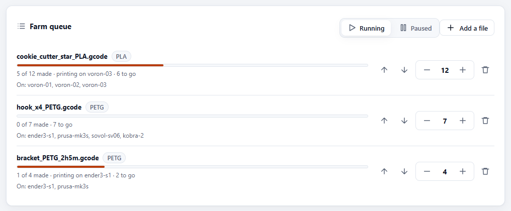
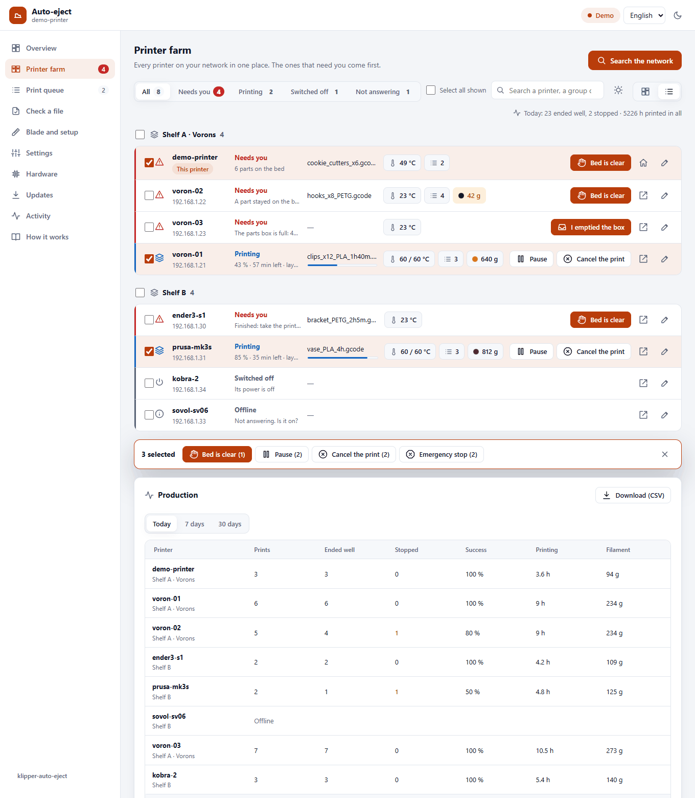
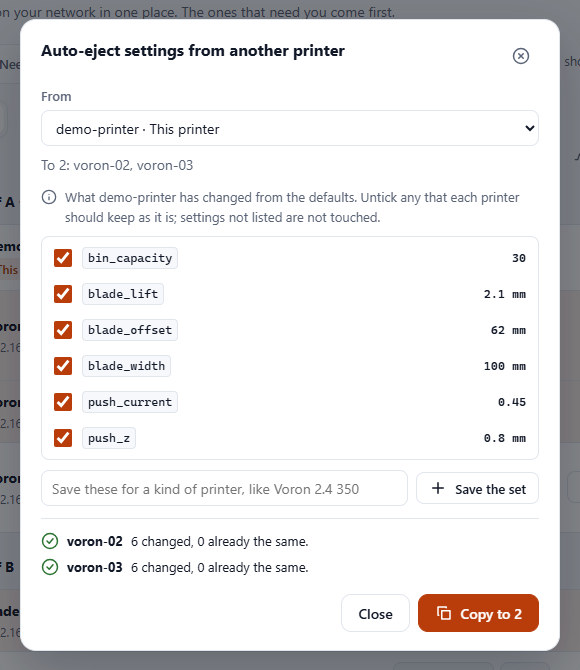
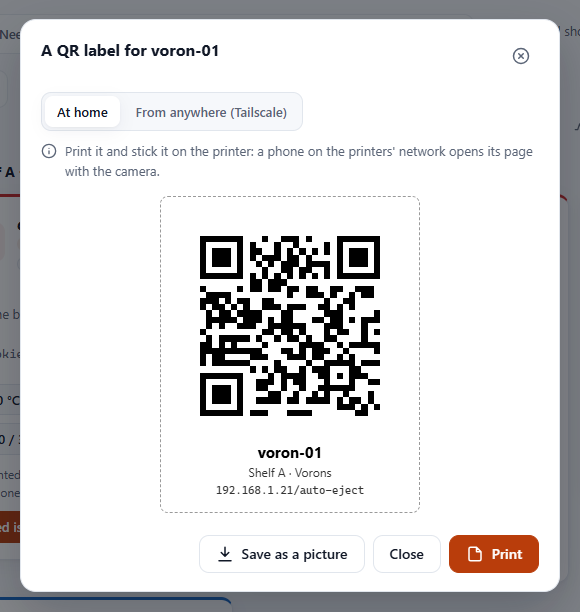

[klipper-auto-eject](../README.md) › [Documentation](README.md) › Printer farm

# Printer farm

Every Klipper printer on your network on one page, with the ones that need you first: a print
to take off, a part that stayed on the bed, an error, a paused queue. You install it on **one
printer only**. It searches the network, finds the other printers and adds them; **the other
printers need nothing installed**.

| A card shows | |
|---|---|
| **Needs you** | A finished print to take off, a part that stayed on the bed, parts too thin to push, an error, a cancelled print, or a job queue that waits for you. It says which. |
| **Printing** | The file with its picture, how far it is, the time left and the layer |
| **Clearing the bed** | auto-eject is cooling the bed and pushing the parts off |
| **Paused**, **Stopped** | A paused print; Klipper stopped, with its message |
| **Free** | Ready for the next print, and how many jobs wait in its queue |
| **Offline** | Not answering |

<p align="center"></p>

Each card also shows the bed temperature and, if the printer has a camera in Moonraker, its
picture. At the top: how many need you, print, are free or offline. The **Printer farm** tab in
the menu shows the number that need you too.

From each printer's print history in Moonraker, a card also shows the hours it has printed, how
many of its last 50 prints ended well, and today's count. The top line adds up the whole farm:
*Today: 16 ended well, 2 stopped · 4571 h printed in all*. A print stopped means it ended with an
error or was cancelled.

Printers with klipper-auto-eject show their parts, the eject and its problems; any other Klipper
printer shows its print. A finished print on a printer without auto-eject counts as **Needs you**
until you press **Bed is clear**.

## Set it up (5 minutes)

1. **Pick one printer** for the page: any Klipper printer with Moonraker and Mainsail or Fluidd,
   preferably one that stays on. It does not need a blade.
2. **On that printer**, over SSH:
   ```bash
   cd ~ && git clone https://github.com/ahmedbebars/klipper-auto-eject.git
   ~/klipper-auto-eject/install.sh --farm
   ```
   This installs the web page and the `klipper-auto-eject` service, which runs the farm. It
   asks for your password once. If this printer has no blade, add `--no-include`: the farm
   does not need the auto-eject macros.
3. **Open** `http://<that printer>/auto-eject/`, tab **Printer farm**, and press **Search the
   network**. After about 10 seconds it lists the printers it found. Untick any you do not want and
   press **Add**.

<p align="center"></p>

The list is kept on that printer. Press **Search the network** again whenever you add a printer.
The printers you left out are remembered: the next search lists them last, unticked, as "left
out last time", so you can still add one later.

### A printer that is not found

The search asks every address of the printer's own network (the 254 addresses around its own,
such as `192.168.1.1` to `192.168.1.254`) and every Linux device on your Tailscale network. On each
one it looks for Moonraker on port 7125 and port 80. A printer it finds both ways is listed once,
with its local address: it knows it is the same machine by its network card.

- **On another network or VLAN:** type its address under **Add by address**, such as
  `10.0.5.20`.
- **Several Klipper instances on one computer:** add each one by address with its Moonraker port,
  such as `192.168.1.50:7126`.
- **Found but Offline:** its Moonraker does not let the farm printer in. Most installs (KIAUH,
  MainsailOS) let in every address of the local network; if yours does not, add the farm printer's
  address to `trusted_clients` in that printer's `moonraker.conf`. A Moonraker that asks for a
  login or an API key cannot be read.

## The buttons

| Button | What it does | Asks first |
|---|---|---|
| **Bed is clear** | You took the print off. With auto-eject: forgets the stored parts (`AUTO_EJECT_CLEAR`). Without: forgets the finished job (`SDCARD_RESET_FILE`) so the printer shows as free. Nothing moves. | No |
| **Print** | A free printer: pick one of its G-code files (each with its picture, print time and filament), or send it one from your phone or computer (**Send it**, or **Send it and print**). Refused while it prints or while auto-eject knows parts are on its bed | Yes |
| **Pause**, **Resume**, **Cancel the print** | The print running on that printer | Cancel asks |
| **Start the queue** | Starts that printer's Moonraker job queue: the next job prints | Yes |
| **Emergency stop** | Stops that printer at once. It then needs a firmware restart | Yes |
| **Open** | That printer's own page: its auto-eject page if it has one, otherwise Mainsail or Fluidd. Away from its network it opens through Tailscale if that printer has Tailscale; otherwise it shows **Open (on its network)** and does nothing | |
| **I emptied the box** | The printer's parts box is full: you emptied it, it counts from zero again (`AUTO_EJECT_BIN_EMPTY`) | No |
| **Turn on** / **Turn off** | For printers with a power switch in Moonraker (`[power]` in `moonraker.conf`, a smart plug, a relay). Off never happens while it prints or while the nozzle is above 50 °C, because the hotend fan stops with it | Off asks |
| ✎ | Rename the printer here, or remove it from the farm. Nothing changes on the printer itself. With a power switch: **Turn off by itself when it has nothing to do** | |

### Switching printers off by themselves

For a printer with a power switch, ✎ offers **Turn off by itself when it has nothing to do**:
never, or after 15 minutes to 4 hours. Nothing to do means not printing, nothing in its queue and
the nozzle below 50 °C. The farm then switches it off and sends a notification. Use it only for
a switch that powers the printer, not the computer that runs Moonraker, or nothing can switch it
on again. A printer switched off shows **Switched off**, with **Turn on**.

A printer with auto-eject also shows its parts box (**Box: 32 / 40**) once
[`bin_capacity`](configuration.md#the-parts-box) is set; a full box makes it **Needs you**.

### Maintenance reminders and the daily report

- **Maintenance reminder:** in a printer's ✎, choose **Every 100 to 1000 hours of printing**. The
  card shows **Maintenance: 450 / 1000 h** (red once due) and the phones get one notification when
  it comes due. After the maintenance, press **Maintenance done** in ✎: it counts from zero again.
  The hours come from that printer's print history in Moonraker.
- **Daily report:** at the foot of the farm, **Daily report to the phones**: every day at the time
  you choose, a notification sums up the farm: *Today 23 ended well, 2 stopped. Now 2 printing, 4
  need you (…). 5226 h printed in all. Maintenance due: voron-01.* Tapping it opens the farm. It
  goes to the phones that turned notifications on in the app ([notifications.md](notifications.md)).

Both are off until you choose them.

## A big farm

The same page works for one printer and for a hundred.

- **Filters** at the top: **All**, **Needs you**, **Printing**, **Free**, **Switched off**, **Not
  answering**, each with its count. A paused print counts as **Needs you**.
- **Search**: a printer's name, its address, its group or the file it prints.
- **Cards or a list**: with more than 12 printers the page shows one line for each printer, with
  its state, its file and progress, the bed and its buttons. The two buttons next to the search
  switch between cards and the list; this browser remembers your choice.
- **Groups**: in a printer's ✎, give it a group, such as `Shelf A` or `Room 2`. The page shows each
  group under its own title, groups by name and printers without a group last. A group is kept on
  the farm printer only; nothing changes on the printer itself.

<p align="center"></p>

### Updating the whole farm

The **Updates** tab shows a **The whole farm** card when the farm has more than one printer: each
printer's version of auto-eject, Klipper, Moonraker and its web page (Mainsail or Fluidd), the
latest of each, and how far its boards' firmware is behind its Klipper. Press **Update** on one
printer, or **Update the free ones** for every printer that has something new and is doing
nothing.

<p align="center"></p>

- **Only while it does nothing.** A printer that prints, is paused, clears its bed, is stopped,
  switched off or not answering is not updated. The farm asks again right before each software, so
  one that starts a print on the way stops updating there. Moonraker refuses too while it prints.
- **Everything at once, in a safe order:** the others first (the web page, crowsnest, a macro
  set), then Klipper, then Moonraker (the farm waits for it to come back), auto-eject last.
- **Klipper restarts once at the end** when something with configs or macros was updated
  (auto-eject, a macro set), and only if the printer is still doing nothing. Klipper and Moonraker
  restart by themselves when they are updated.
- **The farm printer itself:** updating its own auto-eject restarts the farm on the way. When it is
  back, it restarts that printer's Klipper, once and only while it does nothing, so the new macros
  load.
- **The boards are not flashed from here.** Flashing needs the right options for each board, and
  some boards need a button pressed. The **Boards** column says how far they are behind: open that
  printer's own **Updates** tab, which tells whether the board code changed since, and so whether
  they need a reflash at all.

The versions are read from each printer's Moonraker every 5 minutes, and right after an update.

### One command for several printers

Tick printers (a box on each card and line), a whole group (the box by its title) or **Select
all shown** (what the filters and the search show now). A bar then offers what can be done on
them: **Bed is clear**, **Start the queue**, **Push now**, **Pause**, **Resume**, **Send a file**, **Farm queue**,
**Turn on**, **Turn off**, **Copy settings**, **QR labels**, **Cancel the print** and **Emergency stop**, each with how many printers
it reaches. A command goes only to the selected printers it suits now (pause to the ones printing,
turn off never to one printing), and the confirmation names the ones left out.

**Send a file** sends one G-code file from your phone or computer to every free printer selected,
one after another, and starts it on each if you ask. Each printer keeps the file.

### One queue for the whole farm

**Farm queue**, under the printers, holds files to print many times over: **Add a file** (or tick
printers and choose **Farm queue** in the bar), say how many **Copies**, and tick the printers it
may print on. Each copy goes to the next of them that is free: printing nothing, its bed empty (no
parts, no finished print waiting), nothing in its own job queue. The jobs higher in the list go
first; ↑ ↓ move a job, − + change its copies, and the bin removes it (a copy printing goes on).
**Paused** stops sending copies; the ones under way finish.

- A copy lands in a `farm/` folder on its printer, so it never takes the place of one of its own files.
- A printer with auto-eject takes the next copy as soon as its bed is clear. One without it waits
  for **Bed is clear** on its card, as after any print.
- When a copy stops (cancelled, an error, Klipper stopped), its printer gets no other until someone
  says its bed is clear: the queue shows which ones wait.
- A file sliced for one filament (PrusaSlicer, Orca and Bambu Studio say which) skips a printer
  whose [spool](spoolman.md) holds another: no PETG on a printer loaded with PLA.
- Tick only printers the file was sliced for: the queue does not know a Voron's G-code from an
  Ender's.

The files stay on the farm printer's card until their job is removed. The queue and what each copy
did are kept across restarts.

<p align="center"></p>

### The spool on each printer

A printer whose Moonraker is linked to [Spoolman](spoolman.md) shows its spool on its card: the
colour, the filament and the grams left, in orange when it runs low (under 50 g, or under a tenth
of a full spool).

### Production

At the foot of the farm, **Production** sums up what each printer made **today**, in the last **7
days** or the last **30 days**: the prints, how many ended well and how many stopped (an error or a
cancel), the success rate, the hours printing and the filament used, then the whole farm.
**Download (CSV)** saves the table for a spreadsheet. It comes from each printer's print history
in Moonraker; the filament from each file's weight, or as 1.75 mm PLA when a file does not say.

<p align="center"></p>

### Settings for a kind of printer

Tune one printer, then give its auto-eject settings to the others of its kind: tick them and choose
**Copy settings** in the bar (or ✎ on one printer, then **Settings from…**). Pick where they come
from: a printer, or a set saved earlier. The list shows what that printer has changed from the
defaults, every one ticked except the notifier's name, which each printer keeps its own; untick
anything else a printer should keep as it is. **Copy to** sets, on each printer, only the ones it
does not already have, with `AUTO_EJECT_SET` like the Settings page, and names what it left as it
was: a value only the settings file can hold (a G-code line), or a setting that printer's
auto-eject does not have yet. Settings not listed are not touched. A printer clearing its bed is
left for later.

Type a name under the list, like *Voron 2.4 350* or *Ender 3 S1*, and **Save the set**: it is kept
in the farm and shows under **Saved sets** next time, for a new printer of that kind.
**Delete the set** forgets it; the printers keep their settings.

A copy is kept after a restart where the printer has `[save_variables]` (the installer adds it);
without it, until Klipper restarts.

<p align="center"></p>

### A QR label on each printer

✎ on a printer, then **QR label**: its name, its group and a QR code of its page, to print and stick
on the printer. Point a phone's camera at it and the printer's page opens. Choose **At home** (its
address on your network: the phone must be on the same Wi-Fi) or **From anywhere (Tailscale)** (a
phone with [Tailscale](remote-access.md) on opens it at home or away). **Print** prints the label
alone; **Save as a picture** keeps it as a PNG for a label printer's own app.

For the whole farm, tick the printers and choose **QR labels** in the bar: one sheet, three labels
across, a dashed line to cut along. The codes are made in the page itself, with nothing sent anywhere.

<p align="center"></p>

### Many printers, without waiting

Every 3 seconds the farm asks all printers at once, up to 32 at a time, so 100 printers take about
as long as one. A printer that does not answer is asked again after 10 seconds, then 20, up to once
a minute, and shows **Not answering** meanwhile: ten printers switched off at the wall do not slow
the others. A printer whose Klipper stopped still answers through Moonraker and shows **Stopped**
with Klipper's message.

## From your phone, anywhere

Set up [remote access](remote-access.md) on the farm printer only:

```bash
~/klipper-auto-eject/install.sh --remote
```

The farm printer reads the others for you, so from your phone you see every printer, its camera
included, through that one printer. **Print**, **Pause**, **Cancel the print** and the other
buttons go through it too, and so do the files you send, so they work from anywhere. The other
printers need no Tailscale. Only **Open** goes
straight to the other printer: on the same network it opens its local address; away from it,
through Tailscale, it opens the printer's Tailscale address when that printer has Tailscale too
(the farm finds it by its network card).

## Notifications from every printer

A phone that turned notifications on in the app ([notifications.md](notifications.md)) gets them
from every printer of the farm too:

| Every printer | Printers with auto-eject, also |
|---|---|
| A print finished (if that phone wants every finished print) | A part is still on the bed after the eject |
| A print stopped with an error, or was cancelled | Parts too thin to push were left on the bed |
| Klipper stopped | A print ended without an eject; the guard did not start a print |

The title starts with the printer's name, and tapping it opens the farm. A printer whose own
klipper-auto-eject service has notifications on sends its own as well, so a phone that turned
them on in both places gets those twice.

## Who can use it

The farm answers only devices on a private network: your local network and Tailscale, like
Moonraker by default. Anyone who can open the page can press its buttons, as in Mainsail.

## How it works

The farm is part of the `klipper-auto-eject` service (`push/farm.py`). Every 3 seconds it asks each
printer's Moonraker for its state, the way Mainsail does. That is a few small requests, which
the printers do not notice. The list of printers is kept in the farm printer's Moonraker
database (namespace `auto_eject_farm`). The service answers the page on `127.0.0.1:7128`, and
nginx publishes that at `/auto-eject/api/`:

| Request | Answer |
|---|---|
| `GET /auto-eject/api/farm` | Every printer's card, and the last search |
| `POST /auto-eject/api/farm/scan` | Starts a search of the network |
| `POST /auto-eject/api/farm/printers` | `{"add": [{"host": …, "port": …}]}`, `{"remove": id}`, `{"rename": id, "name": …}` |
| `POST /auto-eject/api/farm/<id>/clear`, `…/continue`, `…/estop`, `…/bin_empty` | The buttons |
| `POST /auto-eject/api/farm/<id>/power` | `{"device": …, "action": "on"}` or `"off"` |
| `POST /auto-eject/api/farm/<id>/pause`, `…/resume`, `…/cancel` | The print on that printer |
| `GET /auto-eject/api/farm/<id>/files` | Its G-code files, newest first |
| `POST /auto-eject/api/farm/<id>/print` | `{"filename": …}`: starts it, only on a free printer |
| `POST /auto-eject/api/farm/<id>/upload?name=…&print=1` | The file as the request body; the farm printer passes it on to that printer's Moonraker |
| `POST /auto-eject/api/farm/printers` | also `{"id": …, "auto_off": minutes, "device": …}` and `{"id": …, "group": …}` |
| `GET /auto-eject/api/farm/report?period=today` | What each printer made: `today`, `7` or `30` days |
| `POST /auto-eject/api/farm/<id>/push` | **Push now**, while its bed cools with the printer free |
| `POST /auto-eject/api/farm/<id>/update` | `{"names": ["klipper", "moonraker", …]}`: updates them in the background, only while that printer does nothing. Its card then shows `job`: `{"names", "done", "state", "error"}` |
| `GET /auto-eject/api/farm/<id>/snapshot` | That printer's camera picture |
| `GET /auto-eject/api/farm/<id>/settings` | Its auto-eject settings: `values`, the `changed` ones, and whether a change is `kept` after a restart |
| `POST /auto-eject/api/farm/<id>/settings` | `{"values": {"cool_temp": 40, …}}`: sets the ones that differ; answers what `changed`, what was the `same`, and what was `skipped` |
| `POST /auto-eject/api/farm/queue/upload?name=…&copies=3&printers=id1,id2` | A file for the farm queue, as the request body |
| `POST /auto-eject/api/farm/queue` | `{"running": false}`, `{"id": …, "copies": n}`, `{"id": …, "move": -1}`, `{"id": …, "remove": true}`, `{"cleared": printer}`; `GET …/farm` shows it in `queue` |
| `POST /auto-eject/api/farm/sets` | `{"name": …, "values": {…}, "from": …}` saves a set, `{"remove": name}` deletes it; `GET …/farm` lists them in `sets` |

Its log: `journalctl -u klipper-auto-eject`. Try it without printers in the
[demo](web-page.md#trying-it-on-a-computer): `?demo#/farm`.

**Not included:** printers without Klipper and Moonraker (Bambu Lab, Prusa Connect, OctoPrint).

## Removing it

`install.sh --uninstall` on the farm printer removes the service and the page. The other
printers were never changed.
