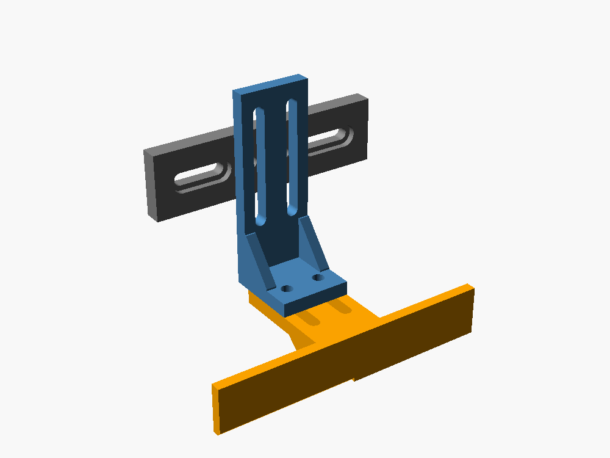
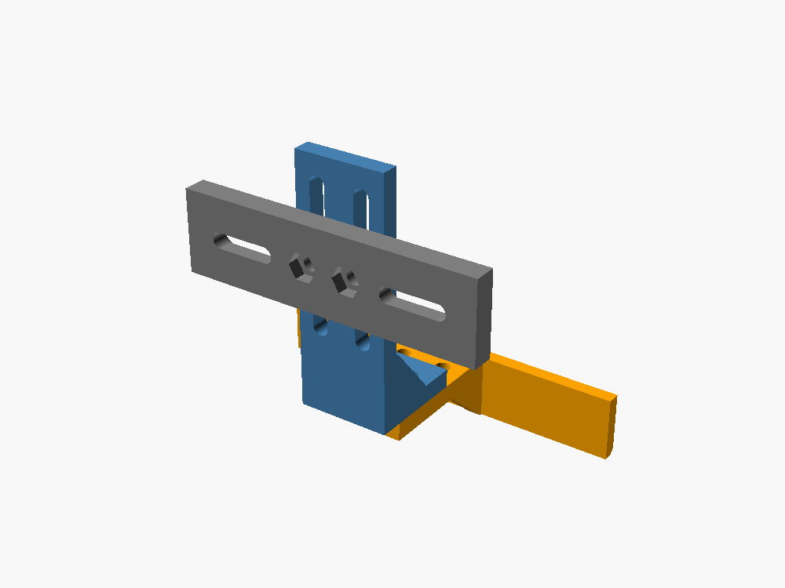
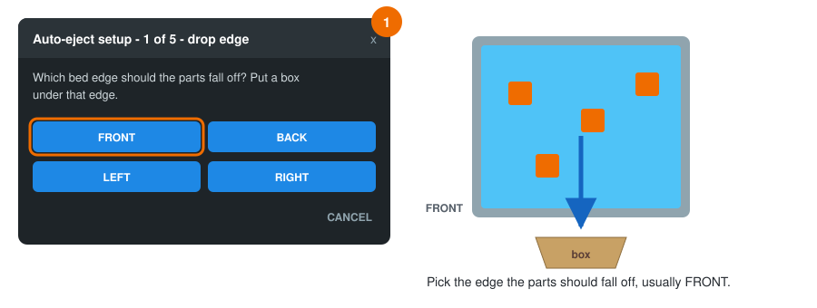
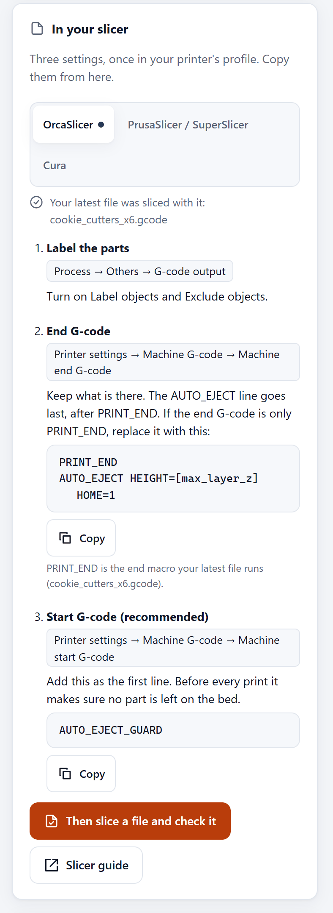

[klipper-auto-eject](../README.md) › [Documentation](README.md) › Getting started

# Getting started

This guide takes you from nothing to a printer that clears its own bed, one step at a time. It
assumes you have a Klipper printer with Mainsail or Fluidd, and nothing else. Every step says
what to do, how to check that it worked, and where to look if it did not.

New words are explained in the [glossary](glossary.md). Quick answers are in the [FAQ](faq.md).

<p align="center"></p>

**Contents**

1. [Check your bed](#1-check-your-bed)
2. [Print the blade](#2-print-the-blade)
3. [Mount the blade](#3-mount-the-blade)
4. [Install the macros](#4-install-the-macros)
5. [Run the guided setup](#5-run-the-guided-setup)
6. [Watch a test eject](#6-watch-a-test-eject)
7. [Set up your slicer](#7-set-up-your-slicer)
8. [Print in a row](#8-print-in-a-row)
9. [Optional: the web page](#9-optional-the-web-page)

---

## Before you start

You need:

- [ ] A printer running **Klipper**, with **Mainsail** or **Fluidd** in the browser.
- [ ] A build sheet that lets go of parts when it is cool, such as textured PEI or BIQU CryoGrip
      (step 1 checks this).
- [ ] Filament for the blade: **PETG, ABS or ASA**. PLA works for a first try, but it softens
      near a hot bed.
- [ ] Four M3 × 10 mm screws with nuts, and two screws that fit your toolhead (usually the
      screws of its front cover, a few millimetres longer).
- [ ] A cardboard box to catch the parts.
- [ ] Recommended: a **probe** (Voron Tap, BLTouch, an inductive probe…). With it, the printer
      checks that the bed is really empty before it starts the next print.

Everything you type into the printer goes into the **console**: in Mainsail it is on the
Dashboard (or the *Console* page), in Fluidd on the Dashboard. Type a command and press Enter.

> [!CAUTION]
> The printer will move on its own. Stay next to it until you have watched several ejects, and
> keep your hands out of the printer while it moves. The **emergency stop** button in Mainsail or
> Fluidd stops everything at once.

---

## 1. Check your bed

The blade only pushes. If a part is still stuck to the bed, nothing will move it, so check this
first.

1. Print something small, or take a part you printed earlier.
2. Let the bed cool to room temperature.
3. Push the part sideways with one finger.

**It worked if** the part slides off without bending the sheet.
**If not:** auto-eject will not work on this sheet. Textured PEI, smooth PEI with a release
agent and CryoGrip-type sheets work well ([which surfaces](hardware.md#bed-surfaces)).

---

## 2. Print the blade

The blade is three printed parts held together with M3 screws. Every joint has slots, so the
same parts fit most toolheads.

<p align="center">
  
  
</p>

Download these files from [`hardware/stl/`](../hardware/stl/) and [`hardware/test/`](../hardware/test/):

| Print | File | Notes |
|:-:|---|---|
| 1 | `blade_60mm.stl`, `blade_80mm.stl` **or** `blade_100mm.stl` | Pick one at least as wide as your toolhead. 100 mm fits a Voron Stealthburner |
| 1 | `arm.stl` | |
| 1 | `mount_screws.stl` | Fits toolhead screws 28–50 mm apart. No usable screws? Print `mount_strap.stl` instead and use cable ties |
| 1 | `blade_gauge.stl` | A 1.5 mm strip that sets the blade height in step 3 |
| 2–3 | `test_hollow_cube.stl` | Light test parts for step 6. Print them later, in step 6 |

**Settings:** PETG, ABS or ASA, 4 walls, 40 % infill, 0.2 mm layers. The files are already
turned the right way for printing and need no supports.

**It worked if** you have a blade, an arm, a mount and a gauge, and the M3 nuts press into the
six-sided pockets on the back of the mount.

---

## 3. Mount the blade

<p align="center">
  
  
  
</p>

1. Turn the printer's heaters off and let the nozzle cool.
2. Press two M3 nuts into the pockets on the back of the mount.
3. Screw the mount to the front of the toolhead with the two toolhead screws.
4. Bolt the arm to the mount, and the blade under the arm, with the M3 screws. **Leave all four
   loose for now**, and slide the blade **as high as the slots allow**.

   > Why high? Some probes (Voron Tap) home on whatever touches the bed first. A blade that hangs
   > below the nozzle would touch first and give a wrong height.

5. Home the printer: type `G28` in the console.
6. Move the nozzle over an empty part of the bed and bring it down to 0.2 mm:
   ```
   G90
   G1 X100 Y100 Z5 F3000
   G1 Z0.2 F300
   ```
   (Use any X and Y where the bed is empty and the blade is over the bed too.)
7. Slide the gauge under the blade, let the blade drop onto the gauge, and tighten the arm
   screws. The blade's lower edge is now **1.5 mm above the nozzle tip**.
8. Raise the nozzle again: `G1 Z20 F600`.

**It worked if**, looking from the side, the blade's lower edge is a little higher than the
nozzle tip, and the blade's face is the part of the toolhead furthest forward in the direction
you want to push.

More detail, other toolheads and making your own size: [hardware.md](hardware.md).

---

## 4. Install the macros

The macros are installed with one line on the printer's computer (the Raspberry Pi or similar
that runs Klipper). You reach it over **SSH**, a text connection from your computer:

1. Find the printer's address: it is what you type in the browser to open Mainsail or Fluidd,
   for example `192.168.1.50` or `mainsailos.local`.
2. On your computer, open a terminal (Windows: *Terminal* or *PowerShell*; Mac: *Terminal*) and
   connect. The user name is the one you chose when you set up the SD card (often `pi`):
   ```bash
   ssh pi@192.168.1.50
   ```
3. Paste this line and press Enter:
   ```bash
   cd ~ && { [ -d klipper-auto-eject ] || git clone https://github.com/ahmedbebars/klipper-auto-eject.git; } && ./klipper-auto-eject/install.sh
   ```
4. It asks a few questions. **Press Enter** to keep the suggested answer, the one in capitals:

   | It asks | Say yes if |
   |---|---|
   | Will this printer push its prints off with the blade? | Yes, unless you only want the web page or the farm on this printer |
   | Add the auto-eject page to Mainsail? | You want the bed map, the queue and the settings in the browser (recommended) |
   | Watch and control the printer from your phone, from anywhere? | You want it outside your home or office. It needs a free Tailscale account ([step 10](#10-optional-from-your-phone-anywhere)) |
   | Notifications on your phone? | You want a message when the printer needs you |
   | More than one Klipper printer? | You want all your printers on one page ([step 11](#11-optional-more-than-one-printer)) |

   It may ask for your password, for the web page only.
5. At the end it offers to restart Klipper: press Enter. It never restarts a printer that is
   printing.

The script links the macros into your config folder, creates `auto_eject_settings.cfg`, adds
the `[include]` lines and the sections auto-eject needs (`[exclude_object]`, `[respond]`,
`[save_variables]`) to `printer.cfg`, and adds the project to Moonraker's update manager so you
get updates from the Mainsail/Fluidd update panel. It backs up every file it changes.

**It worked if** typing `AUTO_EJECT_SETUP` in the console opens a dialog that says
*Printer check: all OK*. Keep it open for the next step.

**If not:** `Unknown command "AUTO_EJECT_SETUP"` means Klipper has not been restarted: type
`FIRMWARE_RESTART` in the console (never while printing). Other ways to install:
[installation.md](installation.md).

---

## 5. Run the guided setup

The setup is five short dialogs. You press buttons; there is nothing to type or measure with a
ruler.

<p align="center"></p>

| Step | You do | The printer does |
|:-:|---|---|
| 1 | Choose the **drop edge**, the side the parts fall off, and put the box under it. CoreXY printers: usually the front. Bed slingers: left or right | |
| 2 | Clear the bed and press **Bed is clear - move** | Homes and moves to the bed |
| | With **Voron Tap** or another probe that touches with the nozzle: press **Measure** | Measures the blade by touching a small printed block, in 2–3 minutes |
| | With **other probes**: follow the jog buttons | Shows each move |
| 3 | Press your blade's width | |
| 4 | Take everything off the bed, press **Bed is clear - move**, and look from the side | Moves the blade to the drop edge so you can check it reaches past the edge of the sheet |
| 5 | Pick the temperature at which parts let go (**32 °C** for PLA is a good start), press **Save**, then **Dry test** | Saves everything, then traces the path 2 cm above the bed |

> **With Voron Tap,** print `calibration_block.stl` from `hardware/test` before the setup:
> **100 % infill**, anywhere but the middle of the bed, and **leave it on the bed** while it is
> still warm. The setup finds it by itself. Details and a picture of every screen:
> [setup-wizard.md](setup-wizard.md).

**It worked if** the last screen says the settings are saved and the dry test moved over the bed
without touching it.

**If a screen says it could not measure,** it names the reason. The usual ones are in
[troubleshooting.md](troubleshooting.md#the-blade-measurement-stops).

---

## 6. Watch a test eject

Now the real thing, with you watching.

1. Print two or three `test_hollow_cube.stl` (in the slicer, turn on **Label objects**, see
   step 7). Leave them on the bed when the print ends.
2. Put the box under the drop edge.
3. Type `AUTO_EJECT` in the console (or, after a restart, `AUTO_EJECT HOME=1`).

<p align="center"></p>

What you will see:

1. **Cooling.** The heaters turn off, the part fan turns on, and the toolhead circles over the
   parts. This takes the longest: 10–30 minutes, depending on the room.
2. **Pushing.** The blade comes down behind the parts and pushes them over the edge, slowly and
   with less motor force than usual. If a part is stuck, the motor skips instead of breaking
   something. That clicking sound is expected.
3. **Checking.** X and Y are homed again, and the probe touches the bed where each part was.
   The console says `bed verified clear`.

**It worked if** the parts are in the box and the console says `bed verified clear`.

**If not:** parts that stay on the edge of the bed, a blade that rides over the parts, or a
part that is found still there each have a fix in
[troubleshooting.md](troubleshooting.md#behaviour). Repeat this step until it works every time.

---

## 7. Set up your slicer

The slicer has to do two things: write down where each part is (**object labels**), and run
`AUTO_EJECT` at the end of every print (**end G-code**).

**The easy way:** open the web page's **Blade and setup** tab, card **In your slicer**. It shows
where each setting is in your slicer and the lines to paste, with your printer's own end macro
already in them, and a **Copy** button. The same lines for each slicer:

<p align="center"></p>

**OrcaSlicer**

1. *Process → Others → G-code output*: turn on **Label objects** and **Exclude objects**.
2. *Printer settings → Machine G-code → Machine end G-code*: add this line **below** what is
   already there:
   ```gcode
   AUTO_EJECT HEIGHT=[max_layer_z] HOME=1
   ```

**PrusaSlicer / SuperSlicer:** *Print Settings → Output options → Label objects:
Firmware-specific*, and the same end G-code line.
**Cura:** see [slicer-setup.md](slicer-setup.md#cura).

`HEIGHT=[max_layer_z]` tells the printer how tall the print is, so flat prints like stencils,
which the blade cannot catch, are left on the bed for you instead of being pushed.

> Your end macro retracts the filament while the nozzle is hot. `AUTO_EJECT` lets the nozzle
> cool, so it must run **after** that, which is why it goes below it. `HOME=1` homes the printer
> again around the parts if the end macro turned the motors off. More in
> [integration.md](integration.md).

**It worked if** the next print clears the bed by itself when it finishes.

---

## 8. Print in a row

To print many jobs one after another, use Moonraker's **job queue**. Open `moonraker.conf` (next
to `printer.cfg`) and add:

```ini
[job_queue]
load_on_startup: False
automatic_transition: True
job_transition_delay: 5
```

Save, and restart Moonraker from the power menu at the top of Mainsail or Fluidd. Then, in the
G-code files list, right-click a file and choose **Add to queue**, as many times as you like.

When a print ends, the printer clears the bed and the queue starts the next job. If a part stays
on the bed, the print ends with an error and **the queue stops**, so nothing is printed on top
of it. Take the part off, run `AUTO_EJECT_CLEAR`, and start the queue again.

Tell it how many parts your box holds, so it warns you before the box overflows: in the web
page's **Settings**, **Parts box**, set `bin_capacity` (for example `40`). When the box is full,
the next print waits until you empty it and press **I emptied the box**
([the parts box](configuration.md#the-parts-box)).

Before you leave it alone, read [safety.md](safety.md).

---

## 9. Optional: the web page

<p align="center"></p>

A page in Mainsail with a live map of the bed, the queue, a check for your G-code files and all
the settings, in English or Arabic:

```bash
~/klipper-auto-eject/install.sh --web
```

If you said yes to the web page in step 4, it is already there. It asks for your password once
(for the web server). Then reload Mainsail and click **Auto-eject** in the sidebar. See
[web-page.md](web-page.md).

## 10. Optional: from your phone, anywhere

Watch the printer and control it from your phone when you are not home, without opening the
printer to the internet. It uses Tailscale, a free private network between your devices:

```bash
~/klipper-auto-eject/install.sh --remote
```

It asks before every step and shows the address to open on your phone at the end. See
[remote-access.md](remote-access.md).

<p align="center"></p>

To get a notification when the printer needs you (a part still on the bed, a print that
finished), add `--push`, then turn notifications on in the app; see
[notifications.md](notifications.md).

## 11. Optional: more than one printer

Put every Klipper printer of your network on one page, with the ones that need you first. Run
this on one printer only; the others need nothing installed:

```bash
~/klipper-auto-eject/install.sh --farm
```

Then open the page's **Printer farm** tab and press **Search the network**. See
[farm.md](farm.md).

<p align="center"></p>

---

## What next?

| I want to… | Read |
|---|---|
| Understand every setting | [configuration.md](configuration.md) |
| Know what happens after a power cut | [recovery.md](recovery.md) |
| Watch the printer from my phone, anywhere | [remote-access.md](remote-access.md) |
| See all my printers on one page | [farm.md](farm.md) |
| Use a BLTouch, an inductive or an eddy-current probe | [probes.md](probes.md) |
| Fix an error message | [troubleshooting.md](troubleshooting.md) |
| See every command | [commands.md](commands.md) |
| Ask a question or share my setup | [Discussions](https://github.com/ahmedbebars/klipper-auto-eject/discussions) |
