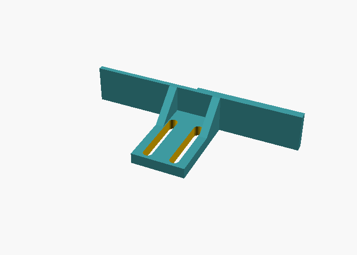
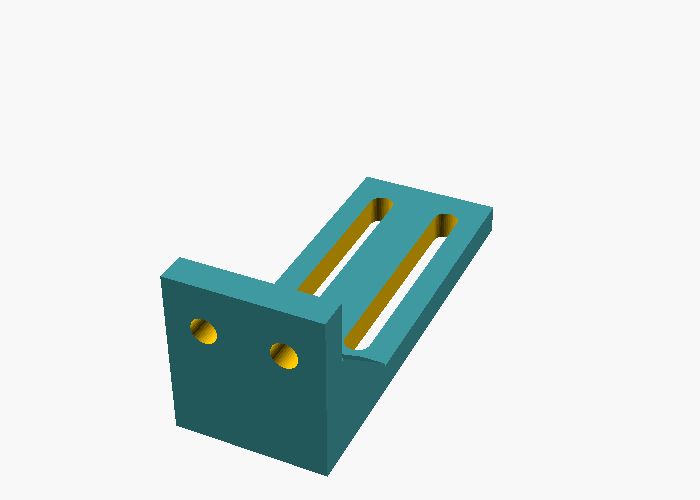
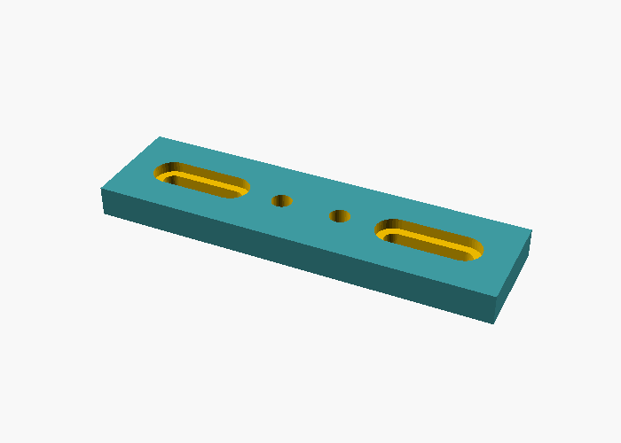

# Hardware: the blade

The blade (or "plow") is a rigid printed part fixed to the toolhead. It pushes the parts,
so the nozzle never touches them.

## Why not push with the nozzle?

- The nozzle, heater block and heat break are the weakest parts of the toolhead. Side loads can
  loosen the nozzle or bend the heat break, and that shows up later as leaks.
- Nozzle probes (Voron Tap and similar) move the whole toolhead on a vertical rail. Side loads
  on that rail affect probing accuracy.
- Pushing with the nozzle needs it a fraction of a millimetre above the bed, so any Z error
  scratches the build surface.

## Design rules

```
          side view                              front view
                                          ┌──────────── blade_width ────────────┐
       ┌─────────┐ toolhead               │                                     │
       │         ├──┐ mount plate         │            ┌───────────┐            │
       │         │  │ (existing screws)   │            │ toolhead  │            │
       │         │  │                     │            └─────┬─────┘            │
       └────┬────┘  │ arm                 │                  │ nozzle           │
            │       │                     ├──────────────────┴──────────────────┤
     nozzle ▼  ┌────┘                     │                blade                │
               │ blade ← blade_offset →   └─────────────────────────────────────┘
   ────────────┴──────── bed              lower edge = nozzle tip + blade lift
```

1. **Mount it on the carriage or a structural cover**, not on the hotend or a fan duct. A nozzle
   probe's moving part is acceptable for light parts.
2. **The lower edge must sit above the nozzle tip** (the *blade lift*, 1–2 mm), so the blade can
   never touch the bed before the nozzle would.
3. **The pushing face must be ahead of the nozzle** in the push direction (`blade_offset`), far
   enough that the parts never reach the hotend.
4. **Wider than the toolhead.** The blade must cover the toolhead's width, so parts outside the
   blade never hit the hotend or the duct from the side. 70–100 mm is typical.
5. **Make it stiff:** PETG, ABS or ASA, 4+ walls, 40%+ infill, two arms, and a short lever.
6. **Chamfer the lower front edge** so it rides over small bumps instead of digging in.
7. **Check the travel.** At the drop edge the blade sticks out past the toolhead, so make sure
   it cannot hit the frame, the bed mounting hardware or cable chains anywhere along the edge.

## Universal blade (recommended)

<p align="center">
  
  
</p>

Three printed parts joined with M3 screws. Every joint is slotted, so one design fits most
toolheads, nozzle heights and toolhead depths:

| Part | File | Adjusts |
|---|---|---|
| **Blade** | `hardware/stl/blade_60mm.stl`, `blade_80mm.stl`, `blade_100mm.stl` | **Reach**: slots in the tab, ±10 mm |
| **Arm** | `hardware/stl/arm.stl` | **Height**: slots in the upright, 30 mm of travel |
| **Mount**, screw version | `hardware/stl/mount_screws.stl` | Fits toolhead screws spaced **28–50 mm** apart |
| **Mount**, strap version | `hardware/stl/mount_strap.stl` | For toolheads without usable screws: cable ties or a strap |

Height and reach only need to be roughly right. `AUTO_EJECT_SETUP` measures the exact values
after mounting ([setup-wizard.md](setup-wizard.md)).

<p align="center">
  
  
  
</p>

The STL files are already oriented for printing: no supports, and the arm lies flat so its
layers run along the load.

**Print settings:** PETG, ABS or ASA (PLA softens near a hot bed). 4 walls, 40% infill, 0.2 mm layers.

**Hardware**

| Qty | Part | For |
|:-:|---|---|
| 2 | M3 × 10 screw + M3 nut | Arm foot to blade tab |
| 2 | M3 × 10 screw + M3 nut | Arm upright to mount (nuts sit in the traps on the mount's back) |
| 2 | Screws that fit your toolhead | Mount to toolhead (usually your existing front-cover screws, a few mm longer) |

**Assembly**

1. Press two M3 nuts into the traps on the back of the mount.
2. Screw the mount to the front of the toolhead.
3. Bolt the arm to the mount through the upright's slots. Leave the screws loose.
4. Bolt the blade's tab under the arm's foot. Leave the screws loose.
5. Lower the nozzle onto a sheet of paper. Slide the arm until the blade's lower edge is **1–2 mm
   above the nozzle tip**, and the blade's face is ahead of everything else on the toolhead. Tighten.
6. Run `AUTO_EJECT_SETUP`.

### Make your own size

`hardware/universal_plow.scad` has every dimension as a parameter: blade width and height, arm
length, slot lengths, mount screw range and screw size. Open it in OpenSCAD, use the
*Customizer* panel, choose the `part`, then *Render* (F6) and *Export as STL*. From a terminal:

```bash
openscad -o blade.stl -D 'part="blade"' -D blade_width=120 hardware/universal_plow.scad
```

### Toolhead adapters

If your toolhead needs a dedicated mount, add it to
[`hardware/adapters/`](../hardware/adapters/) and open a pull request, so others with the same
toolhead can use it.

## Single-piece template

[`hardware/plow.scad`](../hardware/plow.scad) is a simpler one-piece blade with a fixed two-screw
mount, for when you design around one specific toolhead.

## Measuring

Do this with the hotend cold and the printer homed.

1. **`blade_offset`:** move the nozzle to the centre of the bed and lower it to Z=5. Measure
   along the push axis from the nozzle tip to the blade's pushing face. Positive means the face
   is ahead of the nozzle in the push direction.
2. **`blade_width`:** measure across the push axis. If the blade is not centred on the nozzle,
   use twice the distance from the nozzle to the *shorter* side.
3. **Blade lift:** with the nozzle touching a sheet of paper on the bed (Z≈0), the gap under
   the blade should be the lift you designed (1–2 mm).
4. **`push_z`:** the blade's lower edge ends up at `push_z + lift`. Start at `push_z: 3.0`,
   watch a real eject, then lower it until the blade reliably catches your parts at 1.5–3 mm
   above the bed.
5. **`push_end`:** with `"auto"`, the push runs to the axis limit. Check that at the limit the
   blade's face is past the edge of the build surface. If it is not, the parts land on the
   bed's edge instead of falling. Lengthen `blade_offset` in the hardware if needed.

## Catching the parts

A cardboard box, a bin or a printed chute under the drop edge. Leave room for the bed to move in Z
if your bed moves vertically, and keep cables away from the drop zone.

## Bed surfaces

| Surface | Releases when cool? |
|---|---|
| Textured PEI | Yes, PLA/PETG release below ~30 °C |
| Smooth PEI | Yes, but PETG can bond too strongly. Use a release agent |
| BIQU CryoGrip | Yes, PLA slides off once cooled |
| Glass | Often, but brittle. Not recommended |
| Garolite / G10 | Nylon releases well |

Always check by hand first: once the bed is cool, a part should slide off with a finger push.
If it needs flexing the sheet, auto-eject will not work on that surface.
