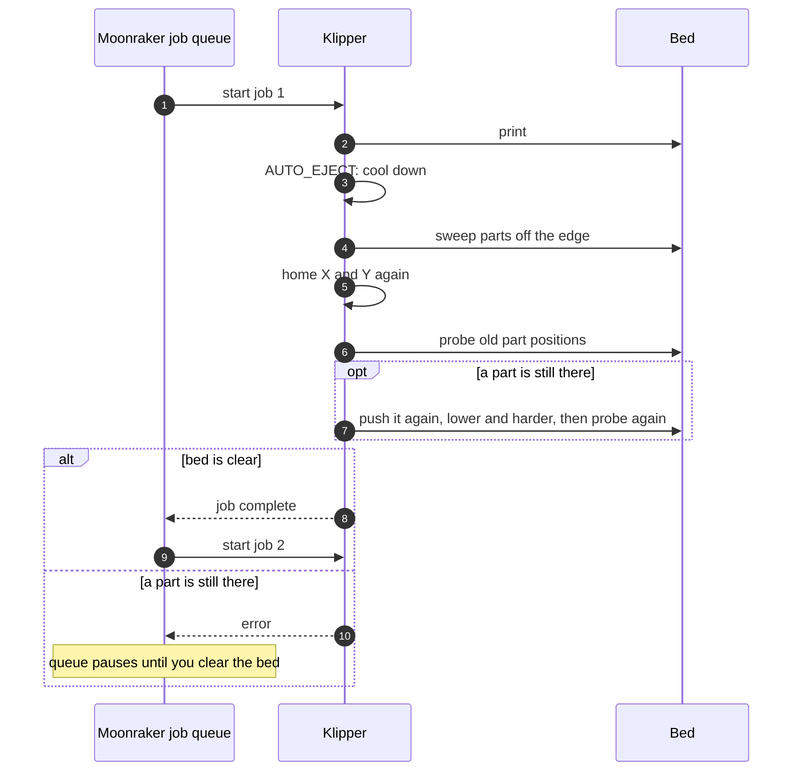

[klipper-auto-eject](../README.md) › [Documentation](README.md) › Integration

# Integration

Where `AUTO_EJECT` goes depends on one thing your end macro almost certainly does: it
**retracts the filament** (`G1 E-2` or similar). `AUTO_EJECT` turns the hotend off and cools the
bed for several minutes, and Klipper refuses to move the filament once the nozzle is below
`min_extrude_temp` ("Extrude below minimum temp"). An end macro that runs after `AUTO_EJECT`
would stop there: the print ends with an error and the job queue stops.

So run `AUTO_EJECT` after the retract. There are two ways:

| Where | Use it when |
|---|---|
| [After your end macro, with `HOME=1`](#after-the-end-macro-recommended) | You don't want to change your macros (DEMON, Klippain, RatOS, stock Voron). Z must home with the probe |
| [Inside your own end macro](#inside-your-own-print_end), after the retract | You write your own `PRINT_END`, or Z homes with a switch |

> Never home Z on a part: the probe would measure the part, not the bed, and the next push
> would hit the bed. `AUTO_EJECT` refuses to run on an unhomed printer, and `HOME=1` homes Z on
> a free spot inside the bed mesh, away from every part.

## After the end macro (recommended)

Slicer end G-code:

```gcode
PRINT_END
AUTO_EJECT HEIGHT=[max_layer_z] HOME=1
```

Use your end macro's name (`DEMON_END`, `END_PRINT`, …). The end macro retracts while the nozzle
is hot, parks, turns the heaters off and usually the motors too. Then `AUTO_EJECT HOME=1`:

1. homes X and Y, and homes Z with the probe on a free spot inside the `[bed_mesh]` area, on the
   print sheet;
2. with a nozzle probe (Voron Tap), first waits for the nozzle to cool to
   `nozzle_probe_max_temp` (150 °C), so it does not mark the sheet;
3. cools the bed, pushes the parts off and checks the bed, as always.

Needs Z to home with the probe (`endstop_pin: probe:z_virtual_endstop`) and `[force_move]`
with `enable_force_move: True`. If Z homes with a switch that sits off the bed, set
`home_method: "g28"`. If the switch is on the bed, use the next method instead.

You can keep a second printer profile in the slicer without the `AUTO_EJECT` line for prints
you want to remove by hand.

## Inside your own `PRINT_END`

Add `AUTO_EJECT` after the retract and before the heaters and motors are turned off:

```ini
[gcode_macro PRINT_END]
gcode:
    G91
    G1 E-2 F2700          ; retract while the nozzle is hot
    G1 Z5 F600            ; lift off the part
    G90
    
      AUTO_EJECT HEIGHT={params.HEIGHT}
    
    TURN_OFF_HEATERS
    M107
    M84
```

Slicer end G-code: `PRINT_END EJECT=1 HEIGHT=[max_layer_z]`. Leave `EJECT` out on prints you
want to remove by hand. The printer is still homed, so no `HOME=1` is needed.

## DEMON Klipper Essentials

**End G-code.** `DEMON_END` retracts at its start (also after its `_CUSTOM_PRE_END` hook), so a
hook that runs `AUTO_EJECT` hits the cold-nozzle error. Put `AUTO_EJECT` in the slicer end G-code,
after DEMON's line:

```gcode
DEMON_END
AUTO_EJECT HEIGHT=[max_layer_z] HOME=1
```

`DEMON_END` turns the motors off (`M84`) and clears the bed mesh, so `HOME=1` is needed. Z must
home with the probe ([`home_method`](configuration.md#recovery) `"auto"` or `"probe"`, never
`"g28"`): DEMON's own Z homing probes the middle of the bed, where a part may be. Finding Z brings
the gantry down to the bed over its whole width, so prints taller than
[`max_part_height`](configuration.md#tall-parts) are left on the bed instead, without homing.

**Start G-code.** Keep DEMON's start lines exactly as DEMON gives them (its `DEMON_START` line
carries a version that DEMON checks), and do **not** put `AUTO_EJECT_GUARD` above them. DEMON
stops the printer (an emergency stop: *DKEU detected your DEMON Machine Start Gcode is not
functional*) when `DEMON_START` has not come a few seconds into a print, and when parts from the
last print are still known, the guard checks the bed with the probe for longer than that. The
guard runs from DEMON's first hook instead, inside `DEMON_START`, before heating and homing.

`install.sh` sets this up by itself when it finds DEMON's `Demon_User_Files`. On a printer that has
auto-eject already, run once:

```bash
~/klipper-auto-eject/install.sh --demon
```

It saves a copy of `demon_custom_expansion_v2.0.0.cfg`, turns on `variable_ceal_master_enable` and
`variable_pre_start` in `_CUSTOM_EXPANSION_ACTIVE_LIST`, puts the line first in the section that is
already there, keeping what you have in it, and restarts Klipper unless it is printing (in a
terminal it asks first):

```ini
[gcode_macro _CUSTOM_PRE_START] # Very first action after you hit print!
gcode:
  AUTO_EJECT_GUARD FROM=DEMON
```

By hand, make the same three changes, then `FIRMWARE_RESTART`. `FROM=DEMON` tells the guard it
runs inside `DEMON_START`. An `AUTO_EJECT_GUARD` left in the slicer's start G-code then does
nothing and says so: DEMON's hook checks the bed a moment later. Without the hook, the guard before
`DEMON_START` stops the print itself with a message that says so, before DEMON would stop the
printer. The web page's **In your slicer** card shows whether the hook is set up. A new version of
DEMON's expansion file may come without the line: run `install.sh --demon` again.

**Auto power-off.** With DEMON's `PRINTER_AUTO_OFF` switch on, `DEMON_END` switches the printer off
5 seconds later. Klipper runs that timer even while `AUTO_EJECT` pushes, so the power would go off
in the middle of a push. `AUTO_EJECT` holds DEMON's power-off while it clears the bed, and two
minutes after, lets DEMON switch the printer off, unless the job queue has started the next print
by then. Keep Moonraker's `job_transition_delay` under two minutes, or turn `PRINTER_AUTO_OFF` off
while you print a queue. When a part is left on the bed, the eject stops with an error and the
printer stays on.

**The variables file.** DEMON keeps its values in `~/demon_vars.cfg`, the file of
`[save_variables]`, and auto-eject keeps its own there too (the stored parts, the blade
measurement, the values saved from the web page). Keep the one `[save_variables]` section DEMON
set up: a second one would move DEMON's values to another file. Running DEMON's installer again
downloads a fresh `demon_vars.cfg`: take the parts off the bed before, and run the guided setup
again after.

**Purge.** For `EJECT_PURGE`, turn DEMON's purge lines off with `variable_purge_lines: False` in
`demon_user_settings` (`PURGE_LINE_TOGGLE` only lasts until the next restart), and call
`EJECT_PURGE` from DEMON's `_CUSTOM_PRE_PRINT` hook, with `ceal_master_enable` and `pre_print`
set to `True` in `_CUSTOM_EXPANSION_ACTIVE_LIST`.

**Heat soak.** The bed cools to `cool_temp` before each push, so DEMON heat-soaks the bed again
before every queued job. That is time, not a fault.

## Klippain, RatOS and other macro sets

The same: put `AUTO_EJECT HEIGHT=[max_layer_z] HOME=1` in the slicer end G-code after the end
macro. The web page's **Check a file** warns when a file runs `AUTO_EJECT` before another macro.

## No end macro

If the slicer's end G-code is a list of plain commands, `AUTO_EJECT` goes last, below the
retract:

```gcode
G91
G1 E-2 F2700
G90
M104 S0
M140 S0
M84
AUTO_EJECT HEIGHT=[max_layer_z] HOME=1
```

Cura has no `[max_layer_z]`: write `AUTO_EJECT HOME=1`, and the printer uses the height it
tracked while printing.

## Moonraker job queue




```ini
# moonraker.conf
[job_queue]
load_on_startup: False
automatic_transition: True
job_transition_delay: 5
```

- Queue jobs from Mainsail/Fluidd (*Add to queue*) or from OrcaSlicer (*Upload and queue*).
- When a print ends normally, Moonraker starts the next queued job after `job_transition_delay`.
- When `AUTO_EJECT` raises an error, the print ends in the **error** state and the queue
  **pauses**. Fix the problem, clear the bed, home, and resume the queue.

## Slicer settings

Copy-paste start and end G-code for OrcaSlicer, PrusaSlicer, SuperSlicer and Cura, plus how to
turn on object labels in each, are in **[slicer-setup.md](slicer-setup.md)**.

## `EJECT_PURGE` instead of a purge line

`EJECT_PURGE` extrudes while raising the nozzle, building a pellet several millimetres tall. It
places the pellet **in front of the nearest part, centred on the parts' span**, so the
`columns` sweep pushes it off with everything else.

Call it in your print start, after heating, instead of the purge line:

```ini
EJECT_PURGE
```

or at a fixed spot: `EJECT_PURGE X=200 Y=60`.

- KAMP: replace the `LINE_PURGE` call in your print start with `EJECT_PURGE`.
- DEMON: see [DEMON Klipper Essentials](#demon-klipper-essentials) (purge lines off, `EJECT_PURGE` in `_CUSTOM_PRE_PRINT`).
- `[extruder] max_extrude_cross_section` must allow the pellet. The macro tells you the value it needs.
