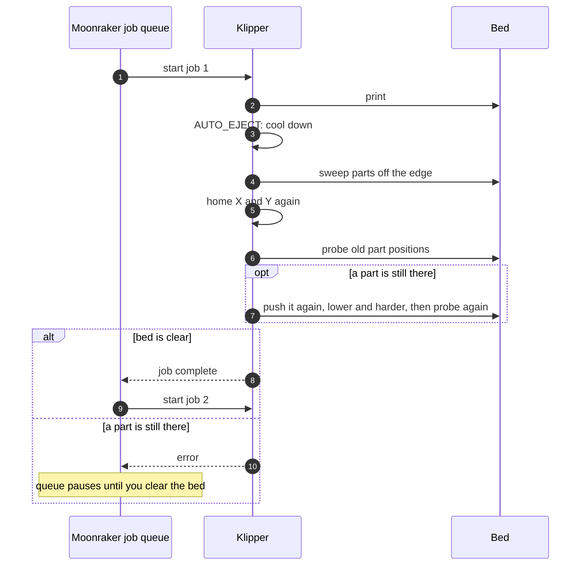

# Integration

`AUTO_EJECT` must run **while the printer is still homed**, before anything turns the steppers
off (`M84`) or runs a park routine that assumes the print is done. In practice, that means early
in your print end macro, or just before it.

> Never let the end sequence home the printer with parts still on the bed: homing Z on a
> part gives a wrong Z height, and the next push would hit the bed. `AUTO_EJECT` refuses to run
> when the printer is not homed for exactly this reason.

## Simplest: slicer end G-code

This works with any macro set (stock, KAMP, Klippain, RatOS and others). Put `AUTO_EJECT` in the
slicer's end G-code **before** your end macro:

```
AUTO_EJECT
PRINT_END
```

You can keep a second printer profile in the slicer without the `AUTO_EJECT` line for prints
you want to remove by hand.

## Generic `PRINT_END`

Add `AUTO_EJECT` before the heaters are turned off and before `M84`:

```ini
[gcode_macro PRINT_END]
gcode:
    G91
    G1 E-2 F2700          ; retract
    G1 Z5 F600            ; lift off the part
    G90
    
      AUTO_EJECT
    
    TURN_OFF_HEATERS
    M107
    M84
```

Slicer end G-code: `PRINT_END EJECT=1`. Leave `EJECT` out on prints you want to remove by hand.

## DEMON Klipper Essentials

`DEMON_END` parks and runs `M84`, so use the `_CUSTOM_PRE_END` hook, which runs first and
receives the parameters passed to `DEMON_END`.

1. In `Demon_User_Files/demon_custom_expansion_*.cfg`, turn the hooks on:
   ```ini
   variable_ceal_master_enable: True
   variable_pre_end: True
   ```
   Hooks only run when their flag is `True`. Turning on the master switch does **not** enable
   the others.
2. In the same file:
   ```ini
   [gcode_macro _CUSTOM_PRE_END]
   gcode:
     
       AUTO_EJECT
     
   ```
3. Slicer end G-code: `DEMON_END EJECT=1`.

## Klippain and other macro sets

Use the [slicer end G-code](#simplest-slicer-end-g-code) method, which needs no changes to the
macro set. If your macro set offers a hook that runs at the start of its end macro, before the
park and `M84`, calling `AUTO_EJECT` there works too.

## Moonraker job queue




```ini
# moonraker.conf
[job_queue]
load_on_startup: False
automatic_transition: True
job_transition_delay: 5
```

- Queue jobs from Mainsail/Fluidd (*Add to queue*) or from OrcaSlicer (*Upload and queue*).
- When a print ends normally, Moonraker starts the next queued job after `job_transition_delay`.
- When `AUTO_EJECT` raises an error, the print ends in the **error** state and the queue
  **pauses**. Fix the problem, clear the bed, home, and resume the queue.

## Slicer settings

Copy-paste start and end G-code for OrcaSlicer, PrusaSlicer, SuperSlicer and Cura, plus how to
turn on object labels in each, are in **[slicer-setup.md](slicer-setup.md)**.

## `EJECT_PURGE` instead of a purge line

`EJECT_PURGE` extrudes while raising the nozzle, building a pellet several millimetres tall. It
places the pellet **in front of the nearest part, centred on the parts' span**, so the
`columns` sweep pushes it off with everything else.

Call it in your print start, after heating, instead of the purge line:

```ini
EJECT_PURGE
```

or at a fixed spot: `EJECT_PURGE X=200 Y=60`.

- KAMP: replace the `LINE_PURGE` call in your print start with `EJECT_PURGE`.
- DEMON: turn DEMON's purge line off in your DEMON settings (or with `PURGE_LINE_TOGGLE`) and call `EJECT_PURGE` from `_CUSTOM_PRE_PRINT`.
- `[extruder] max_extrude_cross_section` must allow the pellet. The macro tells you the value it needs.
