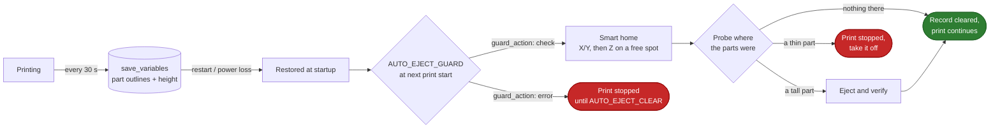

[klipper-auto-eject](../README.md) › [Documentation](README.md) › Recovery

# Recovery after a restart or power loss

A restart, power cut or emergency stop makes Klipper forget two things: where the toolhead is,
and where the parts on the bed are. klipper-auto-eject keeps the second, and can recover the
first **without touching a part**.



## What is saved

While a print runs, a background check every 30 seconds stores in `[save_variables]`:

| Key | Content |
|---|---|
| `auto_eject_objects` | Each part's bounding box, centre and three verification points |
| `auto_eject_height` | The highest Z the print has reached, so travel moves clear the parts |

It writes only when something changes (new print, or the height grew by 0.5 mm or more), so the SD
card sees a few dozen writes per print. After a **successful** eject both are cleared. A failed
or interrupted eject keeps them.

The toolhead position itself is **not** saved. With the motors unpowered the bed or gantry can
move, so a stored position could be wrong. Z is always measured again.

## Smart homing: `AUTO_EJECT HOME=1`

1. `G28 X Y`: X and Y never touch the bed. Your homing macro's Z lift still applies.
2. Pick the probe spot **furthest from every stored part** (at least `home_clearance`, 20 mm),
   preferring the centre when several are equally free. The probe, the nozzle and the whole
   blade (`blade_offset`, `blade_width`) must all be that far from the parts, because a nozzle
   probe such as Tap triggers on whatever touches first.
3. Measure Z there with the probe, so a part is never mistaken for the bed.
4. Continue with the normal eject.

Requirements: Z homes with the probe (`endstop_pin: probe:z_virtual_endstop`, e.g. Tap,
BLTouch, inductive probe) and `[force_move] enable_force_move: True`. For a Z switch that sits
off the bed, set `home_method: "g28"`. Otherwise smart homing refuses, because a normal
homing move could land on a part.

## The guard: `AUTO_EJECT_GUARD`

Put it **first** in the slicer's start G-code ([slicer-setup.md](slicer-setup.md)):

```gcode
AUTO_EJECT_GUARD
PRINT_START ...
```

If the printer still remembers parts that were never ejected (a print without `AUTO_EJECT`, a
cancelled print, a restart):

| `guard_action` | What happens |
|---|---|
| `"check"` (default) | Smart home, then probe where the parts were. Nothing there: the record is cleared and the print continues, nobody has to confirm anything. A tall part still there: it is pushed off and checked first. A thin part such as a stencil: the print stops; take it off and start again |
| `"error"` | The new print stops with a message until you run `AUTO_EJECT_CLEAR`. Nothing moves |
| `"eject"` | Smart home around the old parts, eject them, verify, then the print continues |

`"check"` needs a probe that can touch plastic (Tap, BLTouch, inductive probes do; an eddy probe
only with its touch mode in `verify_probe_gcode`). Without one, or with no free spot to home Z,
it stops like `"error"`.

**Thin parts.** A 0.4 mm stencil is easy to miss: the bed itself is rarely flat to 0.4 mm. For
parts thinner than twice `verify_threshold`, the probe also touches the bare bed on two sides of
the part and compares with the lower of the two (a purge line next to the part raises a reading,
it never lowers it), and the limit is half the part's height.

**A cool nozzle.** With a nozzle probe the nozzle touches the part if it is still there, so the
check waits until the nozzle is at `nozzle_part_max_temp` (50 °C), below where PLA softens, with
the part fan on to cool it faster. Homing Z on the bare sheet waits for `nozzle_probe_max_temp`
(150 °C).

## When a print ends without an eject

If a print ends (finished, cancelled or stopped) and its parts were not ejected, a dialog opens in
Mainsail, Fluidd and the web page: take the parts off, then click **Bed is clear**. You don't have
to: with `guard_action: "check"`, the next print checks the bed itself.

## Commands

| Command | Use |
|---|---|
| `AUTO_EJECT HOME=1` | Home safely around the stored parts if needed, then eject |
| `AUTO_EJECT HOME=1 SOURCE=saved` | Same, using the stored outlines even if a new file's labels are loaded |
| `AUTO_EJECT_CLEAR` | You removed the parts by hand: forget them |
| `AUTO_EJECT_GUARD` | Start G-code check (see above) |

## Settings

| Setting | Default | |
|---|---|---|
| `persist_state` | `True` | Save outlines and height while printing |
| `guard_action` | `"check"` | `"check"`, `"error"` or `"eject"` |
| `home_method` | `"auto"` | `"auto"`, `"probe"` or `"g28"` |
| `home_clearance` | `20.0` | Minimum distance between the probe spot and any part |
| `home_edge_margin` | `15.0` | Distance kept from the bed edges when choosing the spot |
