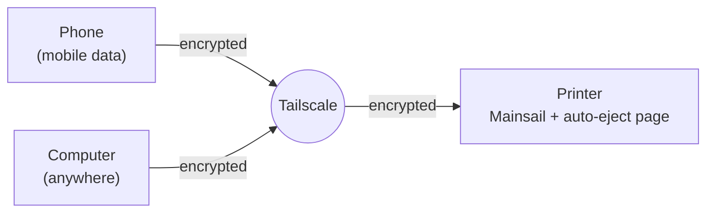

[klipper-auto-eject](../README.md) › [Documentation](README.md) › Remote access

# Remote access

Watch the printer and control it from your phone, from anywhere: the bed map, the print queue,
the eject, the camera. Without opening the printer to the internet.

> [!WARNING]
> Never forward a port on your router to the printer (80, 7125 or any other). Moonraker and
> Mainsail control the whole machine: heaters, motors, files. Anyone who finds the port could
> use them. The method below keeps the printer private.

## How it works

[Tailscale](https://tailscale.com) makes a private network between your own devices: the
printer, your phone, your computer. Each device gets an address like `100.87.12.34` that works
wherever the device has internet, at home, at work or on mobile data. The connection is encrypted
from end to end, and nothing else can reach the printer. It is free for personal use.



## Set it up (about 10 minutes)

1. **Make a Tailscale account** at [tailscale.com](https://tailscale.com) (sign in with Google,
   Apple, Microsoft or GitHub).
2. **On the printer**, over SSH:
   ```bash
   ~/klipper-auto-eject/install.sh --remote
   ```
   It asks before every step, and asks for your password when it needs it:
   - installs Tailscale if it is missing,
   - connects the printer to your account: it shows a login link, open it on any device,
   - lets the devices on your Tailscale network use Mainsail and the auto-eject page (adds
     `100.64.0.0/10` to Moonraker's `trusted_clients`, after a backup of `moonraker.conf`, and
     restarts Moonraker when the printer is idle),
   - serves the printer over HTTPS, see [below](#https).

   At the end it shows the address to open on your phone.
3. **On your phone**, install the Tailscale app (Google Play or the App Store), sign in with the
   same account and switch it on.
4. **Open the address** in the phone's browser: Mainsail at `http://100.x.y.z/`, the auto-eject
   page at `http://100.x.y.z/auto-eject/`.

**It worked if** Mainsail shows the printer as connected with the phone's Wi-Fi switched off.

The auto-eject page has a **Phone and remote access** card on its **Blade and setup** tab that
shows how you are connected and what is still missing.

## HTTPS

Phones install a web page as an app, and let it send notifications, only when it comes over
HTTPS. Tailscale gives the printer a real HTTPS address for free:

1. In the [Tailscale admin console](https://login.tailscale.com/admin/dns), on the **DNS** page,
   turn on **MagicDNS** and **HTTPS Certificates**.
2. On the printer (`install.sh --remote` does this for you):
   ```bash
   sudo tailscale serve --bg 80
   ```
3. The printer is now at `https://<printer-name>.<your-tailnet>.ts.net/`, the auto-eject page at
   `https://<printer-name>.<your-tailnet>.ts.net/auto-eject/`.

The address works only for devices on your Tailscale network. To stop serving it:
`sudo tailscale serve --https=443 off`.

## By hand, without the installer

```bash
curl -fsSL https://tailscale.com/install.sh | sh
sudo tailscale up
```

Then in `moonraker.conf`, add the Tailscale range to `trusted_clients` and restart Moonraker:

```ini
[authorization]
trusted_clients:
    192.168.0.0/16
    100.64.0.0/10
```

## Who can control the printer

Every device on your Tailscale network, and nothing else. Someone who learns the address cannot
use it: the `https://….ts.net` name has no address on the public internet (it appears in public
certificate logs, as every HTTPS name does, but that gives no way in), and the `100.…` address
can only be reached through your Tailscale network. `tailscale serve status` should say
**tailnet only**. Never turn on `tailscale funnel` for the printer: Funnel publishes it to the
whole internet.

If you share your Tailscale network with other people, or run servers on it, let only your own
devices reach the printer with [Tailscale access controls](https://tailscale.com/kb/1018/acls).
Listing your devices' addresses (`100.x.y.z`) in `trusted_clients` instead of `100.64.0.0/10`
only covers the `100.…` address: through the HTTPS address Moonraker sees every request coming
from the printer itself.

## Phone apps and the camera

- **The auto-eject page** works in any phone browser, and over HTTPS it installs as an app with
  its own icon ([web-page.md](web-page.md#on-your-phone-as-an-app)).
- **[Mobileraker](https://mobileraker.app)** (Android and iOS) is a full Klipper app. Add the
  printer with its Tailscale address. For notifications when the app is closed, install its
  companion on the printer:
  ```bash
  cd ~ && git clone https://github.com/Clon1998/mobileraker_companion.git && ./mobileraker_companion/scripts/install.sh
  ```
- **A camera**: any USB webcam works with crowsnest, which MainsailOS and KIAUH install
  ([crowsnest](https://github.com/mainsail-crew/crowsnest)). Add it in Mainsail's settings under
  **Webcams**, and the auto-eject page shows it on its overview.

## Many printers

Set up remote access on one printer only and add the others to its
[printer farm](farm.md): you see them all from your phone through that one printer, without
Tailscale on the others.

## Notifications

`install.sh --push` sends a notification to the auto-eject app on your phone when the printer
needs you, even while the app is closed; tapping it opens the page ([notifications.md](notifications.md)).

## Without Tailscale

[Obico](https://www.obico.io) and [OctoEverywhere](https://octoeverywhere.com) give remote access
through their own servers, with an app, the camera and failure detection. They are easier to
start with and have free plans, but your printer's traffic goes through their cloud.

## Problems

| What you see | What to do |
|---|---|
| Mainsail opens but cannot connect, or the page says it is not allowed | `trusted_clients` does not have the Tailscale range yet, or Moonraker was not restarted afterwards |
| Nothing opens on the phone | Switch on the Tailscale app on the phone. On the printer, `tailscale status` should list it as connected |
| It works at home but not outside | You opened the home address (`192.168…`). Use the `100.…` address or the `https://….ts.net` one |
| The `https://` address does not open | Turn on MagicDNS and HTTPS Certificates in the admin console, then `sudo tailscale serve --bg 80`. `tailscale serve status` shows what is served |
