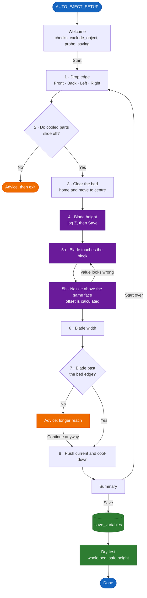

# Guided setup

`AUTO_EJECT_SETUP` walks you through the whole configuration in dialogs inside Mainsail or
Fluidd. You click buttons and jog the toolhead. There are no files to edit and almost nothing to measure
with a ruler.

```
AUTO_EJECT_SETUP
```

## Before you start

- The blade is mounted on the toolhead.
- You have a small block with a flat side, such as a 20 mm calibration cube.
- `printer.cfg` has a `[respond]` section (the dialogs need it) and, ideally, `[save_variables]`
  so the results survive a restart.
- A recent Mainsail or Fluidd. Both show Klipper's `action:prompt` dialogs.

## The steps



> Purple steps move the toolhead with on-screen buttons: **Z ±1 / ±0.1** for height, and
> **toward edge / away 10 / 1 / 0.1** for the blade position. Z never goes below 0.5 mm.

### Step by step

| # | Step | What you do | What it sets |
|:-:|---|---|---|
| | Welcome | Read the checks: exclude_object, probe, saving | |
| 1 | Drop edge | Pick front, back, left or right | `direction`, `current_steppers` |
| 2 | Bed surface | Confirm cooled parts slide off | |
| 3 | Prepare | Clear the bed. The printer homes if needed and moves to the centre | |
| 4 | Blade height | Jog Z until the blade is ~2 mm above the bed (Z never goes below 0.5) | `push_z` |
| 5 | Blade position | Touch the block with the **blade**, then put the **nozzle** above the same face. The difference is measured for you | `blade_offset` |
| 6 | Blade width | Set it with the +/− buttons | `blade_width` |
| 7 | Drop edge check | The toolhead goes to the edge with the blade lowered. Confirm the blade reaches past the build surface | |
| 8 | Current and cooling | Accept or adjust the suggested push current (60% of `run_current`) and the cool-down | `push_current`, `cool_mode`, `cool_temp`, `cool_time` |
| | Summary | Review everything, then **Save** | |
| | Test | Run a dry test over the whole bed at a safe height | |

## Where the values go

- With `[save_variables]`: saved as `auto_eject_<setting>` and applied one second after every
  start. Saved values **override** `auto_eject_settings.cfg`.
- Without `[save_variables]`: applied until the next restart, and the dialog lists the lines to
  copy into `auto_eject_settings.cfg`.

To go back to the values in `auto_eject_settings.cfg`:

```
AUTO_EJECT_SETUP STEP=reset
FIRMWARE_RESTART
```

## Tips

- You can run the setup again at any time. It starts from your current settings.
- The jog buttons label directions as **toward edge** and **away**, so they mean the same thing
  whichever drop edge you chose.
- If the blade offset comes out below 1 mm or above 200 mm, the wizard asks you to measure again.
  This usually means the nozzle was moved the wrong way.
