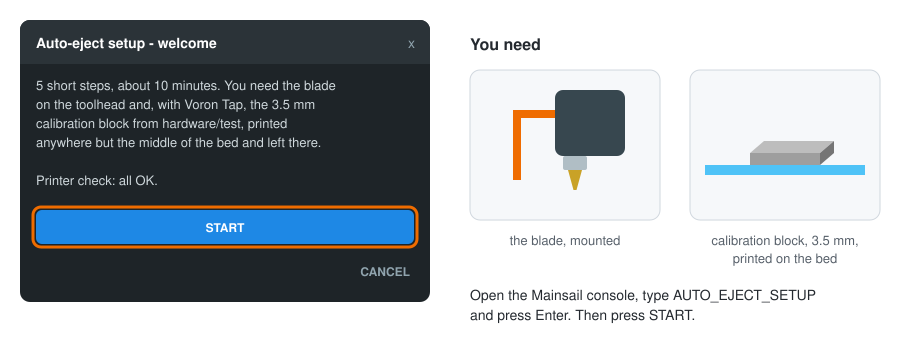
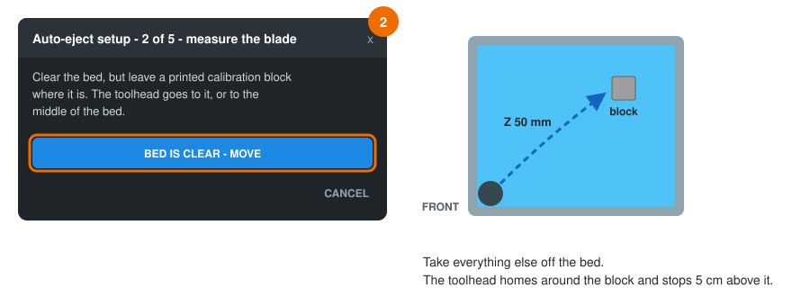
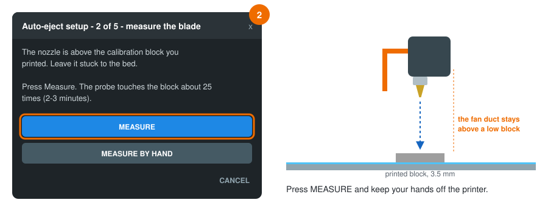
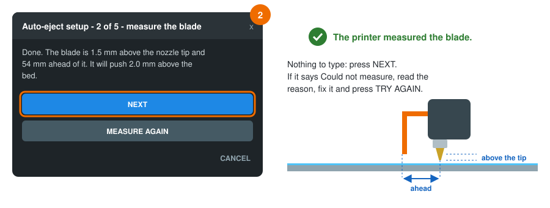
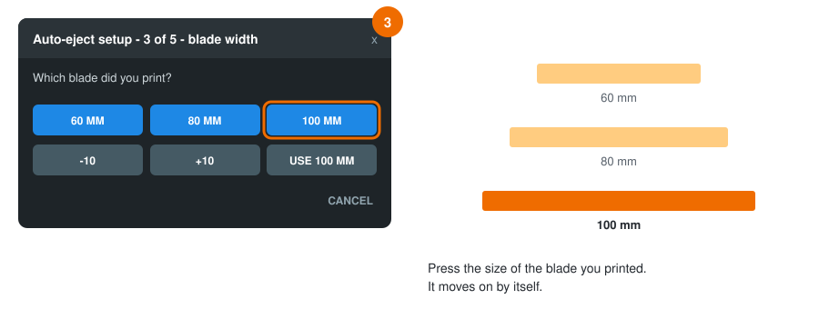
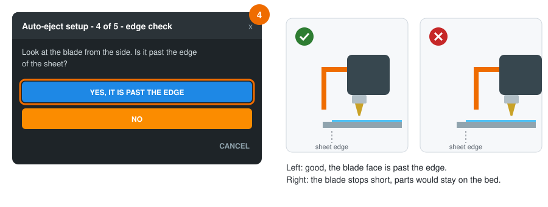
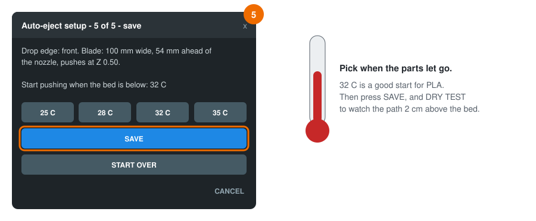
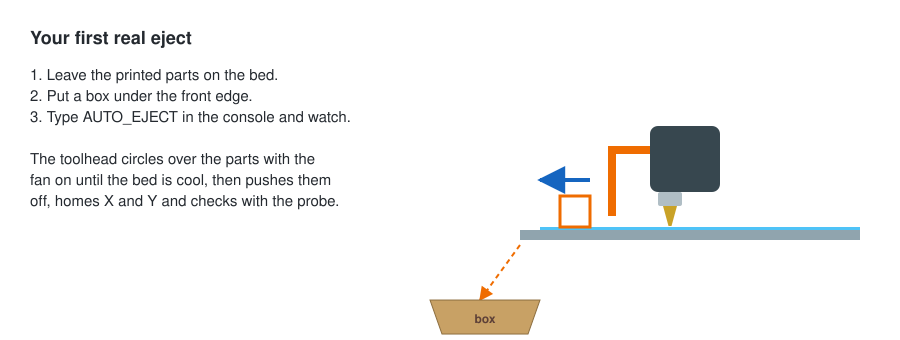

[klipper-auto-eject](../README.md) › [Documentation](README.md) › Guided setup

# Guided setup

`AUTO_EJECT_SETUP` sets everything up in five short dialogs inside Mainsail or Fluidd. You press
buttons; there are no files to edit and nothing to measure with a ruler.

```
AUTO_EJECT_SETUP
```

> **In short** (Voron Tap, parts falling off the front):
>
> 1. Set the blade 1.5 mm above the nozzle tip with `hardware/test/blade_gauge.stl`. Print
>    `hardware/test/calibration_block.stl` with 100 % infill, away from the middle of the bed, and
>    leave it there. Measure right after the print, while it is warm and well stuck.
> 2. Run `AUTO_EJECT_SETUP` and press **Start**, then **Front**.
> 3. Clear everything else off the bed and press **Bed is clear - move**. The toolhead goes to the
>    block by itself. Press **Measure** and wait 2–3 minutes, then **Next**.
> 4. Press the width of your blade: **60 mm**, **80 mm** or **100 mm**.
> 5. Take the block off, press **Bed is clear - move** and check that the blade is past the edge
>    of the sheet. Press **Yes, it is past the edge**.
> 6. Pick a temperature (**32 C** for PLA), press **Save**, then **Dry test**.
>
> Every screen is shown below with a picture.

## Before you start

- The blade is mounted on the toolhead.
- With a probe that touches with the nozzle (Voron Tap and similar): print
  [`hardware/test/calibration_block.stl`](../hardware/test/) (20 × 20 × 3.5 mm) anywhere but the
  middle of the bed and leave it stuck there. The blade's lower edge should sit 1–2 mm above the
  nozzle tip. The wizard then measures the blade by itself.
- With other probes: a small block with a flat side, such as a 20 mm calibration cube.
- `printer.cfg` has a `[respond]` section (the dialogs need it) and, ideally, `[save_variables]`
  so the results survive a restart.
- A recent Mainsail or Fluidd. Both show Klipper's `action:prompt` dialogs.

## The steps

Five short screens. Each picture shows the dialog on the left and what to do at the printer on
the right. The highlighted button is the one to press.

### Start

Type `AUTO_EJECT_SETUP` in the console and press Enter. The first screen lists anything missing
from `printer.cfg`. If it says *all OK*, press **Start**.

<p align="center"></p>

### 1. Drop edge

Choose the edge the parts should fall off and put a box under it. On a CoreXY printer that is
usually the front, on a bed slinger left or right.

<p align="center"></p>

### 2. Measure the blade

Clear the bed, but leave the printed calibration block, and press **Bed is clear - move**. The
toolhead homes around the block and stops 5 cm above it (or above the middle of the bed, if no
block was printed).

<p align="center"></p>

With Voron Tap or another probe that touches with the nozzle, press **Measure**. The probe finds
the blade by itself in 2–3 minutes ([how](#automatic-blade-measurement)).

> **Why a low, printed block?** The fan duct under the toolhead sits only a few millimetres
> above the nozzle tip. On a tall block it would touch the block before the blade does, and a
> loose block slides when it is touched. A 3.5 mm block stuck to the bed avoids both. Without a
> printed block, tape a flat piece 2–6 mm tall under the nozzle.

<p align="center"></p>

When it is done, press **Next**. If it says *Could not measure*, the reason is on the screen: fix
it and press **Try again**, or press **Measure by hand**. If the blade is on the other side of the
nozzle from the drop edge you chose, it says so and names the edge to choose.

<p align="center"></p>

> **Other probes** (BLTouch, inductive, eddy current) measure by hand instead: jog Z until the
> blade is about 2 mm above the bed, then touch the block with the blade and with the nozzle.
> The screens tell you each move.

### 3. Blade width

Press the size of the blade you printed. For another size, use **-10 / +10**, then **Use**.

<p align="center"></p>

### 4. Edge check

Take the block off the bed and press **Bed is clear - move**. The toolhead goes to the drop edge
and lowers the blade. Look from the side: the blade must be past the edge of the sheet, or the
parts would stay on the bed.

<p align="center"></p>

### 5. Save

Pick the bed temperature at which your parts let go (32 °C is a good start for PLA), press
**Save**, then **Dry test** to watch the path traced 2 cm above the bed. The push current is set
for you, to 60 % of your motors' `run_current`.

<p align="center"></p>

### Your first real eject

<p align="center"></p>

After that, put `AUTO_EJECT HEIGHT=[max_layer_z] HOME=1` in your slicer's end G-code, after
your end macro ([slicer-setup.md](slicer-setup.md)), and the printer clears the bed after every
print.

## Automatic blade measurement

With a probe that touches with the nozzle, such as Voron Tap, anything that pushes the toolhead
up triggers the probe, the blade included. The wizard uses that to measure the blade against the
printed calibration block (`hardware/test/calibration_block.stl`, 20 × 20 × 3.5 mm) stuck to the
bed:

<p align="center"></p>

1. **The nozzle finds the block:** it touches the top, then steps off the front and rear edges,
   halving the step each time, to find where they are.
2. **The blade lands on the block:** with the nozzle behind the block, only the blade can
   touch it. The difference to the block height is how far the blade's lower edge sits above the
   nozzle tip (`blade_lift`).
3. **Step back until the blade misses:** the point where the blade comes off the rear edge gives
   the distance from the nozzle to the blade face (`blade_offset`), to about ±0.5 mm.

It takes about 25 touches, or 2–3 minutes. `push_z` is then set so the blade's lower edge runs
`blade_clearance` (1 mm) above the bed, but never with the nozzle below `push_z_min`.

To measure again later, for example after moving the blade in its slots:

```
AUTO_EJECT_CALIBRATE
```

It saves only `push_z`, `blade_offset` and `blade_lift`. The block must stay put: print it with
100 % infill, leave it stuck to the bed, and measure while the bed is still warm (55 °C at most).
It is low on purpose: on a taller block the fan duct under the toolhead touches it before the
blade does. The blade's lower edge must be 1–2 mm above the nozzle tip. If something does not
fit, the measurement stops and the dialog says why
([troubleshooting](troubleshooting.md#the-blade-measurement-stops)). Nothing is changed until you
click **Use these values**.

## Where the values go

- With `[save_variables]`: saved as `auto_eject_<setting>` and applied one second after every
  start. Saved values **override** `auto_eject_settings.cfg`.
- Without `[save_variables]`: applied until the next restart, and the dialog lists the lines to
  copy into `auto_eject_settings.cfg`.

To go back to the values in `auto_eject_settings.cfg`:

```
AUTO_EJECT_SETUP STEP=reset
FIRMWARE_RESTART
```

## Tips

- You can run the setup again at any time. It starts from your current settings.
- When measuring by hand, the jog buttons label directions as **toward edge** and **away**, so
  they mean the same thing whichever drop edge you chose.
- If the blade offset comes out below 1 mm or above 200 mm, the wizard asks you to measure again.
  This usually means the nozzle was moved the wrong way.
