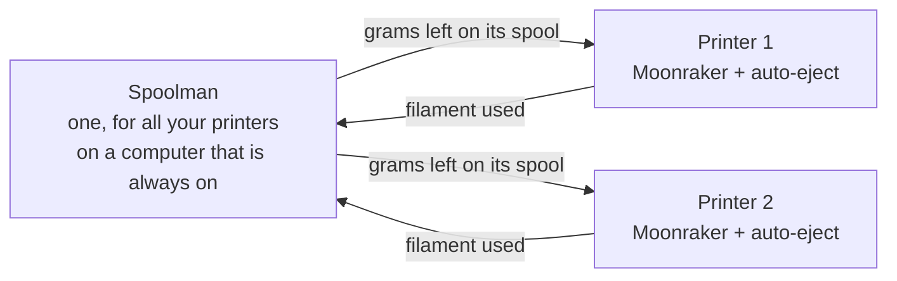

[klipper-auto-eject](../README.md) › [Documentation](README.md) › Spoolman

# Spoolman: does the spool finish the queue?

A queue that runs through the night is of little use if the spool runs out halfway through a job.
[Spoolman](https://github.com/Donkie/Spoolman) knows what is left on each of your spools. With it,
auto-eject checks the queue against the spool on the printer and stops the queue **before** a job
the spool cannot finish.

There is nothing to turn on in auto-eject: when Moonraker is linked to Spoolman, the page and the
service find it. Without Spoolman, nothing changes.

| Where | What you get |
|---|---|
| **Print queue** | A **Spool** card: the spool on the printer, what is left on it, and whether the queue fits. Each job shows the grams it needs, and the one the spool cannot finish is marked **Spool runs out**. **Change the spool** picks another of your spools. |
| **Overview** | A **Spool** chip with the grams left, and a message when the print running may run out or the queue stopped for the spool. |
| **Starting the queue** | When the spool cannot finish the next job, **Start the queue** asks first. |
| **The service** | With the page closed, it stops the queue before a job the spool cannot finish and sends a [notification](notifications.md). It needs the `klipper-auto-eject` service (`install.sh --push`). |

<p align="center"></p>

## How the pieces fit

Spoolman is a small program of its own, with a web page, that keeps the list of your spools. It
is not part of Klipper or of auto-eject. Each printer's Moonraker tells it how much filament the
printer used, so Spoolman always knows what is left on each spool. Before each job, auto-eject asks
it, through Moonraker, what is left on the spool on that printer.



## Where to run Spoolman

**One Spoolman for all your printers**, on a computer that is on whenever a printer prints.

| Where | |
|---|---|
| A computer that is always on: Home Assistant, a NAS, a Raspberry Pi, a mini PC | Best, above all with several printers: switching a printer off changes nothing for the others |
| One of the printers | Fine, with no extra hardware: Spoolman is small. Pick the printer that is never switched off |
| A copy on every printer | No: each keeps its own list, and a spool moved to another printer is not followed |
| A server on the internet | No: Spoolman has no password, so anyone who reaches it can change your spools. To reach it from outside, use Tailscale ([remote-access.md](remote-access.md)) |

While Spoolman is off, a printer keeps what it used and sends it once Spoolman is back (it is lost
if Moonraker restarts in the meantime), and the queue is not checked: the **Spool** card says
Moonraker cannot reach Spoolman.

## Setting it up

1. **Install Spoolman**, once, on the computer you chose: with Docker (Spoolman's own advice), with
   its install script on any Linux computer such as a Raspberry Pi, or as a Home Assistant add-on.
   See [Spoolman's installation guide](https://github.com/Donkie/Spoolman/wiki/Installation). Its
   page opens at `http://<that computer>:7912`.
2. **Add your spools** in Spoolman's page. Give each filament its weight, and each spool what is
   on it: without a weight, Spoolman cannot say what is left.
3. **Link each printer to it**: in each printer's `moonraker.conf`, the same address:

   ```ini
   [spoolman]
   server: http://192.168.0.123:7912
   ```

   Then restart Moonraker (from the power menu of Mainsail or Fluidd, not while printing).
4. **Say which spool is on each printer**: in the **Spool** card of the print queue, or in Mainsail
   or Fluidd. Say it again each time you change the spool.

For the queue to stop by itself while the page is closed, the `klipper-auto-eject` service must
run on the printer: `install.sh --push`, or `--farm` ([notifications.md](notifications.md)).

## How it counts

- **What a job needs:** the filament weight the slicer writes in the file (OrcaSlicer,
  PrusaSlicer, SuperSlicer and Cura write it). A file that gives only a length is weighed with the
  density and diameter Spoolman has for the spool's filament.
- **What is left:** Spoolman's remaining weight for the spool, less what Moonraker has not
  reported to it yet.
- **The print running:** only the part not printed yet.
- **The reserve:** slicer weights are estimates, so `spool_reserve` grams (10 by default) are kept
  back. A job that would leave less on the spool counts as one it cannot finish.
- **Not checked:** a file without a weight, and a file that prints more than one filament
  (multi-material or colour changes), since one spool says nothing about it. The jobs after it are
  not checked either, and the card says so.

## Settings

| Setting | Default | What it does |
|---|---|---|
| `spool_low_action` | `"stop"` | Before a job the spool cannot finish: `"stop"` stops the job queue before it and sends a message (needs the service), `"notify"` only sends the message, `"off"` does not check |
| `spool_reserve` | `10.0` | Grams to keep on the spool, since slicer weights are estimates |

Change them in the **Settings** tab (**The spool (Spoolman)**), in `auto_eject_settings.cfg`, or
with `AUTO_EJECT_SET` ([configuration.md](configuration.md#the-spool-spoolman)).

## When the queue stops

You get a notification that names the job, what it needs and what is left. Put on another spool,
choose it (the **Spool** card, Mainsail, Fluidd or Spoolman), then start the queue.

If you start the queue again with the same spool, it is not stopped again for the same job: you
have decided.

A print that has started is never stopped. If the spool may run out during it, you get a message
to keep another spool ready. Stopping a print when the filament ends is the job of a filament
runout sensor.
