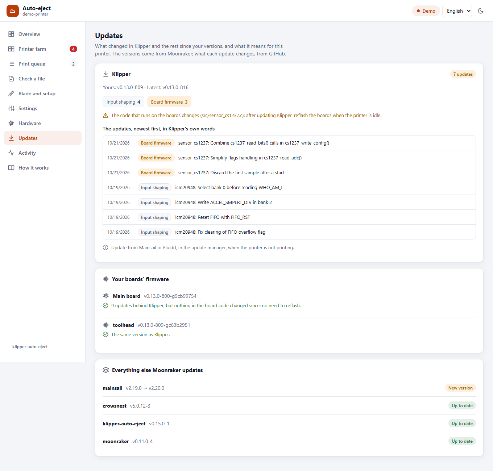
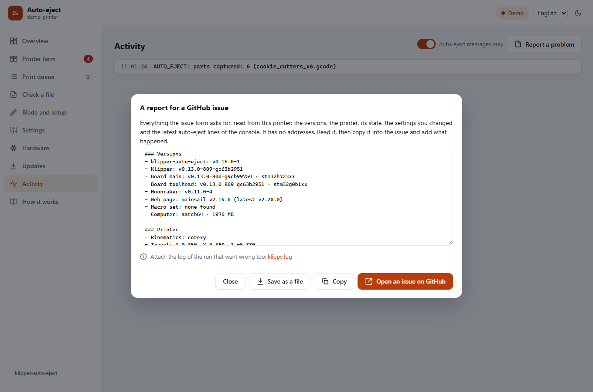
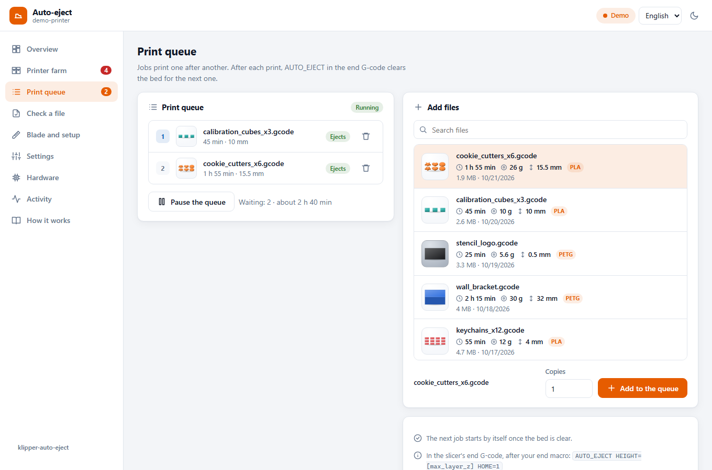

[klipper-auto-eject](../README.md) › [Documentation](README.md) › Web page

# Web page

An **Auto-eject** page for the printer's web interface: what the printer is doing, a map of the
bed with the push lanes, the print queue, a check for G-code files, the blade setup and every
setting. In Mainsail it gets its own entry in the sidebar.

<p align="center"></p>

It is optional. Everything it does can also be done from the console, and it never does
anything the console could not: every button runs one of the commands from the
[command list](commands.md) or a Moonraker job queue call.

**Try it without a printer:** open `web/index.html?demo` from a local web server (see
[Trying it on a computer](#trying-it-on-a-computer)). The demo printer prints, cools, clears the
bed and starts the next job by itself.

## What is on it

| Section | What it does |
|---|---|
| **Overview** | Status (ready, printing, cooling, clearing the bed, needs you) with progress; while the bed cools, the time it pushes at the latest (`cool_timeout`). With [`cool_background`](configuration.md#cooling-with-the-printer-free), **Push now** and **Stop, I'll take them off** while it cools. The bed map shows the stored parts, the lanes the blade will push along, the drop edge and the toolhead moving live. Buttons: **Eject now** (or **Home safely and eject** after a restart), **Dry run**, **I took the parts off** and, when the queue is paused, **Bed is clear, continue the queue**. Every button that moves the printer asks first. A camera is shown if one is set up in Moonraker. The **Box** chip counts the parts in the box under the drop edge; press it once you have emptied the box. With Spoolman, the **Spool** chip shows what is left on the spool. |
| **Printer farm** | Shown when the `klipper-auto-eject` service runs (`install.sh --farm`). Every Klipper printer on the network, the ones that need you first, with buttons to say the bed is clear, start the queue or stop. **Search the network** finds and adds them. See [farm.md](farm.md). |
| **Print queue** | Shown when Moonraker has a `[job_queue]`. Add files by their pictures (search them by name, pick one, set a number of copies), remove them, start or pause the queue. Each file shows its picture and says whether it will be pushed off or is too thin and stays on the bed. Says whether the queue moves on by itself (`automatic_transition`). With [Spoolman](spoolman.md), a **Spool** card: what is left on the spool on the printer, whether the queue fits, and the job it cannot finish. |
| **Check a file** | Every file shows its picture, print time, filament, height and material. Pick one and the page reads it: are the parts labelled, does the end G-code run `AUTO_EJECT`, is the print tall enough, can the blade get behind every part? It draws the plan on the bed map before you print. When the slicer needs a change, **Show me what to paste in the slicer** opens the lines to paste. |
| **Blade and setup** | The measured blade (height above the nozzle tip, distance ahead of it, width) in a side view, the probe type, buttons for the guided setup, the blade measurement and a dry run, and downloads for the test parts (calibration block, blade gauge, test cube). The setup dialogs open right in the page. **In your slicer**: for OrcaSlicer, PrusaSlicer/SuperSlicer or Cura, where each setting is and the lines to paste, with a **Copy** button. The end G-code names the end macro this printer really uses, found in its newest file or its config (`PRINT_END`, `END_PRINT`, `DEMON_END`…). On a printer with DEMON Klipper Essentials it says to keep DEMON's start lines as they are with `AUTO_EJECT_GUARD` above them, and warns when `home_method` is `"g28"`. |
| **Settings** | Every setting from `auto_eject_settings.cfg`, grouped like the file, with its explanation, a switch, a list or a number box, and where the value comes from (your file, or saved here; a default shows nothing). The sections are listed at the side with how many you have set, and **Only my changes** shows just those. Changes are saved with `AUTO_EJECT_SET` and kept after a restart. Klipper takes no command while the bed is being cleared, so a change made then waits for the end of the eject, and the page says so. |
| **Hardware** | Everything Klipper and Moonraker tell about the machine, live: boards and their links, motors, heaters, fans, the computer, sensors and the camera, with a line that says whether all is normal and a tile for each part at the top that takes you to it. Under each board, whether its firmware is behind Klipper and needs a reflash. See [Hardware](#hardware). |
| **Updates** | What changed in Klipper and the rest since your versions, from Moonraker's update manager: each update in Klipper's words with what it is about (motion, heaters, board firmware…), whether it changes the code on the boards (then reflash them after updating), and Klipper's notes on config changes. Each board's firmware against Klipper, whether it needs a reflash, and a button that reflashes them. What an update changes comes from GitHub; without internet the list still shows. |
| **Activity** | The auto-eject messages from the console, newest first. **Report a problem** (here and on **Hardware**) gathers what a GitHub issue asks for: the versions, the printer, its state, the settings you changed and the console, without any address, to copy into the issue. |
| **How it works** | The illustrated guide. |

<p align="center"></p>

The page is in English and Arabic (right to left), in light and dark, and works on a phone.
It picks the browser's language and theme; both can be switched at the top.

### Settings

Every setting with what it does and its control, in the file's sections. The sections are listed at
the side with how many you have set in each; a search and **Only my changes** narrow the list. Only
your own values are marked: **Your file** for `auto_eject_settings.cfg`, **Saved here** for a change
made on the page, which the round arrow takes back.

<p align="center"></p>

### Hardware

The **Hardware** tab shows what Klipper and Moonraker report about the machine, read while the tab
is open (Klipper once a second) and never changing anything. Each part shows only when the machine
has it. The line at the top says **All hardware normal**, or what needs a look.

<p align="center"></p>

| Section | What it shows | What it warns about |
|---|---|---|
| **Boards** | Each MCU (main board, toolhead board, the host process): its chip, USB, CAN or serial, its load, the round trip, resent and corrupt bytes, firmware, and its temperature when a `temperature_mcu` sensor is on it. CAN boards add the bus state and error counts. | Bytes resent or corrupt while the page is open (a cable, a connector or interference), a CAN bus that is not healthy |
| **Motors** | Below | Driver warnings, a hot motor |
| **Heaters** | Temperature and target, the heater's power, and the last ten minutes | A heater that reached its target and then cannot hold it at full power, or runs far above it |
| **Fans** | Every fan's speed; turns per minute when it has a speed sensor; temperature fans' temperature | A fan that should turn and does not (needs a speed sensor) |
| **Computer** | Processor use and temperature, memory, storage, system load, uptime, and every network interface with its errors and drops (a CAN interface with its bitrate) | A hot processor, little memory or storage left, low supply voltage on a Raspberry Pi, new errors on a CAN interface |
| **Sensors** | Every temperature sensor with its lowest and highest, and the filament sensors | No filament during a print |
| **Camera** | Working or not; resolution and frames a second with ustreamer | A camera that stops answering |
| **Problems** | Every warning while the page was open, and the prints that stopped with an error | |

**With the page closed.** With the notification service (`install.sh --push`), the printer watches the
serious ones all the time and sends them to the phones that turned notifications on in the app: a
fan with a speed sensor that stopped, a driver warning, a motor above 70 °C (with its own sensor), a
board link resending data (200 bytes in ten minutes) or sending corrupt data, an unhealthy CAN bus,
a heater that cannot hold its target, and the computer too hot, short of voltage, memory or storage.
A warning must last a few seconds, is sent once, and again only after it has cleared. StallGuard and
'coil open?' never send one. Each phone can turn them off: **Hardware warnings too**.

#### Motors

The motors section shows every stepper that has a TMC driver (TMC2130, 2208, 2209, 2224, 2240,
2660, 5160): X, Y, every Z motor and every extruder. Each motor shows:

- whether it is **moving**, **holding** or **off**, and its current (running and holding);
- for an extruder, its **flow** instead: the filament through the hotend in mm³/s, its last ten
  minutes and the highest so far, to compare with what the hotend can melt (an extruder turns too
  slowly for StallGuard);
- its **StallGuard** reading, with the last ten minutes as a line: how easily the motor turns, higher
  is easier. It drops when the motor works hard and also at low speed, so it is no alarm on its own;
  near 0 while the motor runs fast, the motor is close to skipping steps (a layer shift). Only the
  TMC2130, 2240, 2660 and 5160 report it here; the TMC2208, 2209 and 2224 do not;
- its driver's warnings: overheating, a short to ground or to the supply, a dropped supply, and an
  open coil (only a hint: drivers show it at standstill or at high speed with the coil connected);
- the motor's own temperature, when it has a sensor (below).

On CoreXY and CoreXZ the two belt motors are marked **motor A** (stepper_x) and **motor B**.

**A motor's own temperature.** Tape a 100K thermistor to the motor's body, connect it to a free
thermistor input, and add it with the motor's name:

```ini
[temperature_sensor motor_a]
sensor_type: Generic 3950
sensor_pin: PF6        # a free thermistor input on your board
```

Names it finds: `motor_x`, `motor_y`, `motor_z`, `motor_e` (or `stepper_x`…), and `motor_a` and
`motor_b` for CoreXY belt motors. The tab shows it on that motor's card, orange from 65 °C and red
from 80 °C.

### Updates

The **Updates** tab lists what changed in Klipper since your version, as Moonraker's update
manager sees it, and what that means for this printer:

- each update in Klipper's own words, with what it is about: motion, heaters, input shaping,
  board firmware, documentation…;
- whether the updates change the code that runs on the boards: then reflash them after updating
  Klipper. If none does, they need no reflash;
- Klipper's own notes on config changes (`docs/Config_Changes.md`), when an update adds one;
- each board's firmware against Klipper: how many updates behind, and whether the board code
  changed since. The same line is under each board on **Hardware**. With the klipper-auto-eject
  service, an **Update the boards** button reflashes them and shows each board as it goes; else
  `install.sh --firmware` over SSH ([firmware.md](firmware.md#from-the-web-page));
- everything else Moonraker updates (Moonraker, Mainsail or Fluidd, crowsnest, auto-eject…), the
  ones with a new version first.

When Klipper is up to date, it lists the latest updates you have. What each update changes is read
from GitHub by your browser and kept there; without internet the list still shows. Updating this
printer stays in Mainsail or Fluidd. With the [printer farm](farm.md#updating-the-whole-farm), a
**The whole farm** card at the top shows every printer's versions and updates the free ones.

<p align="center"></p>

### Report a problem

**Report a problem**, on **Hardware** and **Activity**, gathers what a GitHub issue asks for: the
versions (auto-eject, Klipper, every board, Moonraker, the web page, the macro set), the printer,
its state, the settings you changed from the defaults and the latest auto-eject lines of the
console. IP addresses and host names are taken out. Copy it, or save it as a file, and paste it
into a new issue with what happened; attach `klippy.log` from the link under it.

<p align="center"></p>

### Pictures of the prints

The files in **Check a file**, the print queue, the printer farm and its **Print** dialog show the
picture your slicer puts in the G-code, with what the file says about the print: the time, the
filament, the height and the material. **Overview** shows the picture of the print on the bed. A
black part on the dark page, or a white one on the light page, gets a backdrop that shows it.

<p align="center"></p>

Moonraker keeps the pictures next to the files; nothing else needs installing. The slicer has to
put them in:

| Slicer | Setting |
|---|---|
| OrcaSlicer | Printer settings › Basic information › **G-code thumbnails**, for example `300x300/PNG` |
| PrusaSlicer / SuperSlicer | Printer Settings › General › Firmware › **G-code thumbnails**, for example `32x32/PNG, 300x300/PNG` |
| Cura | Extensions › Post Processing › Modify G-Code › Add a script › **Create Thumbnail** |

A file without a picture shows a plain box. Files sliced before the setting was on need slicing
again.

## Installing

```bash
~/klipper-auto-eject/install.sh --web
```

This needs `sudo` once (it asks for your password), because the page is served by nginx, the
same web server as Mainsail or Fluidd. The script:

1. Writes `/etc/nginx/auto-eject.conf`, which serves the page from the repository at
   `http://<printer>/auto-eject/`.
2. Adds one `include` line for it to the Mainsail or Fluidd site in `/etc/nginx/sites-enabled/`
   (a backup goes to `/etc/nginx/`), checks the result with `nginx -t` and reloads nginx.
   If nginx does not accept it, the old file is put back.
3. Adds an **Auto-eject** link to the Mainsail sidebar in `.theme/navi.json` in your config
   folder. Reload Mainsail to see it.

The page lives in the repository, so the Moonraker update manager updates it together with the
macros. Reloading nginx does not interrupt a print. `install.sh --uninstall` removes all three.

**Fluidd** has no custom sidebar links: bookmark `http://<printer>/auto-eject/`.

### By hand

Add this inside the `server { ... }` block of your Mainsail or Fluidd site
(`/etc/nginx/sites-available/mainsail` on most installs), with your own path:

```nginx
location = /auto-eject/ { absolute_redirect off; return 302 /auto-eject/web/; }
location ~ ^/auto-eject/(.*/)?\. { deny all; }
location /auto-eject/ {
    alias /home/pi/klipper-auto-eject/;
    index index.html;
    add_header Cache-Control "no-cache";
}
```

Then `sudo nginx -t && sudo systemctl reload nginx`. For the Mainsail sidebar, create
`.theme/navi.json` in your config folder (or add the entry to the one you have):

```json
[
  {
    "title": "Auto-eject",
    "href": "/auto-eject/web/",
    "target": "_self",
    "position": 35,
    "icon": "M2 11h12V7l6 5-6 5v-4H2z M20 4h2v16h-2z"
  }
]
```

## Requirements

- klipper-auto-eject installed and included in `printer.cfg` (the page says so if the macros
  are missing).
- Moonraker, reachable through the same nginx (the usual Mainsail/Fluidd install).
- The browser must be allowed in by Moonraker, as for Mainsail: its network in
  `trusted_clients` in `moonraker.conf`. The page does not log in.
- `[save_variables]` in `printer.cfg`, to keep changed settings after a restart. Without it they
  last until the next restart, and the page says so.
- Optional: `[job_queue]` in `moonraker.conf` for the queue section, a webcam in Moonraker for
  the camera picture.

Nothing is loaded from the internet: the page is plain HTML, CSS and JavaScript, and works on a
printer with no internet access.

## On your phone, as an app

<p align="center"></p>

On a phone the sections move to a tab bar at the bottom: the first four, and **More** for the
rest. Every button and box is at least 44 px, big enough for a finger. The page keeps clear of
notches, rounded corners and the home indicator, on any phone, folding phones and tablets included.

Over HTTPS, the page installs as an app with its own icon and opens without the browser's bars.
Set up [remote access](remote-access.md) with HTTPS (`install.sh --remote`), open
`https://<printer>.<your-tailnet>.ts.net/auto-eject/` on the phone, then:

| Phone | How |
|---|---|
| Android, and Chrome or Edge on a computer | The install button at the top of the page (a phone with an arrow), the **Install the app** button on **Blade and setup**, or the browser menu: **Install app** |
| iPhone and iPad (Safari) | **Share**, then **Add to Home Screen** |

The **Phone and remote access** card on the **Blade and setup** tab says which applies to the
device you hold. The app keeps a copy of its own files, so it opens and says the printer is not
reachable when there is no connection; everything about the printer always comes live from
Moonraker. Over plain HTTP (the home address) browsers do not install pages as apps; adding the
page to the home screen still works as a shortcut.

Once installed:

- **Its own window and icon**, with a splash screen while it opens on iPhone and iPad. The
  install dialog of Chrome, Edge and Android shows pictures of the app.
- **Shortcuts on the icon:** a long press (on a computer, a right click) opens the farm, the
  print queue or **Check a file** directly.
- **A number on the icon:** how many printers need you, like unread messages, where the system
  shows such badges (Android, Windows, macOS, iPhone with notifications on).
- **Notifications** with the page closed ([notifications.md](notifications.md)). A tap opens the
  app already open, on the tab the notification is about.
- **A new version of the page:** after the printer is updated, a page left open says so, with
  **Reload**, instead of staying on the old one.
- **Keep the screen on:** the ☀ button in the farm's tools (or the switch on the **Phone and
  remote access** card) keeps this device's screen on while the page is open, for a tablet on
  the wall by the printers. It needs HTTPS too.

## Changing a setting from the console

The page saves settings with a macro you can also use yourself:

```
AUTO_EJECT_SET KEY=cool_temp VALUE=35
AUTO_EJECT_SET KEY=verify VALUE=off
AUTO_EJECT_SET KEY=cool_temp RESET=1
```

The value is checked against the setting's type (a number for numbers, on/off for switches) and
saved in `[save_variables]`, like the guided setup's values. It takes the place of the value in
`auto_eject_settings.cfg` until you reset it. Text values cannot contain spaces, quotes, `#` or
`;`; edit the file for those.

Klipper runs one command at a time, and an eject is one long command, cooling included. A
setting changed while the bed is being cleared is made only when the eject has finished: to push
sooner, change `cool_temp` or `cool_timeout` before the print ends.

## Trying it on a computer

From a checkout of the repository:

```bash
python3 -m http.server 8000
```

Then open `http://localhost:8000/web/?demo`. Useful additions to the address:

| | |
|---|---|
| `?demo=eject` | The demo starts clearing the bed by itself |
| `?demo=print` | The demo starts the next print by itself |
| `&lang=ar`, `&lang=en` | Language |
| `&theme=dark`, `&theme=light` | Theme |
| `?printer=http://printer.local:7125` | Talk to a real printer from the computer. Its `moonraker.conf` needs the computer's address in `cors_domains`. |

## Translating

The texts are in `web/lang/`. Copy `en.js` to a new file named after the language code,
translate the values (keep the `{placeholders}`), change the first line to your code, language
name and direction (`"ltr"` or `"rtl"`), and add a `<script>` line for it in `web/index.html`.
Anything left out is shown in English. Setting names and console messages stay in English.

## How it is built

| File | |
|---|---|
| `web/index.html` | The page |
| `web/app.js` | The start: the Moonraker connection, the menu, and which view is shown |
| `web/app/` | The views, one file each (`overview.js`, `farm.js`, `settings.js`...), and `core.js` with what they share. They are JavaScript modules: each file imports what it uses, so nothing is built or bundled |
| `web/model.js` | The logic: the push plan, reading the settings file, checking G-code, the setup dialogs. It does what the macros do, and `tests/test_web.py` compares the two |
| `web/moonraker.js` | A small Moonraker websocket client |
| `web/demo.js` | The pretend printer for `?demo` |
| `web/style.css` | The design tokens, then the styles: light and dark, the phone layout |
| `web/manifest.json`, `web/sw.js`, `web/icons/` | What makes it an app: the name and icons, and the service worker that keeps a copy of the page's files |

The settings section is built from the comments in `config/auto_eject_settings.cfg`, so a new
setting shows up in the page with its explanation without changing the page.

### Design tokens

The top of `web/style.css` holds every colour and measure of the page, in three layers. The
rules below them use only the last two, so a colour or a size is changed in one place:

| Layer | What it holds | Examples |
|---|---|---|
| Primitives | The raw values: the palette, the type scale, corners, spacing, motion | `--orange-600`, `--text-sm`, `--radius-lg`, `--dur-fast` |
| Semantic | What a value is for, once for the light theme and once for the dark one | `--surface`, `--text`, `--muted`, `--accent`, `--ok`, `--warn`, `--bad` |
| Component | One control's measures | `--btn-h`, `--input-h`, `--card-pad`, `--modal-radius`, `--focus-ring` |

- **Text sizes** come from one scale: `--text-sm` (12 px) to `--text-3xl` (24 px), with
  `--text-base` (14 px) for body text. Nothing is smaller than 12 px.
- **Contrast:** text and its background pass WCAG AA (4.5:1) in both themes, the orange buttons
  and links included; that is why the light theme's orange is a deep one.
- **Targets:** on a phone every control is at least `--touch` (44 px).
- **A printer's state** has one colour everywhere: an element with `data-state="printing"`,
  `"paused"`, `"needs"`… gets `--state` and `--state-soft`, whether it is the overview, a farm
  card, a farm line or the farm's versions.
- **Less motion:** with the system's *reduce motion* setting, nothing pulses, spins or slides.
- `tests/test_web.py` checks that the rules write no colour or text size of their own, that every
  token they use exists, and that the two dark-theme blocks (by the system, or chosen on the page)
  stay the same.
